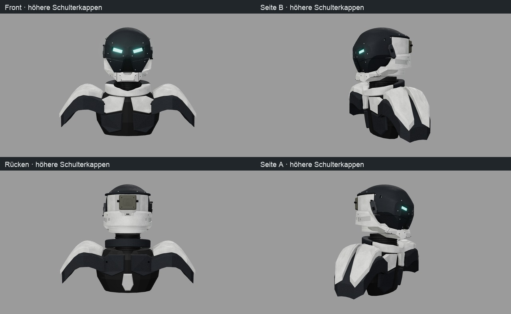

# Assembly 0.5 – Einzelteile und Oberkörper

Prüfexporte des bestehenden Three.js-Generators. Materialvarianten bleiben frei wählbar; die hier benannten
Kombinationen dienen dem Vergleich. Helmform und Augen bleiben gegenüber 0.4 erhalten.

Generatorquelle für Kontrolle, Headset aus und Oberkörper: **`6090262c1720c98a89d857970f9f11156103d29f`**.
Die Explosion nutzt **`3ff99582bdfc6ba1eaa06095632a40ae284c0099`** mit etwas weiter entfernten Zusatzkameras.
Die Bilder wurden bei eingefrorenen Quellen erzeugt; jeder Quellenhash wird gegen den jeweiligen Commit geprüft.
`export-comparison.json` enthält die dazugehörige Kontrolle.

| Ordner | Inhalt | Einstellung | Meshes |
|---|---|---|---:|
| `control` | Kontrollhelm mit Headsets | Graphit, helle Befestigungen, ohne Blenden | 102 |
| `headset-off` | Helm ohne Kopfhörer/Bügel/Kabel/Antennen | sonst wie Kontrolle | 62 |
| `exploded` | Beschriftete Explosionsübersicht, alle Helmteile | Metall, weiße Blenden, Headsets an | 104 |
| `shoulders` | Kurzer Hals, breite höhere Schultern, Brust/Rücken | Graphit, ohne Blenden/Headsets | 78 |

Pro Ordner: `scifi_helmet.glb`, `assembly.json` mit allen Meshpfaden und Verbindungsnotizen,
`textures/` mit tatsächlichen Quellkarten und Materialbelegung, `verification.json` mit Quellen/Parametern/Kameras/Hashes,
vier Renderansichten; Explosionsstand zusätzlich `render_assembly.png`. Körper/Explosion haben keine Helm-IoU.
Beschriftungen sind im Bild und Viewer sichtbar, während die GLB-Datei ausschließlich 3D-Bauteile enthält.
Teile-ID, montierte Matrix und Explosionsoffset sind im explodierten GLB als Knotenmetadaten gespeichert.

[Technischer Aufbau, B01–B22, Konstruktionsbedarf und Titan-Herkunft](../../docs/HELM_AUFBAU.md) ·
[Stil](../../docs/HELM_STIL.md) · [Prüfbericht](../../docs/versions/0.5.md).



[Explosionsübersicht](../../docs/bilder/helm_assembly_explosion.jpg) ·
[Headset an / aus in vier Ansichten](../../docs/bilder/helm_assembly_headset.jpg) ·
[Schulterkorrekturen im Verlauf](../../docs/bilder/helm_assembly_schulterverlauf.jpg).

## Wiederherstellung

```sh
npm --prefix web ci
./ce lock status
./ce lock gpu -- node web/verify_renders.mjs --finish=graphite --accents=light-fasteners --strips=off --out=/ABS/PFAD/control
./ce lock gpu -- node web/verify_renders.mjs --finish=graphite --accents=light-fasteners --strips=off --headset=off --out=/ABS/PFAD/headset-off
./ce lock gpu -- node web/verify_renders.mjs --finish=metal --accents=white-strips --exploded=1 --no-iou --out=/ABS/PFAD/exploded
./ce lock gpu -- node web/verify_renders.mjs --finish=graphite --accents=light-fasteners --strips=off --headset=off --body=shoulders --no-iou --out=/ABS/PFAD/shoulders
```

`headset` und `body` ändern die tatsächlich exportierte Auswahl. Explosionsabstände sind Darstellungshilfen,
keine Fertigungsmaße und keine geprüfte Demontagereihenfolge. Einige alte Schraubensätze enthalten mehrere
Schrauben in einem Mesh; diese sind noch nicht für individuelle Fertigung aufgeteilt.
Die neuen 22 Körpermeshes sind einzeln und geschlossen. Reale Wandstärken, Verbindungen und Bewegungsprüfung stehen aus.
