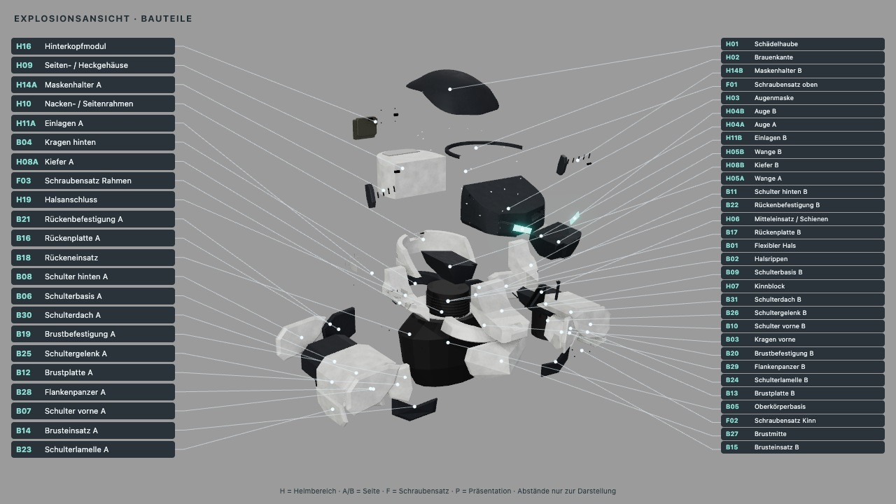

# Bastion 0.7 – Lieferstand

Montierte und explodierte Oberkörperstudie mit Graphit, hellen Befestigungen, ohne Headset und Stirnstreifen.
31 separate Körpermeshes, insgesamt 87 Meshes und 53 beschriftete Gruppen.

`assembled/` enthält die vier Ansichten; `exploded/` fünf Ansichten einschließlich beschrifteter Übersicht.
Beide enthalten GLB, Originaltexturen, Teilelisten und Prüfmanifeste. `comparison.json` hält den Vergleich
zu Cuirass fest. **Quellenpin:** `c445de50b758710962b32097a61202cea534ad97`. Beide Quellmanifeste und sämtliche Ausgabedateien sind gegen diesen Commit geprüft.
Der unabhängige Opus-Richter hat nach Nachweis der historischen Fixture Freigabe ohne blockierende Befunde erteilt.
Sein niedriger Hinweis zum Vorzeichen wurde durch den Ausdruck `y - (-0.84) = y + 0.84` und bytegleiche
Renderbilder vor/nach der reinen Parametrisierung aufgeklärt; siehe `comparison.json`.

`tests.txt` enthält 59 Gesamttests; `tests-targeted.txt` die 14 gezielten Prüfungen nach der Reviewkorrektur.
`browser-qa.txt` belegt 53 kollisionsfreie Labels, vollständige Bildabdeckung und stabile Moduswechsel.
`browser-qa.mjs` ist nach Installation der Web-Abhängigkeiten mit `./ce lock gpu -- node assets/helmet-bastion/browser-qa.mjs` ausführbar.
Die zwei unabhängigen Reviewantworten sind als JSON gesichert. Gesamtkosten: 0,122080 USD.

[Aufbau, Stil und Reproduktion](../../docs/HELM_BASTION.md) · [Prüfbericht](../../docs/versions/0.7.md)

Der Vorgänger bleibt unter `assets/helmet-cuirass/` mit eigenem Quellenpin erhalten.

Die vorhandenen Originalkarten liegen zusätzlich zum GLB bei; `bumpMap` wird von glTF nicht direkt dargestellt.

