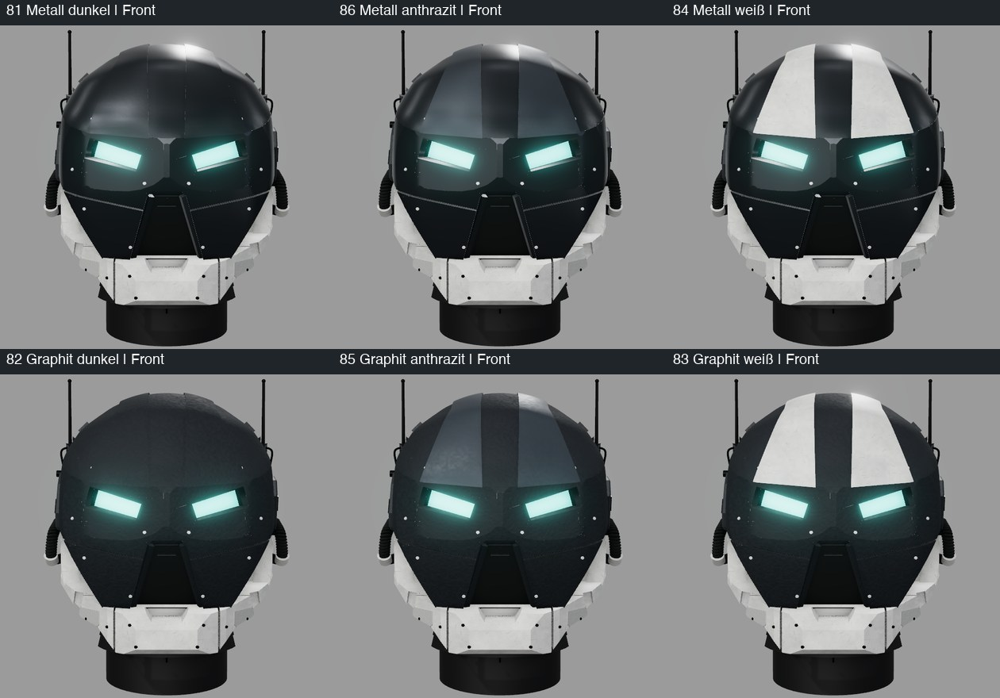
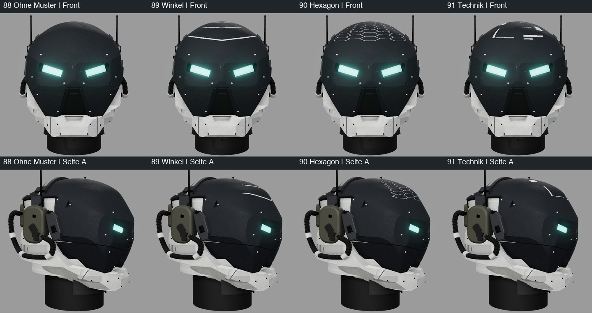

# Continuity 0.4 – Form- und Materialvergleich

Diese Varianten sind ein Versuch zur Auswahl durch den Nutzer. Der bisherige [Stand 79](../helmet/README.md)
bleibt separat erhalten. Alle Varianten teilen dieselben 102 Grundmeshes mit breiteren Rundungen neben den Augen. Zwei separate
trapezförmige Streifen von der Stirn bis zum Hinterkopf sind optional; ebenso eine Bemalung der runden Haube. Augen erhalten.

| Stand | Ordner / GLB | Finish | Akzente |
|---|---|---|---|
| 80 | [original](original/scifi_helmet.glb) | bisherige Materialien | bisherige dunkle Schrauben |
| 81 | [metal](metal/scifi_helmet.glb) | kontrolliert glänzendes Metall | helle Schrauben auf dunkler Rüstung |
| 82 | [graphite](graphite/scifi_helmet.glb) | feine dunkle Haubenstruktur | helle Schrauben auf dunkler Rüstung |
| 83 | [white-strips](white-strips/scifi_helmet.glb) | Graphit | zusätzlich weiße Stirn-/Scheitelstreifen |
| 84 | [metal-white-strips](metal-white-strips/scifi_helmet.glb) | Metall | zusätzlich weiße Stirn-/Scheitelstreifen |
| 85 | [graphite-contrast](graphite-contrast/scifi_helmet.glb) | Graphit | glattere anthrazitfarbene Streifen |
| 86 | [metal-contrast](metal-contrast/scifi_helmet.glb) | Metall | mattere anthrazitfarbene Streifen |
| 87 | [metal-plain](metal-plain/scifi_helmet.glb) | Metall | helle Schrauben, ohne Blenden |
| 88 | [graphite-plain](graphite-plain/scifi_helmet.glb) | Graphit | helle Schrauben, ohne Blenden |
| 89 | [chevron](chevron/scifi_helmet.glb) | Graphit | helle Schrauben, ohne Blenden, weiße Winkel |
| 90 | [hex](hex/scifi_helmet.glb) | Graphit | helle Schrauben, ohne Blenden, weißes Hexagonraster |
| 91 | [tech](tech/scifi_helmet.glb) | Graphit | helle Schrauben, ohne Blenden, weiße Technikmarkierungen |

Die hellen Punkte sind ausschließlich `Screws_Upper`. Schrauben auf hellem Rahmen, Funkmodulen und anderen Anbauten
behalten ihre Materialien. Weiße Streifen verwenden dasselbe gebrochene Weiß und dieselben Texturen wie der Rahmen.
Jeder Ordner enthält vier gerenderte Ansichten, GLB, Texturen, IoU und ein Prüfmanifest mit Quellen, Parametern,
Finish, Akzenten, Kameras und Ausgabehashes. 87–91 erfassen zusätzlich Blenden- und Musterwahl. Die älteren
Manifeste entstanden vor diesen Schaltern und entsprechen `strips=on`, `crownPattern=none`.
[Exportvergleich](export-comparison.json) prüft die identischen 102 Grundmeshes einschließlich Transformationen,
Kameras, Grundparameter und die tatsächlichen Abweichungen von Stand 79. 80–86 enthalten zusätzlich H20/H21
(104 Meshes), 87/88 kein Zusatzmesh (102), 89–91 allein den Bemalungsträger `CrownMarking` (103).
Die Silhouetten sind innerhalb 80–86 und innerhalb 87–91 jeweils bytegleich, zwischen diesen Gruppen unterschiedlich.



[Vier ursprüngliche Materiallooks aus vier Ansichten](../../docs/bilder/helm_continuity_vier_ansichten.jpg) ·
[Formänderung 79/80](../../docs/bilder/helm_continuity_form.jpg) · [Stilbeschreibung](../../docs/HELM_STIL.md)
· [Technische Agentenübergabe und visueller Eindruck](../../docs/HELM_AGENTEN.md)

[Metall: dunkel/anthrazit/weiß](../../docs/bilder/helm_continuity_metall_auswahl.jpg) ·
[Graphit: dunkel/anthrazit/weiß](../../docs/bilder/helm_continuity_graphit_auswahl.jpg).
[Metall/Graphit ohne Blenden](../../docs/bilder/helm_continuity_ohne_blenden.jpg) ·
[Muster aus vier Ansichten](../../docs/bilder/helm_continuity_muster_vier_ansichten.jpg).



Quellen der gespeicherten Prüfstände: 80–84 bei `9e1b495`, 85/86 bei `b773c1d`, 87–91 bei `f90d7c4`. Der Exportvergleich prüft jeden
Quellhash gegen den zugehörigen Git-Stand; ein später ergänztes Preset macht einen früheren Prüfbeleg nicht aktuell.

## Reproduktion

Node/Python und gepinnte Abhängigkeiten gemäß [web/README.md](../../web/README.md) einrichten. Im Repo-Hauptverzeichnis:

```sh
./ce lock status
./ce lock gpu -- node web/verify_renders.mjs --finish=original --accents=original --out=renders-original
./ce lock gpu -- node web/verify_renders.mjs --finish=metal --accents=light-fasteners --out=renders-metal
./ce lock gpu -- node web/verify_renders.mjs --finish=graphite --accents=light-fasteners --out=renders-graphite
./ce lock gpu -- node web/verify_renders.mjs --finish=graphite --accents=white-strips --out=renders-white-strips
./ce lock gpu -- node web/verify_renders.mjs --finish=metal --accents=white-strips --out=renders-metal-white-strips
./ce lock gpu -- node web/verify_renders.mjs --finish=graphite --accents=contrast-strips --out=renders-graphite-contrast
./ce lock gpu -- node web/verify_renders.mjs --finish=metal --accents=contrast-strips --out=renders-metal-contrast
./ce lock gpu -- node web/verify_renders.mjs --finish=metal --accents=light-fasteners --strips=off --out=renders-metal-plain
./ce lock gpu -- node web/verify_renders.mjs --finish=graphite --accents=light-fasteners --strips=off --out=renders-graphite-plain
./ce lock gpu -- node web/verify_renders.mjs --finish=graphite --accents=light-fasteners --strips=off --crown-pattern=chevron --out=renders-chevron
./ce lock gpu -- node web/verify_renders.mjs --finish=graphite --accents=light-fasteners --strips=off --crown-pattern=hex --out=renders-hex
./ce lock gpu -- node web/verify_renders.mjs --finish=graphite --accents=light-fasteners --strips=off --crown-pattern=tech --out=renders-tech
```

Relative Ausgabepfade beziehen sich auf `web/`; absolute Pfade sind möglich. Im Browser dieselben Optionen über
`?finish=graphite&accents=white-strips` oder `?finish=graphite&accents=light-fasteners&strips=off&crownPattern=tech`.
Ohne Optionen: neue Form mit Originalmaterial, dunklen Schrauben, eingeschalteten Blenden und ohne Muster.
Die normale GUI-Geometrieänderung und der GLB-Export behalten die gewählten Materialien. Keine feste Auswahl vorweggenommen.

Muster verlangen ausdrücklich ausgeschaltete Blenden. Die deterministischen 1024×1024-PNGs werden mit sphärischen
UVs auf einen um .001 versetzten Haubenträger gelegt und als reguläre GLB-Alpha-Maske exportiert. Das sind Bemalungen,
keine zusätzlichen massiven Bauteile. Originalhaube und ihre UVs bleiben erhalten. Beim Geometrie-Reset bleibt die
URL-Auswahl aktiv; [Browserprüfung](viewer-reset.txt). Augen, Funktechnik und Rahmen bleiben in allen Proben erhalten.

Der Kopfbügel überdeckt die Streifen äußerlich; innen besteht lokal eine Überlappung von etwa 0,002 Modelleinheiten.
Das Modell ist in separate Teile gegliedert, aber noch keine geprüfte Druck-/Montagekonstruktion.
Silhouetten-IoU misst den Umriss, nicht Materialähnlichkeit. Ein anderer Grafiktreiber kann Renderpixel verändern.
