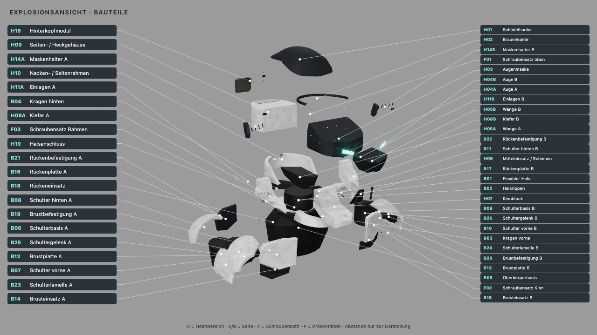

# Cuirass 0.6 – Lieferstand

> **Archiv (seit 0.12):** Diese Körperstudie ist aus dem Viewer und dem Code entfernt („wir bauen dann auf ballon auf“). Die hier
> genannten Quellen, Schalter (`body=…`, `--body`) und Reproduktionsbefehle gelten für Commit `4e63f05`
> (`git checkout 4e63f05`); Lieferpakete und Belege bleiben unverändert.

Reproduzierbare Oberkörperstudie mit 26 Körpermeshes und unverändertem Helm. Die Bilder zeigen Graphit
mit hellen Befestigungen, ohne Headset und ohne Stirnstreifen. Das ist eine Sichtungsvariante, kein neuer
Standard für die Materialwahl.

| Ordner | Inhalt |
|---|---|
| `assembled/` | Montierter Helm mit Körper, 82 Meshes, vier Ansichten |
| `exploded/` | Dieselben Teile auseinandergezogen, fünf Ansichten, beschriftete Baugruppenübersicht |

Jeder Ordner enthält GLB, echte Texturkarten, `assembly.json`, `parts.json` und `verification.json` mit
Quellen- und Ausgabehashes. `comparison.json` dokumentiert den Vergleich zur bisherigen Lieferung.
**Quellenrevision:** `2bbd72f118f5e9202e8ca986d0428256379ec613`. Beide Renderläufe und alle Quell-/Ausgabehashes wurden dagegen geprüft.
`tests.txt` enthält den vollständigen Lauf, `tests-targeted.txt` die elf nach der Prüferkorrektur wiederholten Tests.
`browser-qa.txt` belegt 48 kollisionsfreie Labels und vollständige Bildabdeckung. Die JSON-Antworten der
unabhängigen Opus-Prüfung enthalten auch die beiden unvollständigen Vorläufe; allein die letzte Fortsetzung
endet mit Freigabe. Gesamtkosten dieser drei Prüfaufrufe: 0,293323 USD.

[Aufbau, Teile und Befehle](../../docs/HELM_CUIRASS.md) · [Prüfbericht](../../docs/versions/0.6.md)

Die frühere Form bleibt unter `assets/helmet-assembly/shoulders-blocky/` samt eigenem Quellenpin erhalten.
Für einen alten Stand den dort genannten Commit auschecken; die aktuellen Standardparameter erzeugen Cuirass.



Die GLBs erhalten Teile-IDs und Montage-/Explosionsmetadaten. Für vollständige Three.js-Oberflächentreue
liegen zusätzlich die Originalkarten bei: glTF selbst bildet die vorhandenen `bumpMap`-Kanäle nicht direkt ab.

Die ergänzende Browserprüfung ist im Paket reproduzierbar:

```sh
./ce lock status
./ce lock gpu -- node assets/helmet-cuirass/browser-qa.mjs
```
