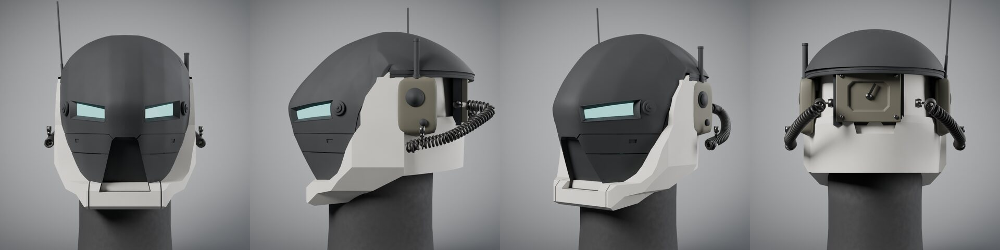

# Scout 0.8 – Blender-Fassung D29 (eingefrorene Referenz)

> Seit 0.18 lädt der Viewer Scout aus dem three.js-Generator ([`assets/helmet-scout-three/`](../helmet-scout-three/README.md)).
> Diese Dateien bleiben unverändert als Referenz (seit 0.19 Bericht `web/tools/robotgen_reference.mjs --model=scout`, bis 0.18 Test
> `scoutgen.test.mjs`) und im Viewer unter `&gen=blender`;
> der Blender-Generator liegt im Archiv (`archive/blender/scout/`).

Scout v3 aus dem Blender-Generator `archive/blender/scout/`, Stand D29 (29.10.2026). Exportiert mit
`archive/blender/scout/run.py -- --build --export assets/helmet-scout` aus leerer Szene.

| Datei | Inhalt |
| --- | --- |
| `assembled/scout.glb` | montierter Helm, 44 Meshes; glTF Y oben, vorn +Z, Höhe ≈ 1,0 |
| `exploded/scout_exploded.glb` | dieselben Meshes, je Teil um den Explosionsversatz aus `helm_explosion.py` verschoben |
| `parts.json` | 18 Gruppen S01–S13 (seitige Teile je R/L) mit Objekten und Versatz |
| `manifest.json` | je Objekt Teil, Vertices, Flächen, Bounding-Box (Blender-Koordinaten) – Nachbau-Vergleich |
| `views/scout_{front,seite,dreiviertel,hinten}.jpg` | Cycles-Ansichten (48 Samples) aus dem Repo-Nachbau |
| `exploded/scout_explosion_{vorn,hinten}.jpg`, `scout_teilekarte.jpg` | beschriftete Explosion und Teilekarte aus der Szene D29 (geometrisch identisch) |

Jedes Mesh im GLB trägt `extras`: `part_id`, `part_label`, `side`, `source_object`.
Die Materialien im GLB sind flache Ersatzmaterialien aus der mittleren Farbe der prozeduralen Blender-Materialien.
Rauschen, Schmutz und Abrieb gibt es nur in Cycles.

Nachbau-Nachweis: `manifest.json` stimmt mit der abgenommenen Szene D29 überein, nämlich 44 Objekte, 91 905 Vertices und alle Bounding-Boxen.
Die vier Repo-Ansichten weichen von den D29-Bildern nur im Renderrauschen ab, RMSE unter 0,07 %.

[Aufbau, Nachbau, Viewer](../../docs/HELM_SCOUT.md) · [Prüfbericht](../../docs/versions/0.8.md)

