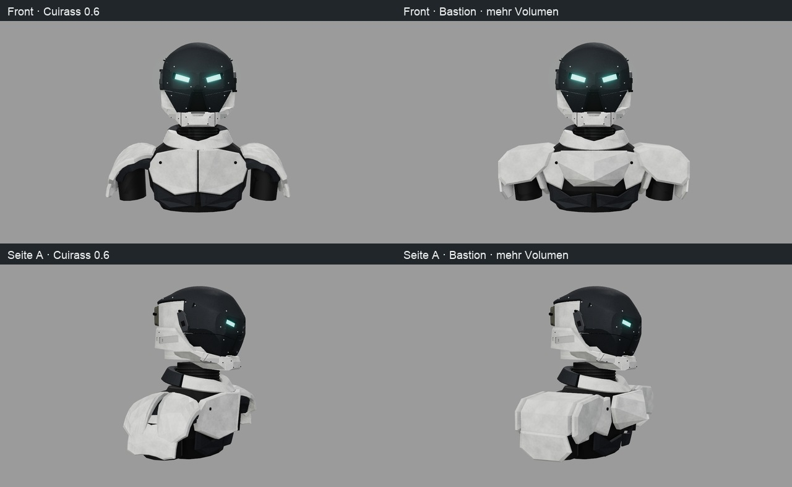
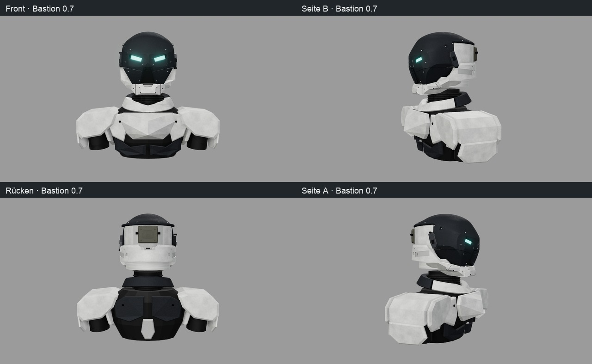

# Bastion 0.7 – kantige Schultergehäuse und zentrale Brust

Dieser Versuch setzt die vier vom Nutzer gezeigten Rüstungsbilder und zwei nachgereichte Facettenreferenzen um: tiefe kastenförmige Schultern,
geschichtete Schutzplatten, eine zentrale helle Brust und separate Flanken über dunklem Unterbau.
Der Helm folgt weiter der Videovorlage; die neuen Bilder betreffen den Oberkörper. Keine neue endgültige
Material- oder Formfreigabe wird aus den Referenzen abgeleitet. Arme, Beine, Taschen und Stoff sind nicht Teil dieser Etappe.



## Referenzen und gestalterische Entscheidungen

| Nutzerbild | Übernommene Beobachtung | SHA-256 der angehängten JPG-Datei |
|---|---|---|
| Zwei Rüstungen, Foto/Zeichnung, Anhang DFB5F730 | Kräftige Brust, dunkle Bewegungsbereiche, schmalere Taille | `b99508e264c83f2688a6c6421fab8a8cfc12eb0e39f0c789f3201d16a410c8d0` |
| Weiße Rüstung frontal, EE0180F4 | Breite mittige Brustfläche, kantige Schultergehäuse | `21795ebf08e86ec6d30ba5d6a9c09a5396caa169f2c7485d62884ee3ca688713` |
| Dieselbe Form schräg, 6A77F235 | Tiefe der Schultergehäuse und seitlich umschließende Platten | `78d0aa67873d8a2fe843933351669095dd734a0a0dd66d61a5d93fc9053346b6` |
| Variantenblatt, E63FDD72 | Gestaffelte Panzerlagen und abgeschrägte Flächen | `490ef426019d3e898261ce5a834718429e6ccd50b6bc54f53cbe8abd56eeb747` |

Zwei weitere Nutzerbilder zeigen erhabene geometrische Flächen mit gebrochenen beziehungsweise weich gefassten
Kanten. Sie steuern die körperliche Bruststruktur, nicht eine aufgemalte Textur:
`1AB9D607`, SHA-256 `d263950b3efa724c9004f7f77fd7e4063dde846ef1224fa54a124c29985c2a5a`;
`91DE0E47`, SHA-256 `316f582ae6344028f08ea0966a29de515719b32d1d1429aefe8180509142a416`.

Die Bilder wurden im Chat betrachtet, nicht als Fremdgeometrie importiert. Die sichtbaren Bungie-/Destiny-Schriftzüge
werden als Bildbeschriftungen beschrieben; Herkunft und Maßstab wurden nicht unabhängig verifiziert.
Die Bilder selbst werden nicht ins öffentliche Repository kopiert. Breite, Tiefe und Winkel sind eigene
Entwurfsparameter. Spitzen und hochgezogene innere Schulterecken werden zurückgenommen, damit der kurze Hals frei bleibt.

## Aufbau im Generator

Quellen bleiben `web/src/parts/shoulderStudy.js` und `web/src/shoulderStudyParams.json`. +Y zeigt nach oben,
+Z nach vorne. Modelleinheiten sind noch keine festgelegten Fertigungsmaße. `body=shoulders` aktiviert Bastion;
der Standard ohne Körper und die Material-/Headset-/Stirnstreifenoptionen bleiben erhalten.

**Schultergehäuse:** `shoulder.box.enabled` wählt den neuen Aufbau. Pro Seite bilden eine vordere und hintere
geschlossene Platte sowie ein eigenes gefaltetes Dach mit Außenwand das Gehäuse. Die Außenkontur liegt im XY-Raum,
der Körper wird entlang Z extrudiert. Die Vorderplatte liegt bei Z = 0,36, die Hinterplatte bei −0,34: 0,70 Bautiefe.
Das Dach überbrückt den Abstand zwischen ihren inneren Flächen. Nach Nutzerfeedback werden die äußeren Ecken stärker abgeschrägt, die Dächer etwas gesenkt und der Fasenparameter von 0,012 auf 0,024 erhöht. Die tatsächliche Fasen-Tiefe bleibt durch die Wanddicke begrenzt.
Eine um den vorgegebenen Mittelpunkt verkleinerte dunkle Unterlage sitzt im Inneren. Eine separate untere
Lamelle bildet die zweite Lage; sie verjüngt sich nach unten. Die dunklen Gelenkkörper bleiben aus Cuirass erhalten.
Die weißen Dachoberkanten bleiben unter Y = −0,58, dem bereits geprüften Grenzwert für die niedrige Schulterlage.

**Brust:** B27 schließt die Mitte als eine einzelne, nach vorne gewölbte Platte. Die Grundebene lautet
`Z = frontZ + centerLift + centerSlope * (Y - centerSlopeOrigin) - depth`, mit `centerSlopeOrigin = -0.84`. Zwei innere Scheitelpunkte liegen 0,16 und 0,20
vor dieser Ebene. Zehn ausdrücklich vorgegebene Dreiecksflächen verbinden sie mit dem achtteiligen Rand;
so entstehen symmetrische, bewusst gesetzte Facetten statt zufälliger Triangulationsmuster.
Der Rand und die Rückseite bleiben am bisherigen Anschluss, die Brust gewinnt nach vorne Volumen.
`beveledPlate` ergänzt dafür optional innere Punkte nur an der Frontkappe; Rückseite, Fasen und Seitenwände
bleiben geschlossen. Die Indizes berücksichtigen eine mögliche Umkehrung der Konturreihenfolge.

Die erste Probe hatte unruhige Dreiecke aus einer verzogenen Randkontur, die nächste eine plane Brustfläche.
Der Nutzer empfand diese seitlich als aufgedrückt und flach und wünschte mehr Volumen und Struktur.
Die neue Reliefgeometrie setzt genau diese Korrektur um. B12/B13 bleiben seitliche Brustsegmente mit stabilen
Kennungen und internen Namen. Die Fläche ist kein Bemalungsmuster und keine Wiederaufnahme der verworfenen Haubenmuster.

**Flanken:** B28/B29 sind eigene seitliche Platten. Ihr X-Abstand nimmt nach unten ab, passend zur Taille.
Sie liegen bewusst vor dem dunklen Kern. Eine Strahlprüfung gegen Flanke und Kern kontrolliert mindestens
0,015 Abstand an einer unteren Seitenprobe. In der ersten Messung war der Abstand kleiner; `flankX = 0,65`
stellt die sichtbare äußere Lage her. Das ist eine Formauflage, keine abgenommene Befestigung.

**Material:** Vorhandenes gebrochenes Weiß, Graphit, dunkle Gelenke und reproduzierbare Texturen werden
weiterverwendet. Kein neuer Zufall, kein neues Texturverfahren. GLB und Originalkarten werden gemeinsam gesichert;
Three.js-`bumpMap` ist im glTF-Kernformat nicht direkt abbildbar.

| Teile | Bedeutung in Bastion |
|---|---|
| B01–B05 | Vorhandener kurzer Hals, Halsrippen, Kragen und tiefer Rumpfkern |
| B06–B11 | Je dunkle Unterlage, vordere und hintere Schulterplatte |
| B12/B13 | Seitliche Brustsegmente, früher die beiden Hauptbrusthälften |
| B14–B22 | Dunkle Brusteinsätze, Rücken und bestehende Befestigungen |
| B23/B24 | Untere Schulterlamellen |
| B25/B26 | Dunkle Gelenkkörper |
| B27 | Neue durchgehende Brustmitte |
| B28/B29 | Neue Flankenplatten |
| B30/B31 | Neue Schulterdächer mit äußerer Seitenwand |

Alle **31 Körperteile** sind getrennte geschlossene Meshes mit stabilen Kennungen. In der gezeigten Konfiguration
ohne Headset und Stirnstreifen: **87 Meshes = 56 Helm + 31 Körper**, 53 beschriftete Gruppen.
Mit Stirnstreifen: 89; mit Headset ohne Streifen: 127. Kopfhörer und Band bleiben im Vergleich ausgeblendet.
Die Explosionsansicht erhält die neuen IDs, Herkunftspfade und montierten Transformationen.

## Reproduktion und Prüfumfang

```sh
npm --prefix web ci
npm --prefix web test
npm --prefix web run build
./ce check
./ce lock status
./ce lock gpu -- node web/verify_renders.mjs --finish=graphite --accents=light-fasteners --strips=off --headset=off --body=shoulders --no-iou --out=/ABSOLUTER/BELEGPFAD/assembled
./ce lock gpu -- node web/verify_renders.mjs --finish=graphite --accents=light-fasteners --strips=off --headset=off --body=shoulders --exploded=1 --no-iou --out=/ABSOLUTER/BELEGPFAD/exploded
./ce lock gpu -- node assets/helmet-bastion/browser-qa.mjs
```

59 Tests: 46 Node-, fünf IoU- und acht Belegsicherungsprüfungen. Geschlossene Kanten, konsistente Orientierung,
positive Volumina, UVs und deterministische Erzeugung prüfen weiterhin die aktuelle gesamte Körperstudie.
Die formgebundenen Cuirass-Prüfungen verwenden jetzt dessen unveränderte Parameter aus
`web/tools/fixtures/cuirass.json`; sie werden nicht an die neue Form angepasst oder gelöscht.
Drei zusätzliche Bastion-Tests prüfen die geschlossene Brustmitte, sichtbare Flanken, tiefe Schulterdächer
über den Gelenken, die untere Lage den Rückweg auf das gerundete Schulterverfahren sowie mehr als 0,15 echte Brustprojektion gegenüber der planen Negativkontrolle bei unverändertem Rand.
Für den exakten alten Lieferstand gelten weiterhin dessen Quellpin und vollständige Parameter.

Die Körperkameras sind unverändert, daher sind Vorher/Nachher direkt vergleichbar. Keine neue Video-IoU:
Die Körperansichten sind keine Helmreferenzmessung. [Lieferindex](../assets/helmet-bastion/README.md) und
[Versionsbericht](versions/0.7.md) nennen Quellen, Exporte und Prüfergebnis.

## Gemessene Größen

Gegenüber Cuirass: Außenbreite 1,9900 → 2,0700 Modelleinheiten, größte Vorderposition Z 0,5046 → 0,6435,
gesamte Körperbautiefe 0,9296 → 1,0685. Die Kerntiefe bleibt 0,7200; der Zugewinn entsteht durch die äußere
Panzerung. Halslänge 0,3100. Die montierten Kameras sind für alle Vergleiche identisch.


## Eindruck und offene Konstruktion

Aus Sicht des Agenten liest sich der Oberkörper jetzt technischer: voluminöse Brustmitte mit großen symmetrischen Facetten, abgesetzte Flanken,
tiefe Schulterkästen und eine klare zweite Panzerlage. Er ist kantiger und etwas breiter als Cuirass; die nachgereichte Korrektur bricht die Schulterkanten weicher, ohne den
Hals zu verlängern oder die Schultern stark anzuheben. Die Seitenansicht zeigt die Gehäusetiefe besonders deutlich.

Die Flächen sind noch eine grobe Formstudie. Es fehlen Armaufnahmen, Lager, Befestigungslaschen, definierte
Überlappungen unter Bewegung und Fertigungstoleranzen. Die dunklen Zylinder sind Gelenkplatzhalter, keine fertigen Arme.
Weitere Oberflächendetails sollten erst nach Nutzerfeedback zur Grundform folgen.


