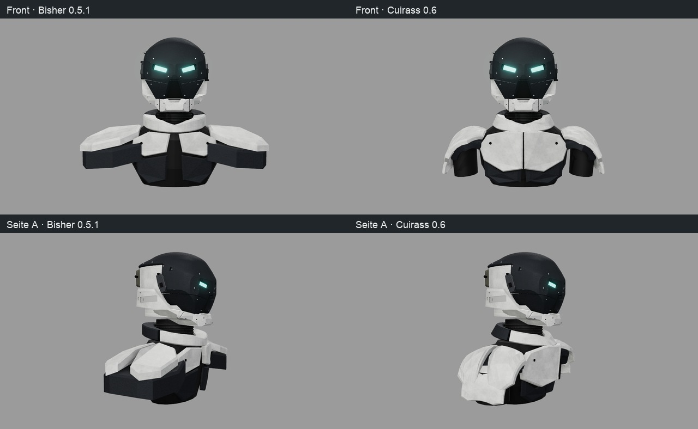
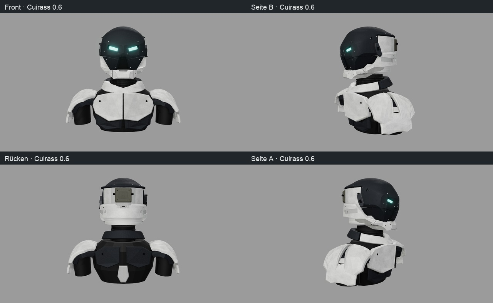

# Cuirass 0.6 – geschichteter Schulterpanzer und Brustgrat

> **Archiv (seit 0.12):** Diese Körperstudie ist aus dem Viewer und dem Code entfernt („wir bauen dann auf ballon auf“). Die hier
> genannten Quellen, Schalter (`body=…`, `--body`) und Reproduktionsbefehle gelten für Commit `4e63f05`
> (`git checkout 4e63f05`); Lieferpakete und Belege bleiben unverändert.

Die neue Oberkörperstudie überträgt die vom Nutzer gezeigte Paladin-/Titan-Inspiration auf den vorhandenen
Helm. Sie ist ein reproduzierbarer Formvorschlag, keine bestätigte Fertigungskonstruktion. Der Helm bleibt
an die Videovorlage gebunden. Die Konfiguration für diese Betrachtung lautet `finish=graphite`,
`accents=light-fasteners`, `strips=off`, `headset=off`, `body=shoulders`.



## Gestalterische Ableitung

Die Nutzerzeichnung trägt die Beschriftung „PALADIN TYPE / TITAN ARMOR“. Übernommen werden die nach unten
umschließenden Schulterpanzer, kleinere untergelegte Lamellen, eine breite Brust mit Mittelgrat und dunkle
Gelenkbereiche. Die bestehende Weiß-/Graphit-Palette, der kurze Hals, die Körperkerntiefe und der Helm bleiben
erhalten. Die Zeichnung liefert keine verbindlichen Körpermaße. Ihre Herkunft als offizielles Spielasset
ist nicht verifiziert; sie wird nicht in das öffentliche Repository kopiert.

Identität der lokalen Nutzerreferenz: `codex-clipboard-b712e4d8-49a3-489b-a4ea-9a90890d4b0f.png`,
SHA-256 `4985eeb5c35ac82c28f4fd531d7a4e79db82307ea9018837b824846247ab975f`.
Die vorherige [ergänzende Titan-Recherche](HELM_AUFBAU.md#ergänzende-titan-referenz-und-herkunft) bleibt eine weitere
Stilquelle. Die neue Form ist parametrisch konstruiert, ohne importiertes Fremdmesh.

## Geometrie und Datenfluss

Quelle: `web/src/parts/shoulderStudy.js`, Parameter: `web/src/shoulderStudyParams.json`.
Koordinaten: +Y oben, +Z vorne; Maße sind Modelleinheiten, noch keine festgelegten Meter oder Druckmaße.
Die vorhandene Montagefunktion ergänzt die Körperstudie am Helm und ersetzt nur den Präsentationshals.

**Schultern:** Die geschlossenen Platten werden zunächst im flachen Parameterraum mit vier Konturringen
aufgebaut: Vorderfläche, Fase, Seitenwand, Rückfläche. Zwei Unterteilungsstufen verfeinern gemeinsam
genutzte Kanten vor der Biegung. Das verhindert offene Nähte zwischen Fasen und gekrümmten Flächen.
Anschließend bildet `shoulderSurface` die Breitenkoordinate auf einen elliptischen Bogen ab:

```text
t = (x - innerX) / (outerX - innerX)
a = startAngle + t * (endAngle - startAngle)
X = side * (centerX + rx * sin(a) + (outset - depth) * normalX)
Y = centerY + ry * cos(a) - arc * z² - drop + (outset - depth) * normalY
Z = z
normal = normalize(sin(a)/rx, cos(a)/ry)
```

Die Wanddicke läuft entlang dieser Normalen. `wrap.enabled=false` oder ein fehlender Wrap-Block nutzt
weiterhin den historischen Schulterverlauf. Exakte frühere Stände benötigen zusätzlich ihre damaligen
Parameter beziehungsweise die im Lieferindex genannten Quellcommits.

Die Hauptkappen bleiben vorne/hinten getrennt. Die dunkle Unterlage liegt nach innen versetzt;
ihre Kontur in der Tiefe wurde gegenüber dem ersten Versuch zurückgenommen. Je eine kleinere Lamelle
liegt 0,13 tiefer und 0,025 weiter außen. Ein eigener dunkler Gelenkkörper bleibt dahinter sichtbar.
Die festen Konstruktionswerte dafür sind 12 Umfangssegmente, 0,92 Verjüngung und 0,08 Radiant Neigung;
Radius, Länge, Tiefe und Position liegen in den Parametern. Seine Oberkante wurde nach Sichtprüfung abgesenkt: Im ersten Versuch ragte der Zylinder durch die
weiße Schale. Eine seitliche Strahlprobe prüft jetzt, dass dort zuerst die Hauptschale getroffen wird.

**Brust:** B12/B13 behalten ihre IDs und internen Namen `ClavicleArmor_R/L`, bilden nun aber die großen
Brusthälften. Ein nach außen linear auslaufender Hub erzeugt den physischen Mittelgrat:
`ridgeHeight * max(0, 1 - abs(x)/ridgeWidth)`. Die schmale Mittelfuge trennt beide exportierbaren Platten.
Die Befestigungen folgen dem Hub; B14/B15 liegen als dunkle Einsätze unter der hellen Hauptbrust.

**Kragen:** Der obere Außenradius wird enger, die unteren beiden Außenringe flaren zur Brust hin aus.
Innenöffnung, vordere Kerbe, Halsanker und kurzer gerippter Hals bleiben erhalten. Vorderer und hinterer
Kragen sind separate Körper; ihre unterschiedliche Farbe entspricht der vorhandenen Materialzuordnung.

**Oberflächen:** Die vorhandenen Materialien und reproduzierbaren Texturen werden wiederverwendet.
Keine neue Bildgenerierung, kein neues Zufallsverfahren. Flache Flächennormalen erhalten die Facetten;
deterministische projizierte UVs tragen die bestehenden Karten. Die runde Helmhaube bleibt unberührt.

| Parameter | Stand 0.6 |
|---|---:|
| Schulterbogen, X-/Y-Radius | 0,33 / 0,39 |
| Bogenwinkel Anfang / Ende, Radiant | −0,65 / 1,68 |
| Hauptschale / Lamelle, Dicke | 0,065 / 0,045 |
| Dunkle Unterlage, Normalenversatz / Dicke | 0,075 / 0,09 |
| Brustgrat, Hub / Auslaufbreite je Hälfte | 0,115 / 0,42 |
| Kragen oben, X-/Z-Außenradius | 0,345 / 0,355 |
| Kragen unten, zusätzliche X-/Z-Weitung | 0,05 / 0,07 |
| Halslänge / größte Körperkerntiefe | 0,31 / 0,72, unverändert |

## Einzelteile und noch offene Verbindungen

Die Außenbreite der Studie sinkt von 2,3198 auf 1,9900 Modelleinheiten (−14,2 %); der Kern bleibt 1,1770 breit und 0,7200 tief. Mit dem Brustgrat beträgt die gesamte Bautiefe nun 0,9296.

Die bestehenden B01–B22 bleiben erhalten. Die Körperstudie besteht nun aus **26 separaten Meshes**.
Mit Helm ohne Headset und ohne Stirnstreifen ergeben sich **82 Meshes**: 56 Helmteile plus 26 Körperteile.
Mit Stirnstreifen sind es 84; mit Headset und ohne Streifen 122. Standardmäßig bleibt der Viewer beim Helm
allein. Die neue Körperform erscheint nur bei `body=shoulders`.

| IDs | Aufgabe | Noch zu konstruieren |
|---|---|---|
| B01–B05 | Hals, Halsrippen, vorderer/hinterer Kragen, Rumpfkern | Halslager, Servicezugang, Aufnahme des Kragens |
| B06–B11 | Je dunkle Unterlage und vordere/hintere Hauptkappe | Träger, definierte Befestigung, Abstand bei Bewegung |
| B12–B15 | Zwei Brusthälften und zwei dunkle untere Einsätze | Mittelfuge, verdeckte Verschraubung, Plattenauflage |
| B16–B22 | Vorhandene Rückenplatten, Einsatz, vier Befestigungen | Funktionale Befestigungsgeometrie |
| B23/B24 | Neue untere Schulterlamellen A/B | Überlappung und Lagerung zur Hauptschale |
| B25/B26 | Neue dunkle Schultergelenkkörper A/B | Gelenkachse, Armaufnahme, Bewegungsfreiraum |

Die Gelenkkörper sind vereinfachte geschlossene Volumen, keine fertigen Oberarme. Überdeckungen sind
gestalterische Auflagen; keine Bohrungen, Passungen, Schraubengewinde oder Rig-Freigänge sind abgenommen.
Die bestehende Explosionslogik beschriftet die neuen IDs und erhält Herkunftspfad, montierte Matrix und
Explosionsoffset im GLB. Die Beschriftung selbst ist eine Viewer-Ebene und kein Mesh. Für den explodierten Oberkörper nutzt der Viewer
einen eigenen Abstand von 9,8 und Zielpunkt Y = −0,55; die fünf Kameras erfassen sämtliche projizierten Meshpunkte
mit Randreserve. Helm- und montierte Körperkameras bleiben unverändert.

## Reproduktion und Prüfung

```sh
npm --prefix web ci
npm --prefix web test
npm --prefix web run build
./ce check
./ce lock status
./ce lock gpu -- node web/verify_renders.mjs --finish=graphite --accents=light-fasteners --strips=off --headset=off --body=shoulders --no-iou --out=/ABSOLUTER/BELEGPFAD/assembled
./ce lock gpu -- node web/verify_renders.mjs --finish=graphite --accents=light-fasteners --strips=off --headset=off --body=shoulders --exploded=1 --no-iou --out=/ABSOLUTER/BELEGPFAD/exploded
```

Der Prüflauf sichert Quellen- und Ausgabehashes. Der [Lieferindex](../assets/helmet-cuirass/README.md) nennt
den exakten Quellcommit und die Prüfbelege. Körperansichten sind nicht mit der Helm-Videosilhouette
vergleichbar; deshalb `--no-iou`. Es wird keine neue Ähnlichkeitszahl zur Videovorlage behauptet.
Geometrieprüfungen kontrollieren geschlossene orientierte Flächen, positive Volumina, endliche UVs,
deterministische Erzeugung, sichtbare Lamellen/Gelenke, Brustgrat und historische Schulterprofile.

## Visueller Eindruck des Agenten

Die Brust liest sich als zusammenhängender Schutzkörper mit klarer Mittellinie. Die Schultern umschließen
den Armansatz und sitzen näher am Rumpf; dadurch wirkt der Oberkörper weniger seitlich ausladend, obwohl
die kräftige Kerntiefe erhalten bleibt. Die unteren Lamellen schaffen eine zweite Panzerlage. Der Kragen
vermittelt zwischen dem kurzen Hals und der Brust, ohne die Schultern zum Helm hochzuziehen.

Noch grob sind die dunklen Gelenkkörper, die Schulterauflagen und die Rückenverbindung. Die Facetten der
weißen Schalen sind bewusst sichtbar. Das sind Beobachtungen des Agenten, keine bestätigte Nutzerwahl.
Sinnvolle nächste Schritte nach Formfeedback wären Armansätze und tatsächliche Montageaufnahmen.


