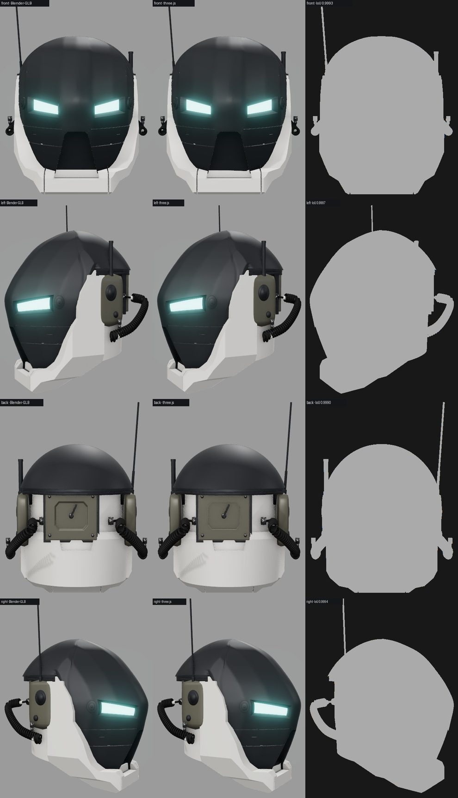
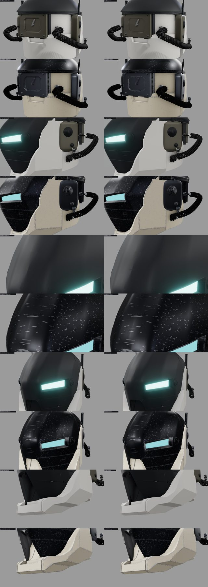
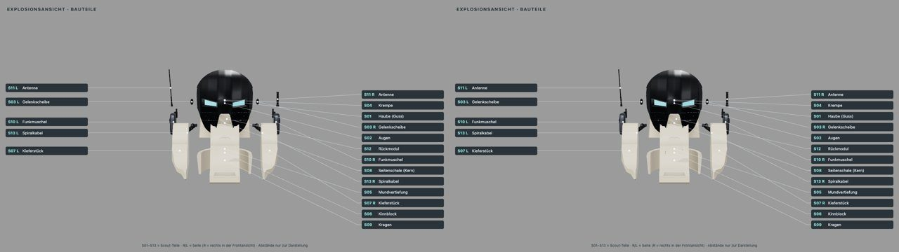

# Scout v3 – Blender-Helm (Version 0.8), seit 0.17 im three.js-Generator

> **Seit 0.18 „Prefab“:** Quelle ist der three.js-Generator (`web/src/robotgen/scout.js`), `web/tools/robotgen_export.mjs` schreibt das
> Lieferpaket `assets/helmet-scout-three/`, der Viewer lädt es. Der Blender-Generator dieser Seite liegt im Archiv (`archive/blender/scout/`),
> seine GLBs in `assets/helmet-scout/` bleiben als eingefrorene Referenz. Cycles-Bilder: `blender/cycles_render.py` aus dem exportierten GLB.
> Abschnitte „Aufbau“ und „Nachbau“ beschreiben den archivierten Blender-Weg.

Scout v3 ist ein zweiter Helm neben dem three.js-Helm. Gebaut wird er nicht im Browser, sondern in **Blender** aus einem
eigenen Python-Generator. Er entstand im Arbeitsordner `trialanderror` mit derselben Kritiker-Arbeitsweise wie dieses Repo:
feste Ansichten, nummerierte Durchläufe, ein unabhängiger Kritiker und Messung per IoU. Die Nutzerkorrekturen kamen über
markierte Bilder und den Markierbogen. Abgenommen ist der **Stand D29** vom 29.10.2026. Er wird hier eingefroren und ist aus dem Generator nachbaubar.


## Aufbau

Der Helm entsteht hybrid aus zwei Quellen:

- **Haube und Gesicht (S01–S04):** ein dunkler Guss aus dem früheren Lauf 2h, bestehend aus Kuppel, Augen, Gesichtsplatte mit Fugen und Krempe.
  Er liegt gebacken in `blender/scout/guss_2h.npz` (seit 0.18 `web/src/robotgen/data/`) und wird mit `guss_2h_einsetzen()` eingesetzt.
- **Unterhelm (S05–S09):** CSG nach dem Vorbild dieses Repos (`helm_csg.py`). Ein Kopfvolumen wird aus drei Profilen geloftet,
  daraus werden Kern, Kragen, Kiefer und Kinnblock geschnitten. Dazu kommen die Mundvertiefung in der Gesichtsplatte und eine Kerbe im Kinnblock.
- **Anbauten (S10–S13):** Funkmuscheln mit Bügel, Antennen, Rückmodul und Spiralkabel.

Alle Maße stehen in `blender/scout/helm_params.json` (seit 0.18 `web/src/robotgen/data/helm_params.json`). Die Einheit ist H = 1,0 für die Helmhöhe, das entspricht etwa 30 cm.
In Blender zeigt +Z nach oben und −Y nach vorn. Die Teile tragen feste Kennungen **S01–S13** ([Teileliste](scout/HELM_TEILE_SCOUT.md)).
Die Seite R liegt bei +X und erscheint in der Frontansicht rechts im Bild. Für die Seite zählt immer die Lage, nie der Objektname.

## Nachbau

```bash
# Repo-Wurzel; baut D29 aus leerer Szene (~2,5 min) und schreibt GLB, Teileliste und Manifest
./ce lock blender -- /Applications/Blender.app/Contents/MacOS/Blender -b --factory-startup \
  --python archive/blender/scout/run.py -- --build --save runs/scout/scout_build.blend --export assets/helmet-scout
# vier Cycles-Ansichten aus der gespeicherten Szene
./ce lock gpu -- /Applications/Blender.app/Contents/MacOS/Blender -b runs/scout/scout_build.blend \
  --python archive/blender/scout/run.py -- --views runs/scout/views/scout
```

Seit 0.18 liegen `guss_2h.npz` und `helm_params.json` in `web/src/robotgen/data/`; zum Ausführen des Archivs beide zurück nach
`archive/blender/scout/` kopieren. In einem laufenden Blender (MCP): `p = '<repo>/archive/blender/scout/run.py'; g = {'__file__': p}; exec(open(p).read(), g)`, danach
`g['scout']['bauen_lauf6b']()`, `g['scout']['ansichten'](…)`, `g['scout_export']['export_all'](…)`. `bauen_lauf6b()` braucht eine
leere Szene, also vorher `bpy.ops.wm.read_homefile(use_empty=True)` aufrufen, und zwar direkt, nicht in einem Timer.
Alle Pfade setzt `run.py` über die Umgebungsvariablen `SCOUT_DIR`, `SCOUT_REF` (`reference/scout/`) und `SCOUT_RUNS` (`runs/scout/`, nicht im Repo).

**Nachweis 0.8:** Der Nachbau aus dem Repo ist identisch mit der abgenommenen Szene D29. Er hat dieselben 44 Objekte, dieselben 91 905 Vertices
und die gleichen Bounding-Boxen auf 1e−4 genau; Prüfung mit `--manifest` gegen die Szene aus dem Arbeitsordner.
Die Meshy-Vorlage `meshy_v2.glb` (49 MB) ist nicht im Repo. Der Generator lädt sie nur als Hilfsreferenz und überspringt sie,
wenn sie fehlt. Die Geometrie von `bauen_lauf6b()` hängt nicht von ihr ab; nur die alten Messhelfer `kinn_kontur()`/`kinn_band_messen()` in `helm_build7.py` brauchen sie.

## Viewer

`web/` zeigt Scout mit `?model=scout`, zum Beispiel `http://127.0.0.1:5173/?model=scout&view=left`. Mit `&exploded=1` (Scout kennt nur 0 oder 1; jeder Wert über 0 zeigt die volle Explosion) erscheint
die Explosionsansicht mit Etiketten S01–S13. Der Viewer lädt `assets/helmet-scout-three/assembled/scout.glb` und
`exploded/scout_exploded.glb` (seit 0.18 der Export des three.js-Generators) und skaliert Scout auf den Rahmen des three.js-Helms, damit
die Kameraansichten passen. Die Geometrie lässt sich im Viewer nicht ändern; `&gen=three` baut den Generator live im Browser,
`&gen=blender` zeigt die Blender-Referenz `assets/helmet-scout/` ([unten](#threejs-generator-017-outrider)).

**Grenze:** Die Blender-Materialien sind prozedural (Rauschen, Schmutz, Abrieb). glTF übernimmt davon nur flache Ersatzmaterialien
mit der mittleren Farbe des Materials, dazu Rauheit, Metall und Leuchten. Der GLB ist deshalb glatter als die Cycles-Bilder.
Maßgeblich für das Aussehen sind die Cycles-Ansichten.

## three.js-Generator (0.17 „Outrider“)

Seit 0.17 entsteht Scout auch ohne Blender: `web/src/robotgen/scout.js` baut dieselben 44 Meshes S01–S13 wie `run.py › bauen_lauf6b`
und `export_scout.py`, mit Namen, Extras (`part_id`, `part_label`, `side`, `source_object`), Gruppen und Explosionsversätzen wie
`parts.json`. Seit 0.18 schreibt `node web/tools/robotgen_export.mjs --model scout` daraus das Lieferpaket `assets/helmet-scout-three/`
(montiert und explodiert, [Export](ROBOTER_BALLON.md#export-018-prefab)), das der Viewer standardmäßig lädt, allein und als Helm auf jedem
Körper; Navigation „Modelle › Quelle: Export / Live / Blender“.



| Datei | Blender-Vorbild | Inhalt |
|---|---|---|
| `npz.js`, `scoutGuss.js` | `helm_bauen.guss_2h_einsetzen` (Modus `voll`), `innen_weg`, `mund_vertiefung` | Guss aus `data/guss_2h.npz` (Haube, Augen, Gelenkscheiben, Krempe) gelesen wie gespeichert; Innenschicht weg, Krempe an der Seitenplatte gekappt, Mundwanne (Umriss per `bisect`, Rand am unversehrten Guss gemessen) |
| `scout.js › unterhelm` | `helm_csg.unterhelm`, `volumen` (`helm_volumen.py`) | Kern, Kragen, Kinnblock, Kieferstücke aus Kopfvolumen, Prismen, Halbräumen, elliptischen Zylindern |
| `scout.js › ohrmodule`, `rueckmodul`, `schlauch` | `helm_csg.ohrmodule_neu`, `rueckmodul_neu`, `helm_build8.ohrmodule`/`schlauch`, `helm_build3.catmull`/`kabel_spirale` | Funkmuscheln mit Bügel, Antennen, Rückmodul mit Feld und Hebel, Spiralkabel (Kurve mit rundem Profil) |
| `scoutMesh.js`, `bsp.js` | `bmesh`, Boolean `EXACT`, `shade_smooth_by_angle` | n-Gon-Meshes, `bisect_plane`, `recalc_face_normals`, BSP-Booleans in doppelter Genauigkeit, Raycasts, Schattierung (Kanten nach Winkel, Eckwinkel-Gewichtung) |

- **Materialien:** die flachen glTF-Ersatzmaterialien des Lieferpakets (`scoutMaterials.json`, Test gegen den GLB). Die prozeduralen
  Cycles-Materialien gibt es weiterhin nur in Blender; Skins und Farbschemata greifen wie beim GLB.
- **Booleans:** Der Unterhelm besteht aus ebenen Flächen. three-bvh-csg (float32) ließ in den verketteten Kieferschnitten Splitter, die
  das Mesh öffneten (Kinnblock 4 mm zu breit) oder bei Reparatur nach jedem Schritt 90 s brauchten. `bsp.js` schneidet exakt an Ebenen
  in doppelter Genauigkeit (nach csg.js), `finish` schließt die T-Kreuzungen einmal am Ende: alle CSG-Teile geschlossen, außen orientiert.
- **Teile, die `bauen_lauf6b` baut und wieder entfernt** (Maske, Wangenplatten, Leuchtkörper, Lauf-3-Module), sind nicht übertragen;
  `helm_params.json` bleibt die gemeinsame Quelle, Zweige, die D29 nicht nutzt (Kronenkuppel, Seitennuten, Halsring), brechen mit Meldung ab.
- **Skin-Atlas** `assets/skins/scout/` (seit 0.18 aus dem exportierten GLB: `skin_bake.mjs --model scout`); die BSP-Teile und die
  Mundwanne tragen gebackene Positionen für den Übertrag in anderen JavaScript-Engines.

**Messung gegen den Blender-GLB** (`web/tools/scoutgen.test.mjs`, `node web/tools/robotgen_compare.mjs --model=scout`):

| Prüfung | Ergebnis |
|---|---|
| Objekte, Extras, Gruppen, Explosionsversätze gegen `manifest.json`/`parts.json` | 44/44 identisch |
| Box je Objekt (H = 1,0 ≈ 300 mm) | max. 0,09 mm (Spiralkabel), Guss, Anbauten und CSG-Teile ≤ 0,03 mm |
| Topologie: Punkte/Flächen je Objekt gegen das Manifest | Guss-Teile, Mundwanne, Anbauten identisch; Haube 72 470/69 649 statt 72 475/69 653; Kabel 6 530 statt 6 550 Punkte |
| Umriss-IoU vorn / links / hinten / rechts (gleicher Viewer, gleiche Kamera) | 0,9993 / 0,9997 / 0,9990 / 0,9994 |
| Dreiecke (GLB) | 182 438 (180 248) |





**Bekannte Abweichungen:** Die Fase des Rückmoduls (Blender-Bevel 0,005, zwei Segmente) ist als gerundeter Kasten nachgebaut, das
eingelassene Feld bleibt scharfkantig – gealtert zeigen seine Kanten mehr Abrieb. CSG-Teile sind trianguliert statt n-Gone (Schattierung
gleich). Das Kabelprofil hat 10 Punkte wie Blenders `bevel_resolution 3`, die Windungszahl weicht um zwei Profilringe ab.

## Stände und Marker

- [Stände D01–D29](scout/STAENDE.md): Index aller Durchläufe mit IoU und Markierbogen-Seiten. Die Durchlauf-Ordner mit
  Vergleichsbögen und Stand-Snapshots (212 MB) bleiben im Arbeitsordner `trialanderror/durchlaeufe/`.
- [Stil und Entscheidungen](scout/STIL_SCOUT_V3.md), [Protokoll](scout/testlog.md).
- [Marker-System](scout/MARKER_GUIDE.md): Der Nutzer klickt in eine Ansicht, Teil, Seite und Höhe werden vorgeschlagen, und die Markierung wird gespeichert.
  Die Werkzeuge dazu sind `archive/blender/scout/markierbogen_vorlage.html` und `markierbogen_bauen.py`, das Raster kommt aus `helm_explosion.py` › `markierbogen_daten()`.

## Offene Punkte (Stand D29)

- Kleine helle Stufe, wo der Kragen auf S07 trifft; S07 wirkt etwas klobig.
- Spiralkabel sind symmetrisch (die Vorlage zeigt nur eine Seite); Antennen bewusst asymmetrisch (L lang, R Stummel).
