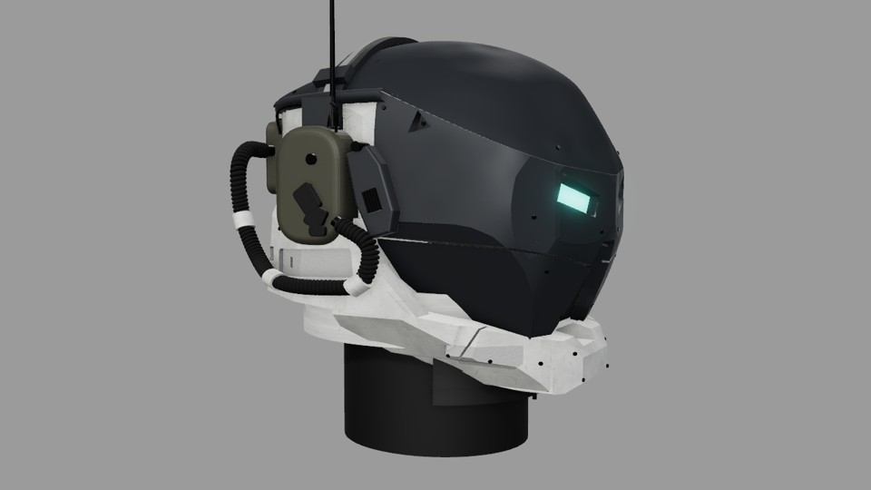

# Helm – Stil- und Formbeschreibung

## Verbindlicher Stand

Aktueller Lieferstand: **Prüflauf 69**. Nach Nutzerfeedback ist der Scheitel nun quer und längs gewölbt;
der Kopfbügel folgt der Haube. Ihr Rand läuft weich zur Augenmaske aus. Der helle Rahmen bleibt moderat kantiger.
Die abgeflachten, eckigen Haubenversuche 62/63 wurden vom Nutzer ausdrücklich verworfen.

Das Video ist die maßgebliche Formreferenz. Vier feste Ansichten unter `web/refs/` und unveränderte Kameras dienen
zum Vergleich. Die Meshy-GLB ist ausschließlich eine zusätzliche 3D-Referenz; ihre Geometrie wird nicht importiert.
Die Zuordnung ist im [Verlauf](HELM_VERLAUF.md) dokumentiert. „Vorher“ bezeichnet keine eindeutige Standnummer.

## Formensprache

- **Schädelhaube H01:** geschlossene, ruhig gewölbte Schale mit fließendem Scheitel. Keine flache Platte oben,
  keine abgeschnittenen hellen Flecken und keine ausgeprägten geraden Schulterflächen. Der Bügel folgt der Rundung.
  Der Übergang zur Augenmaske ist weich gewölbt, mit feiner Teilefuge statt heller Absatzkante; H01 und H02 bleiben getrennt.
- **Gesicht H02–H06:** dunkle, kantige Panzerplatten mit schmalen Fugen, zurückgesetztem trapezförmigem Mitteleinsatz
  und klaren Wangenflächen. Die akzeptierten cyanfarbenen Augen bleiben in Form, Lage und Leuchtwirkung erhalten.
- **Heller Rahmen H07–H11:** kräftige, asymmetrisch gegliederte technische Konstruktion. Die gewählte Kieferkontur aus
  Stand 46 bleibt erhalten. Seiten-/Nackenrahmen besitzen 16 moderate Mantelfacetten, eine schmale obere Fase und
  gerade abgeschrägte Vertiefungen. Keine erneut verschmälerten Kieferplatten wie in den verworfenen Versuchen 51–58.
- **Anbauten H12–H18:** olivfarbenes Funkgehäuse auf Seite A, helles Ohrmodul auf Seite B, schwarzes Spiralkabel,
  sichtbare Halter, Antenne und rückwärtiges Technikmodul. Die Asymmetrie gehört zum Design.
- **Halsanschluss H19:** rund und zurückgesetzt. Der schwarze Hals ist ein Präsentationsträger; der Schal aus dem Video
  ist kein Bestandteil des exportierten Helms.

## Material- und Farbpalette

Haube und Maske verwenden exakt dieselbe Grundfarbe und dieselben Körnungs-/Rauheitsbilder bei gleichem
Texturmaßstab. Die Haube leitet `crownArmor` von `darkArmor` ab: Rauheit 0,90 statt 0,75, Glanzintensität 0,45 und
Umgebungsreflexion 0,35 statt 0,60. So dominieren auf der Rundung weniger helle Glanzflecken. Das Maskenmaterial bleibt
unverändert. Diese Anpassung betrifft die Lichtantwort; Licht und Flächenrichtung erzeugen weiterhin Helligkeitsunterschiede.

Die Werte stammen aus [materials.js](../web/src/materials.js); das Rendering ergänzt Licht, Tonemapping und Texturen.

| Bereich | Basisfarbe | Wirkung |
|---|---|---|
| Dunkle Panzerung | `#313438` | Graphit, überwiegend matt, leicht metallisch |
| Helles Gehäuse | `#D6D7D5` | Gebrochenes Weiß, dezente Gebrauchsspuren |
| Strukturierte Einlagen | `#A8A9A6` | Feine, matte Oberflächenstruktur |
| Funk-/Heckmodule | `#4A493E` | Gedämpftes Olivgrau |
| Augen | `#5FE3D6` | Cyan, Emission 1,0; Form und Lage bewahren |
| Gummi und Kabel | `#141414` | Dunkel, rau |
| Metallhalter | `#1A1A1A` | Dunkles Metall mit kontrollierten Glanzkanten |

Texturen werden prozedural mit festen Seeds erzeugt. Fünf unterschiedliche Karten liegen in sieben PNG-Dateien (Haube/Maskenkarten bytegleich) im [Lieferstand](../assets/helmet/textures/).
`materials.json` enthält Wiederholung und Bump-Stärke. Farb-/Rauheitskarten sind im GLB eingebettet; Three.js-Reliefkarten
zusätzlich als Höhen-/Bump-Texturen zuordnen, da glTF diesen Kanal nicht direkt übernimmt.

## Aufbau und Reproduktion

Quelle ist der Three.js-Generator, keine von Hand geänderte Exportdatei. Formparameter liegen in
[helmetParams.json](../web/src/helmetParams.json); einige Kieferkonturen stehen noch direkt in `parts/lowerArmor.js`. Feste Teilekennungen H01–H19 stehen in [HELM_TEILE.md](HELM_TEILE.md).
Im Generator zeigt +Y nach oben, +Z nach vorn. Seite A liegt bei −X (Kamera `right`), Seite B bei +X (`left`).
Die anders bezeichneten Achsen in der ursprünglichen Formbeschreibung werden nicht mit diesen Arbeitskoordinaten vermischt.

Der GLB enthält **89 Meshes** mit getrennten Baugruppen; Schraubensätze können gemeinsam in einem Mesh liegen.
[parts.json](../assets/helmet/parts.json) listet die tatsächlichen Exportobjekte und Materialien.
Einzelne Meshes sind noch keine Zusicherung fertiger Druckwandstärken, Montagepassungen oder tragbarer Schutzwirkung.

Änderungen einzeln parametrisieren, alle vier Ansichten bei gleichen Kameras prüfen und Bilder mit konkreten
Standnummern beschriften. Messwerte ergänzen die Sichtprüfung; Silhouetten-IoU ist kein Prozentwert für die Gesamtähnlichkeit.
Die optionale Körperstudie (`?body=1`) ist ein separater Proportionsentwurf und nicht als fertige Körperform freigegeben.

[Reproduktionsanleitung](../web/README.md#aktueller-lieferstand-69) · [GLB und Prüfbelege](../assets/helmet/README.md)
