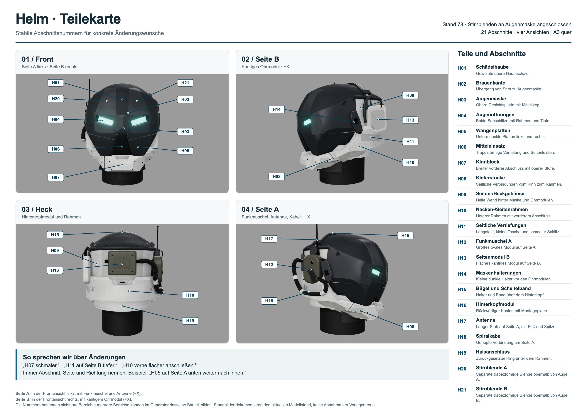

# Helm – Teile und Abschnitte

Diese Nummern bleiben über Modelländerungen hinweg gleich. Für einen Änderungswunsch genügen **Nummer, Seite und Richtung**:
„H07 schmaler“, „H11 auf Seite B tiefer“ oder „H10 vorne flacher anschließen“.



**Seite A** liegt in der Frontansicht links: Funkmuschel, Antenne und Kabel; im Three.js-Modell `−X`, Kamera-Schaltfläche
`Right`. **Seite B** liegt in der Frontansicht rechts: das kantige Ohrmodul; im Modell `+X`, Schaltfläche `Left`.
Diese Bezeichnungen gelten unabhängig davon, von welcher Richtung man gerade auf den Helm schaut.

| ID | Teil / Abschnitt | Gemeint ist |
| --- | --- | --- |
| H01 | Schädelhaube | Gewölbte obere Hauptschale, ohne Bügel und Antenne. |
| H02 | Brauenkante | Quer verlaufender Übergang zwischen Stirn und Augenmaske. |
| H03 | Augenmaske | Obere dunkle Gesichtsplatte einschließlich breitem Mittelsteg. |
| H04 | Augenöffnungen | Beide Sehschlitze mit Außenrahmen, Schnittflächen und innerer Stufe. |
| H05 | Wangenplatten | Die beiden unteren dunklen Platten neben dem Mitteleinsatz, einschließlich ihrer Konturen und Fugen. |
| H06 | Mitteleinsatz | Lange trapezförmige Aussparung, zurückgesetzter Einsatz, Seitenleisten und oberer Schlitz. |
| H07 | Kinnblock | Breiter vorderer Kinnabschluss mit schrägen Seitenflächen und oberer Absenkung. |
| H08 | Kieferstücke | Seitliche Verbindungen vom Kinnblock zum Seitenrahmen, einschließlich der Lüftungsgitter. |
| H09 | Seiten-/Heckgehäuse | Helle Gehäusewand unter der Haube, hinter Maske und Ohrmodulen. |
| H10 | Nacken-/Seitenrahmen | Unterer umlaufender Rahmen mit vorderem Anschluss unter dem Ohr und hinterer mittiger Absenkung. |
| H11 | Seitliche Vertiefungen | Längliches Feld, zusätzliche kleine Tasche und schmaler Schlitz im Seitenrahmen. Bitte A oder B angeben. |
| H12 | Funkmuschel A | Großes ovales Gehäuse auf Seite A mit seinen Bedienelementen. |
| H13 | Seitenmodul B | Flaches, kantiges Ohrmodul auf Seite B mit eingesetztem Außenfeld. |
| H14 | Maskenhalterungen | Kleine dunkle kantige Halter unmittelbar vor den Ohrmodulen. |
| H15 | Bügel und Scheitelband | Haltebügel an den Ohren sowie Band und Klemmen über dem hinteren Scheitel. |
| H16 | Hinterkopfmodul | Rückwärtiger Kasten einschließlich Montageplatte, eingefasstem Feld und Anschlüssen. |
| H17 | Antenne | Langer Stab auf Seite A mit Fuß und Endkappe. |
| H18 | Spiralkabel | Gerippte Kabelschleife auf Seite A mit Klammern und Anschlüssen. |
| H19 | Halsanschluss | Zurückgesetzter Ring unter dem Nackenrahmen. Der darunterliegende schwarze Hals dient als Träger. |

Die IDs bezeichnen sichtbare Abschnitte, nicht zwingend einzelne Meshes. Seit Fidelity sind Haube, Augenmaske, beide Wangen, Kinn und beide Kieferstücke getrennte Meshes.
Die bestehende Bildkarte zeigt Stand #42; aktuelle Vier-Ansichten-Belege stehen im [Fidelity-Bericht](versions/0.2.md).
Farben helfen beim Zuordnen; ein Änderungswunsch an H11 betrifft die Geometrie, solange keine Materialänderung genannt wird.

## Zuordnung für die Umsetzung

| IDs | Datei unter `web/src/parts/` | Bereich / Objektnamen |
| --- | --- | --- |
| H01–H06, H14 | `upperHelmet.js` | `Crown`, `Shell` (Augenmaske), `Cheek_L/R`, `Brim`, `Visor_L/R`, `Mouth_Insert`, `MouthRail_L/R`, `MaskGap`, `Hinge_L/R` |
| H07–H11, H19 | `lowerArmor.js` | `Chin`, `Jaw_L/R`, `Jaw_Insert_L/R`, `Core`, `Collar`, `NeckRing`, seitliche Felder |
| H13, H15 | `leftEar.js` | `EarCap`, `EarCap_Insert`, `HeadBand`, `Bracket`, Klemmen |
| H12, H16–H18 | `rightComms.js` | `RadioModule`, `BackBox_Group`, `Antenna`, `Hose` |

## Blatt aktualisieren und drucken

Nach einem abgeschlossenen Renderlauf aus `web/`:

```sh
python3 tools/parts_sheet.py . --capture --doc-image ../docs/bilder/helm_teile.jpg
```

In der Cloud vorher `export PLAYWRIGHT_CHROMIUM_EXECUTABLE_PATH=/usr/bin/chromium` setzen. Der Befehl erzeugt
`web/renders/parts_sheet.html`, `.png` und `.pdf`; das PDF ist **ein Blatt A3 quer**. Das HTML enthält seine Bilder und ist
ohne Server oder Netzwerk lesbar. Die JPG-Kopie dient der Vorschau in diesem Dokument. Ohne `--capture` wird nur HTML
geschrieben; dafür genügt Python ohne Zusatzpakete.

Die Karte verwendet die vier vorhandenen Renderansichten mit 1280×720 Pixeln. Callout-Positionen stehen in
`web/tools/parts_sheet.py`. Bei Änderungen der Kameras müssen sie kontrolliert werden. Die Nummern H01–H19 nicht neu
vergeben; zusätzliche Bereiche erhalten neue Nummern. Die Karte dokumentiert einen Modellstand und ersetzt keinen
Vergleich mit den Referenzbildern.

Aktueller Lieferstand: **73**, mit quer und längs gewölbtem Scheitel, angepasstem Bügel und weichem Übergang
zwischen H01 und H02. Die Fugenlinie ist durch einen verdeckten Überlappungsrand reduziert. Beide Teile bleiben getrennt; H09–H11 bleiben moderat facettiert.
Die Haube besitzt dieselbe Graphitgrundfarbe wie die Maske, mit sichtbarer feiner Lackkörnung und gedämpftem Glanz.
Teilekennungen und 89 Meshes bleiben erhalten; [Exportverzeichnis](../assets/helmet/parts.json),
[Stilbeschreibung](HELM_STIL.md), [Prüfbericht](versions/0.3.md).
