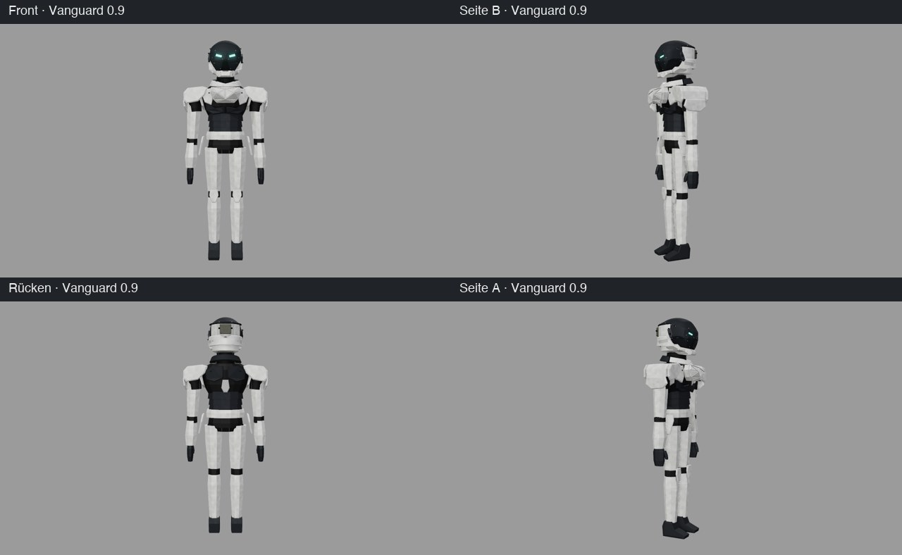
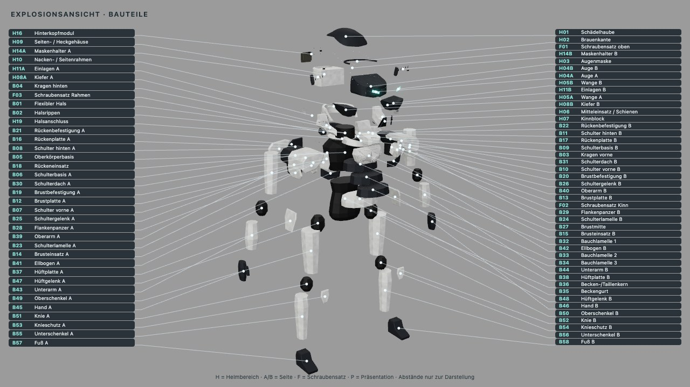

# Vanguard 0.9 – einfacher Gesamtkörper

Auftrag: „Baue einen einfachen Gesamtkörper mit Körper, Arme, Beine, Schultern, Hände, Füße.“ Zuvor hatte der Nutzer
für den Bereich zwischen Brust und Hüfte **dunkle Bauchlamellen und einen weißen Beckengurt mit Hüftplatten** gewählt.
Vanguard setzt beides als Blockform auf den unveränderten Bastion-Oberkörper. Keine Finger, kein Rig, keine
Gelenkmechanik, keine Aufnahmen oder Fertigungsmaße.

## Aufbau im Generator

Quelle ist der Three.js-Generator, kein Blender. `web/src/parts/fullBody.js` ruft `buildShoulderStudy` mit den
Bastion-Parametern auf und ergänzt 27 Teile; die Maße stehen in `web/src/fullBodyParams.json` (Weltkoordinaten des
montierten Helms, +Y oben, +Z vorn). Im Viewer: `?body=full`, in der GUI „Körper › Gesamtkörper“.

- **Lofts:** facettierte Röhren aus Ringen `[y, rx, rz, cx, cz]`, acht- bzw. zwölfeckig mit einer flachen Seite nach vorn.
  Gelenke sind facettierte Kapseln. Eine Hand besteht aus Handblock und Daumen als zwei geschlossenen Körpern in einem Teil.
- **Platten:** Hüftplatten, Knieschutz und Füße nutzen das gefaste `beveledPlate` der Schulterstudie (jetzt exportiert).
  Die Hüftplatten weiten sich nach unten (`flare`), die Füße sind ein seitliches Keilprofil mit Fase.
- **Paare:** Parameter gelten für Seite B (+X) und werden für Seite A (−X, Suffix `_R` wie in der Schulterstudie) gespiegelt.
- **Unverändert:** B01–B31 sind bytegleich zu `body=shoulders`; dieser Modus bleibt bytegleich zur 0.7-Lieferung
  (GLB und vier Renderbilder geprüft). Helm, Materialien und Texturen sind unverändert.

| Bereich | Teile | Material |
|---|---|---|
| Bauch | B32–B34 Bauchlamellen, gestaffelt; die schmale Oberkante liegt unter der Lamelle darüber | dunkle Panzerung |
| Becken | B35 Beckengurt, B36 Becken-/Taillenkern, B37/B38 Hüftplatten | weiß / dunkles Gummi / weiß |
| Arme | B39/B40 Oberarm, B41/B42 Ellbogen, B43/B44 Unterarm mit Stulpe, B45/B46 Hand | weiß / Gummi / weiß / dunkel |
| Beine | B47/B48 Hüftgelenk, B49/B50 Oberschenkel, B51/B52 Knie, B53/B54 Knieschutz, B55/B56 Unterschenkel, B57/B58 Fuß | Gummi / weiß / Gummi / weiß / weiß / dunkel |

Proportionen: Helmoberkante Y ≈ 0,40, Sohle Y = −4,85, also etwa 6,5 Helmhöhen. Die Arme hängen leicht nach außen,
die Fingerspitzen enden auf dem Oberschenkel über dem Knie. Schulterbreite 2,07 gegenüber etwa 1,1 an den Hüftplatten:
bewusst kräftiges V, passend zu den Schultergehäusen.

## Explosionsansicht

Neue Teile bewegen sich entlang ihrer Gliedkette (`explosion` in `web/src/fullBodyParams.json`, über die Teile-ID): Arme nach außen gestaffelt,
Beine nach unten, Bauchlamellen nach vorn. 80 Beschriftungen ohne Überlappung oder Anschnitt; alle Meshpunkte im Bild.

## Prüfung

Sechs neue Tests in `web/tools/fullBody.test.mjs`: alle 58 Kennungen und Namen, B01–B31 unverändert; geschlossene,
nach außen orientierte Körper; Arm- und Beinketten berühren sich lückenlos, sind exakt gespiegelt und stehen auf einer
Bodenebene; Hände über dem Knie und neben den Hüftplatten; gezielte Parameteränderung, Explosionswege und Beschriftung der Explosion, Halsentfernung. Gegenproben mit
verschobenem Unterarm bzw. zu tiefen Händen schlagen fehl, wie beabsichtigt.

## Eindruck und offene Punkte

Aus Sicht des Agenten ergibt sich eine stimmige, schlanke Hard-Surface-Figur: die massige Bastion-Brust bleibt der
Blickfang, Arme und Beine sind ruhige weiße Röhren mit dunklen Gelenken. Wirkt noch schematisch; offen sind
Muskel-/Panzergliederung an Ober- und Unterschenkeln, Finger, Rückenpanzer unterhalb der Schulterblätter, Gesäß- und
Schrittbereich sowie echte Gelenkgeometrie. Die nächste Formrunde sollte von der Rückmeldung des Nutzers ausgehen,
etwa über den Markierbogen (`docs/MARKER.md`; erkennt B32–B58 über dieselbe Teiletabelle).
