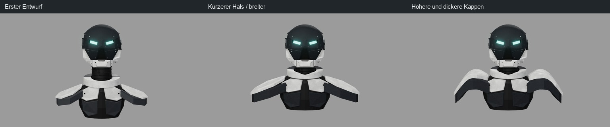

# Helm im Browser – alle Durchläufe

Jeder Durchlauf = Änderung am Generator, `npm run verify` (vier Ansichten, Umriss-IoU), Sichtvergleich mit dem Video.
Zwei Messungen: **A** = ganzes Bild inklusive Schal (Runde 1), **B** = nur oberhalb der Schalkante der Vorlage (ab Runde 2,
seit der Schal entfernt ist). Zwischenstände innerhalb einer Runde sind nicht einzeln committet; abrufbar sind die
Rundenenden (Commit in der letzten Spalte).

## Runde 1 – Erstaufbau (27.10.2026, Messung A)

| # | Änderung | front | left | back | right | Mittel | Ergebnis |
|---|---|---|---|---|---|---|---|
| 1 | Erstaufbau: Superellipsoid-Kuppel, Frontplatte aus Silhouetten, Kiefer, Ohrkappe, Funkmodul, Rippenschlauch, Schal | 0,937 | 0,898 | 0,914 | 0,882 | 0,908 | behalten |
| 2 | Frontplatte schmaler (weiße Kieferseiten sichtbar), Helm vorn länger, Bloom gedämpft, Schal glatter | 0,937 | 0,897 | 0,917 | 0,896 | **0,912** | behalten |
| 3 | Erhabene Frontplatte, Kinn weiter vor, Kamerawinkel links 64°/rechts 298° | 0,938 | 0,891 | 0,918 | 0,889 | 0,909 | behalten |
| 4 | Kuppel geneigt, Schal mit Längsfalten, Augen gedimmt | 0,938 | 0,887 | 0,919 | 0,886 | 0,907 | Neigung verworfen (verschob Visier/Mund – Ursache später: CSG-Fehler) |
| 5 | Neigung zurück | 0,938 | 0,885 | 0,916 | 0,885 | 0,906 | behalten |
| 6 | Kantigere Kuppel (Exponenten 0,55/0,45) | 0,930 | 0,875 | 0,911 | 0,878 | 0,899 | verworfen |
| 7 | Exponenten 0,65/0,55 | 0,939 | 0,887 | 0,918 | 0,887 | 0,908 | Stand Runde 1 (`eb8bb58`, Version 0.0.2) |

## Runde 2 – Profil, Facetten, ohne Schal (28.10.2026)

| # | Änderung | front | left | back | right | Mittel | Ergebnis |
|---|---|---|---|---|---|---|---|
| 8 | CSG-Fix (Transformation einbacken) + Kuppelmitte auf Ursprung, Messung A | 0,939 | 0,888 | 0,918 | 0,888 | 0,908 | behalten |
| 9 | Grundform als Schnitt dreier Profile + großer Superellipsoid, Messung A | 0,905 | 0,850 | 0,896 | 0,862 | 0,878 | verworfen („Kiste“) |
| 10 | Grundform als Loft aus drei Profilen; Schal und Büste entfernt; ab hier Messung B | 0,890 | 0,872 | 0,856 | 0,861 | 0,870 | Form behalten, rundum ~2–3 cm zu groß |
| – | Vergleichswert: Stand Runde 1 mit Messung B | 0,926 | 0,921 | 0,896 | 0,884 | 0,907 | Referenz |
| 11 | Profile oben eingezogen | 0,922 | 0,911 | 0,885 | 0,896 | 0,904 | behalten |
| 12 | Frontplatte reicht an der Wange zurück, Ohrkappe +30 %, Spiralkabel, graue Strukturflächen, Weiß grauer, Augen ruhiger | 0,923 | 0,910 | 0,881 | 0,898 | 0,903 | behalten |
| 13 | Kiefer vorn nur als Steg, größere Schläfenplatten | 0,923 | 0,910 | 0,881 | 0,898 | 0,903 | behalten |
| 14 | Rückplatte um die Heck-Box, Kragenkerben, dünnere Ohrkappe | 0,923 | 0,910 | 0,881 | 0,898 | 0,903 | behalten |
| 15 | Ebene Facetten der Frontplatte, Augen ohne Bloom | 0,923 | 0,910 | 0,881 | 0,898 | 0,903 | behalten |
| 16 | Material: Anthrazit statt Schwarz, Weiß mit Gebrauchsspuren | 0,923 | 0,910 | 0,881 | 0,898 | 0,903 | behalten |
| 17 | Strukturflächen grauer, Funkmuschel runder, Fugen an der Kuppelseite | 0,922 | 0,910 | 0,882 | 0,897 | 0,903 | Stand Runde 2 (`0c4008b`) |

## Runde 3 – Augenhöhlen, spitze Front, Fasen (28.10.2026, Messung B)

Rückmeldung: Augen saßen in Runde 1 schöner in ihren Kerben, die Details von Runde 2 gefallen; Front läuft im Video
spitzer zu; bessere Übergänge zwischen den Formen.

| # | Änderung | front | left | back | right | Mittel | Ergebnis |
|---|---|---|---|---|---|---|---|
| 18 | Augenhöhlen (Pyramidenstumpf), Fugen unter den Augen, Mundschlitz, sechseckige Schläfenplatten | 0,922 | 0,910 | 0,882 | 0,896 | 0,903 | teilweise: Nasengrat-Fugen falsch, Schläfenplatte zu groß, Leuchten zu weiß |
| 19 | Leuchten sattes Cyan, schmalere Fassung, Fugen und Schläfenplatte korrigiert | 0,922 | 0,909 | 0,882 | 0,896 | 0,902 | behalten |
| 20 | Front aus zwei Ebenen mit Mittelgrat, Fasen an allen Facettenkanten | 0,923 | 0,918 | 0,882 | 0,893 | **0,904** | behalten |
| 21 | Augenhöhle an der V-Front ausgerichtet und verlängert, Wangenmarkierungen, Schraubenreihen, Nieten | 0,923 | 0,917 | 0,882 | 0,893 | 0,904 | Stand Runde 3 (`966721d`) |

## Runde 4 – Formbeschreibung von GPT 6 Astra (28.10.2026, Messung B)

Vorlage: ausführliche Formbeschreibung in vier Stufen (Silhouette, Ausschnitte, Anbauten, Details) mit Richtmaßen.
Übernommen bis auf die Gesamttiefe (Beschreibung 78–84, im Video gemessen ~95) und den Kiel (Beschreibung: kein
Mittelgrat; die Front bleibt leicht V-förmig gewölbt). Ab hier gibt es je Durchlauf ein Vergleichsbild (Video links,
Render rechts, alle vier Ansichten) unter [`belege/helm/<Nr>.jpg`](belege/helm/); die vollständigen Belege
(`compare.png`, `iou.json`) liegen lokal unter `runs/helm/<Nr>/`.

| # | Änderung | front | left | back | right | Mittel | Ergebnis |
|---|---|---|---|---|---|---|---|
| 22 | Stufe 1: Seitenprofil nach Beschreibung (Braue vorn, Gesicht 15° zurück, Kinn springt vor), Front ohne Kiel, Kinnblock schmal | 0,925 | 0,893 | 0,881 | 0,854 | 0,888 | verworfen: weißer Kern sticht durch die Stirn |
| 23 | Kern vorn beschnitten | 0,925 | 0,890 | 0,881 | 0,851 | 0,887 | Kernschnitt behalten |
| 24 | Seitenfase ab x = 0,18, Augen in zwei Abschnitten um die Kante, Mund mit geneigtem Boden | 0,925 | 0,888 | 0,881 | 0,848 | 0,885 | verworfen: Augen zerfallen, Gesicht unten klotzig |
| 25 | Zurück auf das Gesicht von #21; Kinnblock hinter die Braue (0,475), schmale Kinnfront mit Schrägflächen | 0,923 | 0,917 | 0,882 | 0,893 | 0,904 | behalten |
| 26 | Stufe 2: Mundaussparung (schmal oben, breit unten) mit Seitenleisten und Querschlitz, Rücksprung-Fuge hinter der Maskenkante, Wangenschlitze, Kinn-Absenkung, Rahmen-Absenkung hinten mit Anschlussplatte, dreieckige Schläfenvertiefung mit Befestigungspunkt | 0,923 | 0,918 | 0,882 | 0,893 | 0,904 | behalten |
| 27 | Licht und Umgebung drehen mit der Kamera (Drehteller wie im Video) | 0,923 | 0,918 | 0,882 | 0,893 | 0,904 | behalten |
| 28 | Stufe 3: Seitenmodul B als kantiges Viereck, Heck-Box nach Maß mit Vieleck-Feld und zylindrischen Anschlüssen, Spiralkabel vom Box-Ausgang am Rahmen entlang zur Muschel, Stecker, Gelenk an den Maskenhalterungen | 0,919 | 0,910 | 0,878 | 0,892 | 0,900 | behalten, Heck-Box zu wuchtig |
| 29 | Heck-Box schlanker | 0,919 | 0,914 | 0,878 | 0,891 | 0,901 | Stand Runde 4 |

Bilder: [22](belege/helm/22.jpg) · [23](belege/helm/23.jpg) · [24](belege/helm/24.jpg) · [25](belege/helm/25.jpg) ·
[26](belege/helm/26.jpg) · [27](belege/helm/27.jpg) · [28](belege/helm/28.jpg) · [29](belege/helm/29.jpg)

## Bilder der Rundenenden

- Runde 1 → 2, Video | vorher | nachher: [bilder/helm_r2_vorher_nachher.jpg](bilder/helm_r2_vorher_nachher.jpg)
- Runde 3 (#21), Video | Render: [bilder/helm_r3_vergleich.jpg](bilder/helm_r3_vergleich.jpg)
- Runde 4 (#29), Video | Render: [bilder/helm_r4_vergleich.jpg](bilder/helm_r4_vergleich.jpg)
- Runde 4, Nahaufnahmen schräg vorn links, vorn rechts, hinten: [bilder/helm_r4_details.jpg](bilder/helm_r4_details.jpg)

Bilder der Durchläufe 1–21 gibt es nicht mehr (Renders wurden überschrieben); abrufbar sind die Rundenenden als
Commits (`eb8bb58`, `0c4008b`, `966721d`).

## Runde 5 – Nackenrahmen und echte Vertiefungen (28.10.2026, Messung B)

Basis: `claude/threejs-helm`, Commit `5af89bd`. Nutzerentscheidung: Materialien erhalten, Geometrie verbessern.
Vorherstand #29 in dieser Cloud reproduziert: front 0,9193 / left 0,9142 / back 0,8785 / right 0,8915, Mittel 0,9009.
Getrenntes Ausblenden bestätigte den vorderen Abschluss von `Collar` als Quelle des weißen Blocks unter dem Seitenmodul;
`Jaw` und `Core` waren nicht die Ursache. Hauptprofile, Augen, Kiefer und Materialien bleiben unverändert.

Durchlauf **30**: Nackenrahmen vorn schräg abgeschlossen; längliche Seitenfelder und kleinere Taschen tatsächlich aus
der Rahmenwand geschnitten, Böden und vertiefte Schlitze separat. Der erste Schnitt ließ koplanare Außenfragmente stehen;
ein über die Außenwand hinausreichender Schnittkörper beseitigt die Streifen. Strahltests prüfen Rand, Boden und Schlitz.
Die IoU sinkt leicht auf rund **0,898**. Das ist keine Verbesserung der Silhouette; behalten wird die lokale Verbesserung
von Übergang und Vertiefungen nach Nahvergleich. Kamera, Referenzmasken und Messausschnitt sind unverändert.

[Vergleich #30](belege/helm/30.jpg), vollständige Werte und Bilder in `runs/helm/30/`; tatsächlicher GLB-Export und Laufstatus
in `web/renders/verification.json`. Die [Teilekarte](HELM_TEILE.md) dient der nächsten gezielten Rückmeldung.

## Offen

Seitenfläche neben dem Auge weiterhin flach; weitere feine Flächendetails noch möglich; Weiß auf Weiß hinten kontrastarm.
Die Teilekarte erleichtert die Abstimmung dieser Bereiche. Keine vollständige Maßrekonstruktion oder Drucktauglichkeitsabnahme.

## Runde 6 – Gesamtform an die Referenz annähern (28.10.2026)

Nutzerauftrag: systematisch Haube, Gesichtsprofil und Kieferkontur vergleichen; Materialien und Kameras beibehalten.
Ausgangsstand ist #30. Vorab wurden sechs Profil-/Proportionskandidaten mit denselben vier Kameras verglichen
(`runs/helm/shape-fit/`, verkleinerte 320×180-Masken nur zur Vorauswahl). Eine stärkere Rundungsvariante wurde nach
nicht abgeschlossenem Aufbau abgebrochen; sie ist nicht als Qualitätsmessung gewertet. Gesichtsfaktoren 0,92 / 0,86 /
0,82 wurden gesichtet: 0,86 trifft den Kinnabschluss besser, ohne das Gesicht so stark zu stauchen wie 0,82.
Alle Werte unten stammen aus der vollständigen bisherigen 1280×720-Prüfung, nicht aus der Vorauswahl.

| # | Änderung / Entscheidung | front | left | back | right | Mittel |
|---|---|---|---|---|---|---|
| 30 | Ausgangsstand | 0,9155 | 0,9131 | 0,8736 | 0,8905 | 0,8982 |
| 31 | Rundere Frontprofile, unteres Gesicht 14 % kürzer, kleinere Sehschlitze; Kern gegen Haube begrenzt | 0,9216 | 0,9158 | 0,8886 | 0,8978 | 0,9060 |
| 32 | Runde Stirn ergänzt; wegen koplanarer Pixelartefakte verworfen | 0,922 | 0,915 | 0,891 | 0,897 | 0,906 |
| 33 | Haube und Gesichtsmaske vor Vereinigung räumlich partitioniert; Artefakte entfernt | 0,922 | 0,914 | 0,891 | 0,896 | 0,905 |
| 34 | Oberste Profilpunkte runder, Augenfassungen schmaler; hinten zu tiefe Haube | 0,9241 | 0,9173 | 0,8983 | 0,8988 | 0,9096 |
| 35 | Stirnkorrektur auf Front begrenzt, hintere Kante erhalten; **behalten** | **0,9241** | **0,9160** | **0,8963** | **0,8994** | **0,9090** |

[Referenz / vorher / nachher](bilder/helm_r5_vorher_nachher.jpg) · Belege:
[31](belege/helm/31.jpg), [32](belege/helm/32.jpg), [33](belege/helm/33.jpg), [34](belege/helm/34.jpg), [35](belege/helm/35.jpg).
Genaue Messwerte je Durchlauf unter `runs/helm/<Nr>/iou.json`.

Die kohärente Formanpassung in `web/src/shapeFit.js` verkürzt sämtliche unteren Bauteile einschließlich ihrer
Befestigungen ab Augenhöhe. Oberhalb bleibt die Geometrie unverändert; Materialien, Licht und Kameras bleiben erhalten.
`profile.front`, `shapeFit`, `browOutline` und `visor` sind die zentralen Parameter. Tests prüfen die konsistente Position
von Bauteilen und vormals instanzierten Befestigungen sowie endliche Normalen. GLB-Export enthält weiterhin alle neun Materialien.

Die Verbesserung beträgt 1,08 Prozentpunkte gegenüber #30 und betrifft alle vier Silhouetten. Sie beweist keine
vollständige Vorlagentreue: die Maske bleibt kantiger, die Seitenfläche neben dem Auge flach und einige Anbauten vereinfacht.
Kinn und Wangen liegen zum Teil unter dem IoU-Messausschnitt und wurden zusätzlich im direkten Bildvergleich beurteilt.

## Durchlauf 36 – Augenöffnungen H04

Auf Nutzerhinweis die türkisfarbenen Einsätze verbreitert und erhöht und im Schlitz nach vorn versetzt. Der direkte
Vergleich zeigt in der Frontansicht deutlich größere sichtbare Leuchtflächen; die Seitenansichten wurden ebenfalls geprüft.
Ein erster, stärkerer Versatz wurde wegen des seitlichen Überstands reduziert. Silhouetten-IoU bleibt bei 0,909;
dieser Wert misst nicht die Füllung der Augen. Die seitliche Augenfassung und die kantige Seitenmaske bleiben vereinfacht.
[Vergleich zur Referenz](belege/helm/36.jpg); aktueller Vorher-/Nachher-Ausschnitt lokal `web/renders/h04_vergleich.png`.

## Durchlauf 37 – H04 und bestätigte Referenz

Das nachgereichte Video ist bytegleich mit `reference/helm/turnaround.mp4` (SHA-256 `fac039db10d9d3ee3c74373c38e323dd53489df69eee18971e736c9d971e70de`). Die bestehenden vier Vergleichsbilder und Kameras bleiben daher gültig.
Der vorherige Ansatz versetzte Schlitz und Einsatz auf der globalen Z-Achse, obwohl beide gedreht sind; dies verschob die Passung insbesondere in Seitenansichten. Ausschnitte und Scheibe folgen nun derselben lokalen Tiefenachse. Die Scheibe ist 0,002 Einheiten kleiner als der Schlitz und sitzt hinter der äußeren Öffnung. Front und beide Seiten wurden verglichen; die stark kantige Seitenmaske und Perspektive der schrägen Öffnung bleiben Abweichungen. [Vergleich aller vier Ansichten](belege/helm/37.jpg). Silhouetten-IoU 0,909; sie misst keine Augenfüllung.

## Durchlauf 38 – Seitenmaske

Auf Nutzerwunsch die verbleibende kantige Seitenfläche visuell gegen die bestätigte Videoreferenz verglichen. Die seitlichen
Facetten der Gesichtsplatte flacher gestellt und die Fasenbreite von 0,004 auf 0,002 verkleinert; die Sehschlitze und ihre
Einsätze bleiben unverändert. Alle vier Ansichten und der GLB-Export wurden geprüft. Die Silhouetten-IoU bleibt gerundet
bei 0,909; sie misst den optischen Übergang der Flächen nicht. Die Änderung ist klein: Das Modell bleibt gegenüber der
Vorlage kantiger und die Wangen-/Kieferübergänge sind weiterhin vereinfacht. [Vier Ansichten](belege/helm/38.jpg),
direkter Vorher-/Nachher-Vergleich lokal unter `web/renders/vergleich_seitenmaske.png`.

## Runde 7 – visueller Formabgleich, Durchläufe 39–41

Ausgangspunkt #38, bestätigt vom Nutzer: H04 erhalten. Die Referenz zeigt einen längeren, nach hinten fallenden Gesichtszug;
das Modell verlief dort steiler. In #39 wurden die unteren Punkte von `profile.sideFront` schrittweise zurückgenommen.
In #40 folgen die Leisten des Mitteleinsatzes der tatsächlichen Tiefe der Oberfläche, statt auf einer konstanten Ebene zu
liegen. In #41 wurden die Ecken des Seitenmoduls B gerundet und seine auffällig dunkle diagonale Linie abgemildert.
Die Augenparameter und Materialien wurden nicht geändert. [Referenz, vorher, nachher](bilder/helm_r7_visueller_abgleich.jpg),
[Durchlauf 39](belege/helm/39.jpg), [40](belege/helm/40.jpg), [41](belege/helm/41.jpg).

| Ansicht | #38 | #41 |
|---|---:|---:|
| Front | 0,9239 | 0,9239 |
| Seite B (`left`) | 0,9180 | 0,9237 |
| Rückseite | 0,8963 | 0,8965 |
| Seite A (`right`) | 0,8995 | 0,8940 |
| Mittel | 0,9094 | 0,9095 |

Die Messung zeigt einen Zielkonflikt zwischen den beiden Seiten; sie bewertet nur den Außenumriss oberhalb der
Schalkante. Die abgerundete Kontur des Seitenmoduls und der angepasste Einsatz wurden zusätzlich visuell beurteilt.
Die Seitenmaske bleibt vereinfacht und flächiger als die Referenz; die modularen Wangen- und Kieferübergänge und die
Form des Seitenmoduls sind noch nicht vollständig nachgebildet. Dieser Stand beansprucht keine fertige visuelle Abnahme.

## Runde 8 – Ziel 95 % und Vorbereitung Mac (28.10.2026)

Ziel der Vorauswahl ist mittlere Silhouetten-IoU über die vier vorhandenen Ansichten, ohne Änderung der Kameras oder
Referenzmasken. Getestet wurden Profilbreite, Front- und Rücktiefe, obere Haubenbreite, Ohrposition, Untergesicht,
Gehäuse und Nackenrahmen. Schnelle Kandidatenwerte bei 320×180 Pixeln dienen ausschließlich der Vorauswahl und sind
nicht direkt mit den vollständigen 1280×720-Werten vergleichbar. Auffällige Knicke oder Verschlechterungen einzelner
Ansichten werden nicht allein für eine höhere mittlere Zahl übernommen.

Behalten: Nackenrahmen `collar.rx` und `collar.rz` jeweils um 0,025 vergrößert. Vollständiger Lauf #42:
front 0,9268, left 0,9289, back 0,9033, right 0,8980, Mittel **0,9143**. Ausgang #41: 0,9239 / 0,9237 /
0,8965 / 0,8940, Mittel **0,9095**. Alle vier Ansichten verbessert; 0,95 ist noch nicht erreicht.
[Referenz und Vorher/Nachher](bilder/helm_95_vergleich.jpg), [Durchlauf 42](belege/helm/42.jpg).
Das Maß vergleicht nur die Außenkontur oberhalb des Schals und ist kein Prozentwert für die Gesamtähnlichkeit.

Für die Fortsetzung: Referenzmasken und die aus Video abgeleiteten Kamerawinkel kritisch gegen die Bilder prüfen,
dann rückwärtige und seitliche Silhouette, Ohrmodule und Kabel gezielt angleichen. Kamerakalibrierung einmal transparent
festlegen und Ausgangs- und Folgestände gleich messen. Zusätzlich Bildvergleich und Prüfung der akzeptierten Augen und
Wangen-/Kieferformen durchführen. Varianten mit Messwerten und visueller Entscheidung dokumentieren; kein 95-%-Ziel
allein durch veränderte Bildausrichtung oder ungleiche Messregeln behaupten.

## Runde 9 – Fidelity, Durchläufe 43–46 (28.10.2026)

Auftrag: Haube/Seitenmaske, Heck/Funkseite, Wangen/Kiefer und Oberflächendetails anhand der vier Videoansichten
verbessern; akzeptierte Augen erhalten. Das Video bleibt maßgeblich, die nachgereichte Meshy-Datei nur Zusatzreferenz.

| # | Änderung | front | left | back | right | Mittel |
|---|---|---:|---:|---:|---:|---:|
| 42 | Ausgang | 0,9268 | 0,9289 | 0,9033 | 0,8980 | 0,9143 |
| 43 | Durchgehende Seitenmaske, getrennte Haube | 0,9282 | 0,9283 | 0,9044 | 0,8974 | 0,9146 |
| 44 | Kleineres/flacheres Heckmodul und enger geführtes Kabel | 0,9252 | 0,9397 | 0,9049 | 0,8884 | 0,9145 |
| 45 | Getrennte Wangen/Kiefer, Fugen und Einlagen | 0,9252 | 0,9397 | 0,9049 | 0,8877 | 0,9144 |
| 46 | Haubenquerschnitt moderat gerundet, Wangenverjüngung, Details und angepasster Mitteleinsatz | 0,9214 | 0,9429 | 0,9068 | 0,8898 | 0,9152 |

Eine zu weit ausladende erste Kabelvariante und ein zu stark gerundeter Haubenquerschnitt wurden verworfen.
Die akzeptierten Augen stimmen in Position, Größe und Drehung innerhalb 0,000001 Einheiten mit #42 überein;
Strahltests prüfen zusätzlich, dass ihre Öffnungen frei bleiben. Die Kamera-/Maskenkalibrierung ist unverändert.
Silhouettengewinne sind klein und nicht in allen Ansichten vorhanden. [Versionsbericht](versions/0.2.md) und
[Vergleich Video / vorher / nachher](bilder/helm_fidelity_vergleich.jpg). Belege: [43](belege/helm/43.jpg),
[44](belege/helm/44.jpg), [45](belege/helm/45.jpg), [46](belege/helm/46.jpg).

## Runde 10 – Sidework, Durchläufe 47–50 (28.10.2026)

Auftrag: Kiefer/Seitenschalen sowie Funkmodul/Kabel. Haube und Augen festhalten; Video maßgeblich, Texturen und Einzelteile reproduzierbar.

| # | Änderung | front | left | back | right | Mittel |
|---|---|---:|---:|---:|---:|---:|
| 47 | Seitenschalen, Einlagen, Funkdeckel und Kabel | 0,9149 | 0,9429 | 0,8911 | 0,8869 | 0,9090 |
| 48 | Seitenschalen zurückgesetzt, Kabelkontur und größere Einlagen | 0,9176 | 0,9429 | 0,8959 | 0,8951 | 0,9129 |
| 49 | Einfassungen, Texturskalierung und gerundete Knöpfe | 0,9180 | 0,9429 | 0,8966 | 0,8922 | 0,9124 |
| 50 | Separate Funkbuchse und Textur-PNG-Ausgabe | 0,9181 | 0,9429 | 0,8966 | 0,8922 | 0,9124 |

Die erste Variante ragte unter der Maskenhalterung vor und verbreiterte den Kabelbogen; beide Stellen wurden zurückgenommen.
Endstand #50 verbessert die Detailgliederung, senkt aber das IoU-Mittel gegenüber #46 von 0,9152 auf 0,9124.
[Bericht](versions/0.3.md), [Vergleich](bilder/helm_sidework_vergleich.jpg).

## Runde 11 – Variantenprüfung und Nutzerauswahl, Durchläufe 51–59 (28.10.2026)

Die Versuche änderten Kieferplatten, Halsring, Seiteneinlagen und Funkanordnung. Nach dem Vier-Ansichten-Vergleich
bevorzugte der Nutzer die mittlere Variante. Diese wurde zunächst irrtümlich als #50 eingeordnet. Lauf #59 stellt #50 wieder her und
behält ausschließlich die konstruktive Bügelkorrektur: Träger und beide Drahtbügel treffen die tatsächlichen Flächen.

| # | Änderung | front | left | back | right | Mittel |
|---|---|---:|---:|---:|---:|---:|
| [51](belege/helm/51.jpg) | Dünne Kieferplatten mit echten Vertiefungen | 0,9121 | 0,9429 | 0,8966 | 0,8922 | 0,9109 |
| [52](belege/helm/52.jpg) | Geöffneter Halsring und Einlagen | 0,9146 | 0,9429 | 0,9041 | 0,8907 | 0,9131 |
| [53](belege/helm/53.jpg) | Weitere Kiefer-/Rahmenabstimmung | 0,9079 | 0,9416 | 0,9016 | 0,8903 | 0,9103 |
| [54](belege/helm/54.jpg) | Funk-/Halterungsanordnung | 0,9094 | 0,9424 | 0,9046 | 0,8904 | 0,9117 |
| [55](belege/helm/55.jpg) | Kinnmuldenboden | 0,9133 | 0,9424 | 0,9046 | 0,8904 | 0,9127 |
| [56](belege/helm/56.jpg) | Flachere Gelenkbolzen | 0,9131 | 0,9424 | 0,9046 | 0,8904 | 0,9126 |
| [57](belege/helm/57.jpg) | Geometrisch verbundener Funkträger | 0,9138 | 0,9424 | 0,9034 | 0,8904 | 0,9125 |
| [58](belege/helm/58.jpg) | Funkmuschel zurück zum Bügel | 0,9090 | 0,9425 | 0,9126 | 0,8899 | 0,9135 |
| [59](belege/helm/59.jpg) | Fehlzuordnung zu #50; Bügelkorrektur beibehalten | 0,9189 | 0,9429 | 0,8941 | 0,8919 | 0,9120 |

96 der 99 Meshes in #59 stimmen inklusive Transformationen exakt mit #50 überein. Abweichend sind nur `Yoke`,
`Radio_Bail_Rear` und `Radio_Bail_Front`; Haube/Augen bleiben unverändert. 30 Tests und zwei bytegleiche unabhängige
Browserläufe bestehen. Das IoU-Mittel bleibt mit 0,9120 gegenüber 0,9124 nahezu gleich; keine höhere Gesamtähnlichkeit behauptet.
[Inzwischen verworfener Stand #59](bilder/helm_sidework_auswahl.jpg), [nicht ausgewählte Variante #58](bilder/helm_sidework_fortsetzung.jpg),
[Bericht](versions/0.3.md).

## Runde 12 – Tatsächliche mittlere Variante wiederhergestellt (28.10.2026)

Das erneut angehängte Nutzerbild entspricht `helm_sidework_vergleich.jpg`: **Video / Stand 46 / Stand 50**.
Die Zuordnung der mittleren Spalte zu #50 war ein Fehler; #59 ist nicht freigegeben. In Prüflauf #60 sind sämtliche
16 Modellquelldateien exakt auf #46 zurückgesetzt, einschließlich Kiefer, Funkmuschel, Bügel und Kabel.
Keine spätere Geometrieänderung wurde beibehalten.

| Lauf | Modellstand | front | left | back | right | Mittel |
|---|---|---:|---:|---:|---:|---:|
| [60](belege/helm/60.jpg) | Vollständige Wiederherstellung #46 | 0,9214 | 0,9429 | 0,9068 | 0,8898 | 0,9152 |

Alle 13 historischen Ausgaben sind bytegleich: vier gerenderte Ansichten, vier Masken, vier Overlays und das vollständige
GLB mit 89 Meshes. 23 Tests bestehen; Textur-PNGs werden weiterhin zusätzlich ausgegeben.
[Original und Wiederherstellung, eindeutig beschriftet](bilder/helm_stand46_wiederhergestellt.jpg), [Bericht](versions/0.3.md).

## Runde 13 – Etwas kantigere Formprobe 61 (28.10.2026)

Auf Wunsch des Nutzers wird der bestätigte Stand #46 moderat kantiger gestaltet. Der helle Seiten-/Heckrahmen erhält
16 ebene Mantelflächen, eine schmalere obere Fase und gerade abgeschrägte Taschen. Haube, Augen, Kieferform,
Funkmuschel, Kabel und Halsring bleiben geometrisch unverändert. 77/89 Meshes und alle Texturkarten sind unverändert.

| Lauf | front | left | back | right | Mittel |
|---|---:|---:|---:|---:|---:|
| [61](belege/helm/61.jpg) | 0,9199 | 0,9418 | 0,9053 | 0,8887 | 0,9139 |

Formprobe, noch keine bestätigte Ablösung der Basis #46. Der Silhouettenwert sinkt leicht; keine höhere Gesamtähnlichkeit behauptet.
23 Tests, Build und Projektprüfung bestehen. [Video / Basis 46 / Variante 61](bilder/helm_kantiger_46_61.jpg), [Bericht](versions/0.3.md).

## Runde 14 – Haubenversuche und finale Auswahl 64 (28.10.2026)

Der Nutzer wünschte zunächst auch eine kantigere Kopfoberseite. #62 flachte den Scheitel ab, #63 verbreiterte die
Schrägflächen und passte den Kopfbügel an. Nach der Bildprüfung bevorzugte der Nutzer ausdrücklich die runde Haube:
die markierte Fläche wirkte merkwürdig. Beide Versuche sind verworfen.

| Lauf | Entscheidung | front | left | back | right | Mittel |
|---|---|---:|---:|---:|---:|---:|
| [62](belege/helm/62.jpg) | Erste abgeflachte Haube, verworfen | 0,9193 | 0,9441 | 0,9104 | 0,8916 | 0,9163 |
| [63](belege/helm/63.jpg) | Breitere Schrägflächen, vom Nutzer verworfen | 0,9160 | 0,9458 | 0,9120 | 0,8926 | 0,9166 |
| [64](belege/helm/64.jpg) | Runde Haube, Rahmen aus 61; damaliger Lieferstand | 0,9199 | 0,9418 | 0,9053 | 0,8887 | 0,9139 |

Alle 21 gesicherten Ausgaben von #64 sind bytegleich mit #61; einschließlich der nach der Codeprüfung ergänzten Hashes für IoU und Vergleichsbild. Der etwas höhere Silhouettenwert der kantigen Versuche ist kein Grund,
die ausdrückliche Formauswahl zu übergehen. [Aktuelles Bild](bilder/helm_aktuell.jpg),
[Nutzerfeedback zur verworfenen Haube](bilder/helm_haube_verworfen.jpg), [Stilbeschreibung](HELM_STIL.md).
Der Nutzer hat anschließend das Hochladen des Gesamtstands einschließlich Dokumentation autorisiert.

## Runde 15 – Gewölbter Scheitel und Stirnübergang 68 (28.10.2026)

Der Nutzer empfand auch #64 am Kopfbügel als zu flach. #65 rundete den Querschnitt, beeinflusste aber die Maske
und wurde verworfen. #66 trennt Hauben- und Gesichtsvolumen und rundet den Scheitel quer und längs.
Anschließend wünschte der Nutzer einen weichen Übergang zur Augenmaske: #67 entfernte den Absatz, zeigte aber eine
unruhige Fuge. #68 trennt die Normalen von Außenfläche und Unterseite und lässt eine feine Teilefuge.

- [65](belege/helm/65.jpg): Verworfen: Maskenartefakt.
- [66](belege/helm/66.jpg): Gewölbter Scheitel; noch harter Stirnabsatz.
- [67](belege/helm/67.jpg): Zwischenstand: unruhige Fuge.
- [68](belege/helm/68.jpg): Aktueller Stand: Wölbung und weicher Stirnübergang.

Stand 68: Front 0.9096, Seite B 0.9463, Rücken 0.9123, Seite A 0.8968, Mittel 0.9163.
83/89 Meshes sind inklusive Transformationen unverändert gegenüber #64. Haube, ihre Schrauben, Kopfbügel, Mittelstreifen
und zwei Clips folgen der neuen Oberfläche. Augen, Augenmaske, Kiefer, Funkmuschel und Kabel bleiben erhalten.
31 Tests und Build bestehen; keine Freigabe durch den Nutzer vorweggenommen.
[Gesamtvergleich 64/68](bilder/helm_uebergang_64_68.jpg) · [Stirnübergang 66/68](bilder/helm_uebergang_66_68.jpg).

## Runde 16 – Haubenmaterial an die Maske angeglichen 69 (28.10.2026)

Auf Nutzerwunsch bleiben Graphitfarbe und Körnung von Haube und Maske identisch. Schon #68 verwendete dieselben
Karten; breite Reflexe ließen die Rundung heller/glatter erscheinen. #69 leitet das Haubenmaterial von der Maske ab und
dämpft seine Glanzantwort. Grundfarbe, Bump-/Rauheitsbilder und Texturmaßstab sind identisch; Maskenmaterial bleibt unverändert.
Alle 89 Meshgeometrien, UVs und Transformationen sowie die vier Silhouettenmasken sind bytegleich mit #68.
31 Tests, Build und Projektprüfung bestehen. Neun Materialien; sieben PNGs mit fünf unterschiedlichen Texturbildern.
[Stand 69 gegen Video](belege/helm/69.jpg) · [Video / Stand 68 / Stand 69](bilder/helm_material_68_69.jpg).

## Runde 17 – Sichtbarere Haubenstruktur 71 (28.10.2026)

Der Nutzer wünscht mehr Struktur auf der Haube. Die Umsetzung beginnt mit feiner Lackkörnung; zusätzliche Fugen/Flächen
sind nicht Teil dieses Stands. #70 wirkte zu grob und lederartig und wurde bei der Sichtprüfung verworfen. #71 reduziert
das Relief deutlich und nutzt Farb-, Normalen- und Rauheitskarten mit Seed 73. Die Graphitgrundfarbe bleibt erhalten.
Alle 89 Geometrien, UVs und Transformationen sowie vier Silhouettenmasken sind bytegleich mit #69. Nur das Haubenmaterial
ist verändert. Die Normalenkarte ist im regulären glTF-Materialkanal enthalten; ihre Vektoren wurden numerisch geprüft.
31 Tests, Build und Projektprüfung bestehen. [Probe 70](belege/helm/70.jpg) · [Stand 71](belege/helm/71.jpg) ·
[Video / Stand 69 / Stand 71](bilder/helm_struktur_69_71.jpg).

## Runde 18 – Fugenlinie möglichst verbergen 73 (28.10.2026)

Der Nutzer wünscht einen möglichst unsichtbaren Anschluss zwischen Haube und Maske. #72 ersetzt den Abstand durch
eine minimale Überlappung, lässt aber helle Restkanten. #73 ergänzt eine kleine Randabdeckung. Die helle Linie ist
an der Stirn weitgehend verschwunden und an den Seiten reduziert; der Materialübergang bleibt je nach Licht erkennbar.
Haube und Maske bleiben getrennte Meshes. 87/89 Geometrien sind einschließlich Transformationen unverändert gegenüber #71;
nur Haube und ihre Schrauben sind angepasst. Alle Materialien und Texturbilder bleiben unverändert.
Der frühere Test auf eine offene Teilefuge ist entsprechend dem geänderten Nutzerwunsch durch 33 Proben auf einen
geschlossenen Anschluss ersetzt. Eine Negativkontrolle mit der alten offenen Fuge schlägt gezielt fehl.
31 Tests, Build und Projektprüfung bestehen. [Zwischenstand 72](belege/helm/72.jpg) · [Stand 73](belege/helm/73.jpg) ·
[Vergleich 71/73](bilder/helm_fuge_71_73.jpg) · [Nahvergleich](bilder/helm_fuge_71_73_detail.jpg).

## Runde 19 – Hinterkopf wieder runder 74 (28.10.2026)

Auf Wunsch nach einem runderen Hinterkopf ist das helle Gehäuse H09 und der Nackenrahmen H10 wieder glatt
elliptisch. 96 Segmente ersetzen die 16 breiten Mantelfacetten; obere Fase und kantige Taschenumrisse bleiben.
Separate Taschenböden und Befestigungen folgen der neuen Oberfläche. Haube, verdeckte Stirnfuge, Augen,
Kieferplatten, Funkmodul und Kabel sind geometrisch unverändert. 77/89 Meshes inklusive UVs/Transformationen sowie
alle Materialien und Texturbilder sind unverändert gegenüber 73.

32 Tests, Build, Projektprüfung und vier feste Ansichten bestehen. Zwölf Strahlproben prüfen die Rundung;
die alte 16-Flächen-Geometrie schlägt als Negativkontrolle fehl. Mittlere Silhouetten-IoU: 91,76 %.
[Stand 74](belege/helm/74.jpg) · [Vier-Ansichten-Vergleich 73/74](bilder/helm_hinterkopf_73_74.jpg) ·
[Heckvergleich](bilder/helm_hinterkopf_73_74_detail.jpg). Noch nicht vom Nutzer abgenommen.

## Runde 20 – zwei Stirnblenden nach Nutzerzeichnung 76 (28.10.2026)

Die Nutzerzeichnung ergänzt zwei oben schmalere Trapezblenden oberhalb der Augen. #75 sitzt noch zu hoch;
#76 führt die Blenden näher an die Maske. H20/H21 folgen der tatsächlichen Rundung, liegen flach auf und lassen
den Mittelstreifen frei. Das Material stammt unverändert von der Augenmaske. Die Blenden sind zwei zusätzliche
Meshobjekte; alle bisherigen 89 Geometrien/UVs/Transformationen und alle Materialien/Texturbilder sind unverändert.
Die Ergänzung ist eine Nutzerentscheidung zur Videovorlage, keine Behauptung höherer Vorlagentreue.

32 Tests und Build bestehen. 18 Auflageproben und drei Mittelstreifenproben sichern den Sitz; eine absichtlich
schwebende Blende fällt gezielt durch. Alle vier Ansichten sind geprüft; mittlere Silhouetten-IoU 91,80 %.
Die Teilekarte enthält H01–H21 und passt weiterhin auf ein Blatt A3 quer.
[Nutzerzeichnung](../reference/helm-forehead-request-20261028/stirnblenden-markierung.jpg) ·
[Erster Versuch 75](belege/helm/75.jpg) · [Stand 76](belege/helm/76.jpg) ·
[Vergleich 74/76](bilder/helm_stirnblenden_74_76.jpg). Noch nicht vom Nutzer abgenommen.

## Runde 21 – Stirnblenden mit der Augenmaske verbinden 78 (28.10.2026)

Der Nutzer möchte die Trapeze als Fortsetzung der metallischen Augenmaske. #77 verlängert sie bis zum Brauenrand,
zeigt dort aber noch freiliegende Haubenstreifen und Schattierungsbänder. #78 überdeckt diesen Anschluss und
transformiert die bestehenden glatten Normalen mit der Verformung. Die Blendenhöhe läuft zur Maske flacher aus.
H20/H21 bleiben separate Meshes; nur diese beiden sind gegenüber 76 geändert. Die übrigen 89 Geometrien, UVs,
Transformationen sowie alle Materialien und Texturbilder bleiben erhalten.

32 Tests und Build bestehen. Zwölf zusätzliche Strahlen prüfen die sichtbare Verbindung mit der Maske;
der vorherige getrennte Umriss lässt diese Prüfung gezielt fehlschlagen. Vier Ansichten und die Teilekarte
sind aktualisiert. Mittlere Silhouetten-IoU bleibt 91,80 %.
[Anschlussprobe 77](belege/helm/77.jpg) · [Stand 78](belege/helm/78.jpg) ·
[Vergleich 76/78](bilder/helm_stirnanschluss_76_78.jpg) · [Front](bilder/helm_stirnanschluss_front.jpg).

## Runde 22 – Kopfhörer und Kabel symmetrisch spiegeln 79 (28.10.2026)

Auf Nutzerwunsch ist die komplette Funkmuschel der Front-links-Seite A nach B gespiegelt: Gehäuse, Polster,
Bedienknöpfe, Antenne, Halter und Spiralkabel. Das mittige Heckmodul bleibt einmal vorhanden; beide Kabel nutzen
dessen vorhandene seitliche Anschlüsse. Das alte helle Ohrmodul auf B samt Halter ist im symmetrischen Modus
ausgeblendet. `comms.symmetric=false` erhält den reproduzierbaren früheren asymmetrischen Aufbau.

18 neue Spiegelmeshes ersetzen fünf alte Meshes; 86 bisherige Geometrien/UVs/Transformationen sowie alle Materialien
und Texturbilder sind unverändert. Insgesamt 104 Meshes. Spiegelung und Dreiecksorientierung werden in der Geometrie
gesichert, der Export verwendet positive Skalierungen. 33 Tests und Build bestehen. Der zusätzliche Test prüft alle
18 Paare punktweise, die Flächenorientierung und das einmalige Heckmodul. Invertierte Flächen werden als Negativkontrolle erkannt.

Vier Ansichten geprüft. Mittlere Silhouetten-IoU 90,78 %; der Rückgang gegenüber 78 ist durch die ausdrücklich gewünschte
Symmetrie erklärbar, während die Videovorlage asymmetrisch bleibt. Kein Anspruch höherer Vorlagentreue durch diese Designänderung.
[Stand 79](belege/helm/79.jpg) · [Vergleich 78/79](bilder/helm_symmetrie_78_79.jpg) ·
[Front](bilder/helm_symmetrie_front.jpg) · [Seite B](bilder/helm_symmetrie_seite_b.jpg) · [Heck](bilder/helm_symmetrie_heck.jpg).

## Befund nach Stand 79 – seitlicher Übergang der Augenmaske (28.10.2026)

Die Nutzerbilder markieren dunkle Streifen links und rechts neben den Augen: Die Maske wirkt dort unterbrochen,
während dieselbe Fläche seitlich einen breiten metallischen Reflex zeigt. Die Geometrieprüfung des Liefer-GLB
bestätigt für diese Bereiche ein gemeinsames Mesh `Shell` mit einem Material `darkArmor`.
Ein waagerechter Strahlquerschnitt bei Y = −0,025 über −80° bis +80° trifft in allen 1601 Proben die Maskenfläche.
Das ist ein gezielter Befund an der fraglichen Zone, keine allgemeine Prüfung auf Wasserdichtigkeit.

Der Übergang zwischen Augenfläche und Seitenfase ändert die Flächennormale deutlich (etwa 12° zu 44° gegen die
Frontachse, mit schmaler Zwischenfase). Zusammen mit Licht und Reflexion erzeugt dies die scheinbare Unterbrechung.
Die Erklärung „nur Licht“ greift deshalb zu kurz; die kantige Geometrie verursacht den starken Helligkeitswechsel.
Quellen: [Maskenaufbau](../web/src/parts/upperHelmet.js), [Facettenparameter](../web/src/helmetParams.json),
[Material](../web/src/materials.js) und [ansichtsabhängige Beleuchtung](../web/src/main.js).

Vorgeschlagener Folgeschritt: breiterer, sanfter gerundeter Übergang neben den Augen, bei erhaltener Augenform und
runder Haube. Vor Übernahme aus allen vier festen Ansichten prüfen. Diese Anpassung ist **noch nicht umgesetzt**;
Lieferstand, Renderbilder und Messwerte bleiben bei 79. Der Befund und das Ziel sind in der [Stilbeschreibung](HELM_STIL.md) festgehalten.

## Runde 23 – Durchgängige Form und Material-/Akzentproben 80–84 (28.10.2026)

Der Nutzer beauftragt die breitere Rundung neben den Augen und die Verlängerung der beiden Stirntrapeze bis zum
Hinterkopf. Zusätzlich sollen die dunkle Haubenstruktur und ein metallischer Look verglichen werden. Im laufenden
Vergleich ergänzt der Nutzer helle Befestigungspunkte auf dunklem Grund sowie weiße Streifen für beide Materialien.

| Stand | Variante | Zweck |
|---|---|---|
| [80](belege/helm/80.jpg) | Neue Form, Originalmaterial | Formvergleich mit 79 |
| [81](belege/helm/81.jpg) | Metall, helle obere Schrauben | Metallische Materialrichtung |
| [82](belege/helm/82.jpg) | Graphit, helle obere Schrauben | Geschlossene dunkle Materialrichtung |
| [83](belege/helm/83.jpg) | Graphit, helle Schrauben, weiße Streifen | Helle Akzentprobe |
| [84](belege/helm/84.jpg) | Metall, helle Schrauben, weiße Streifen | Vervollständigung des Material-/Akzentvergleichs |

Die Stirnstreifen bleiben echte separate Bauteile. Ihre radiale Form folgt der Haube über den Scheitel nach hinten;
der bestehende Bügel liegt darüber. Die seitlichen Maskenknicke erhalten tangentiale Rundungen mit Radius .055.
Die erste Metalltextur war zu fleckig und wurde vor den nummerierten Materialproben geglättet.

44 Tests, Build und unabhängige Prüfung bestehen. Alle Varianten haben dieselben 104 Meshes, Kameras und Silhouetten;
mittlere IoU 90,89 %. Gegenüber 79 bleiben 97 Meshes bytegleich; die sehr kleinen numerischen Augenabweichungen sind
im [Prüfbericht](versions/0.4.md) quantifiziert. Keine Materialwahl wird aus dem positiven Nutzerfeedback abgeleitet.
[Materialauswahl, später um 85/86 ergänzt](bilder/helm_continuity_varianten.jpg) · [Alle Ansichten](bilder/helm_continuity_vier_ansichten.jpg) ·
[Formvergleich](bilder/helm_continuity_form.jpg) · [Agentenübergabe mit visueller Einschätzung](HELM_AGENTEN.md).

### Ergänzung 85/86 – dunkle Streifen besser lesbar

Die schwarzen Stirnblenden gefallen dem Nutzer auf Metall, verschwinden ihm aber auf Graphit zu stark. Auf Wunsch
wird das Kontrastverfahren bei beiden Finishes ausprobiert: [85](belege/helm/85.jpg) setzt glattere, hellere
Anthrazitstreifen auf raues Graphit; [86](belege/helm/86.jpg) setzt mattere Anthrazitstreifen auf glänzendes Metall.
Die Ausgangsvarianten bleiben erhalten. Nur Materialien ändern sich; 104 Meshes, Transformationen und Silhouetten
stimmen mit 80–84 überein. Zehn gezielte Tests und die unabhängige Nachprüfung bestehen.
[Metallvergleich](bilder/helm_continuity_metall_auswahl.jpg) · [Graphitvergleich](bilder/helm_continuity_graphit_auswahl.jpg).

### Ergänzung 87–91 – ohne Blenden und alternative Haubenmuster

Der Nutzer möchte die Kopfoberseite ohne Stirnblenden sehen und statt der Bänder andere Muster „just for fun“
ausprobieren. `strips=off` lässt ausschließlich H20/H21 weg; die bereits darunter vorhandene Haube bleibt unverändert.
Die Materialproben [87 Metall](belege/helm/87.jpg) und [88 Graphit](belege/helm/88.jpg) zeigen diese ruhigere Form mit
hellen oberen Schrauben. Die 102 verbleibenden Grundmeshes sind identisch zu 80–86.

[89 Winkel](belege/helm/89.jpg), [90 Hexagon](belege/helm/90.jpg) und [91 Technik](belege/helm/91.jpg) verwenden Graphit
ohne Blenden und ergänzen ausschließlich `CrownMarking`: einen separaten Träger für deterministische weiße PNG-Bemalung.
Die drei Trägergeometrien sind identisch; nur ihre Motive unterscheiden sich. GLB-Alpha-Masken und PNGs sind exportiert.
Die Markierungen belegen den vorderen/oberen Scheitel, nicht das Heck. Die Technikmarkierungen sind bewusst asymmetrisch.

Nach Sichtprüfung wirkt die blendenlose Form ruhiger, das Winkelmotiv klar und leicht, das Hexagonraster feiner und
auf Distanz unruhiger; die Technikmarkierungen erinnern an auflackierte Kennzeichnungen. Dies sind Einschätzungen des
Agenten, keine Nutzerentscheidung. Alle bisherigen Blenden- und Materialproben bleiben verfügbar.

50 Tests und Build bestehen. Unabhängige Nachprüfung: Freigabe; der ergänzend verlangte Browsercheck bestätigt
Reset-/Rebuild-Verhalten und Wiederherstellung der Mustersichtbarkeit nach dem Maskenrender. Vier Ansichten pro Probe
geprüft. Die fünf Silhouettensätze sind bytegleich, mittlere IoU 90,73 %; dies bewertet keine Mustergestaltung.
[Mustervergleich](bilder/helm_continuity_muster_vier_ansichten.jpg) ·
[Ohne Blenden](bilder/helm_continuity_ohne_blenden.jpg) · [Aufbau und Reproduktion](HELM_AGENTEN.md).

### Nutzerentscheidung nach 91 – Muster vollständig verworfen

Der Nutzer verwirft alle drei Muster ausdrücklich komplett. Winkel, Hexagon und Technik sind daher aus Generator,
Viewer, Runner und aktiven Exporten entfernt; fünf ausschließlich zugehörige, vorher bestandene Tests entfallen.
45 verbleibende Tests und Build bestehen. Die Musterbilder oben sind ausschließlich historische Belege verworfener Versuche.
Ihr vollständiger Aufbau und ihre Exporte bleiben im [Git-Stand vor Rücknahme](https://github.com/ffunkfabian-hash/cubeescape-critic/blob/caf7a79dc46269b9f02801587b909d5c947f73d8/assets/helmet-continuity/README.md).
Die Varianten 80–88 einschließlich Metall/Graphit ohne Blenden bleiben unverändert verfügbar. Keine neue Geometrie-
oder Materialauswahl wird daraus abgeleitet; Video, Augen und Einzelteilaufbau behalten ihre bisherigen Vorgaben.

## Assembly 0.5 – Aufbau und Oberkörper (28.10.2026)

Quelle `6090262`: Der Nutzer wünscht eine beschriftete Explosionsansicht, einen Blick ohne Kopfhörer/Kopfbügel
und den Beginn eines passenden Oberkörpers. Die Helmform bleibt erhalten. 104 Meshes werden auseinandergezogen,
34 Gruppen im Bild benannt und alle Einzelmeshes in `assembly.json` aufgeführt. Der Headsetschalter entfernt
40 zugehörige Meshes einschließlich Kabeln und Antennen; Heckmodul und Maskenhalter bleiben stehen.

Der Oberkörper ergänzt 22 eigene Teile. Erste Rückmeldung: Hals zu lang, Schultern zu schmal und zu wenig stämmig.
Daraufhin Hals 0,49 → 0,31 und Breite 1,97 → 2,3198. Zweite Rückmeldung: mehr Schultermasse nach oben.
Zusätzlicher Bogen 0,23, weiße Dicke 0,10 und kräftigere dunkle Unterlage heben die obere Kontur um etwa 0,15.
Helm und Halsposition bleiben bei dieser zweiten Korrektur unverändert.

Der Hinweis des Nutzers auf `cubeescape-reference` führt zur noch uncommitteten Titan-Auswertung im Worktree
`titan-style`. Sie stützt geschichtete gerundete Schutzschalen und dunkle Zwischenlagen, liefert aber keine
verbindlichen Körpermaße. Quellenhashes und gelesene Abschnitte stehen im [Aufbaudokument](HELM_AUFBAU.md).
Die erhöhte Schulterform war beim Quellenfund bereits umgesetzt. Die endgültige Formbewertung durch den Nutzer ist offen.

[Vier Körperansichten](bilder/helm_assembly_schultern.jpg) · [Explosionsbild](bilder/helm_assembly_explosion.jpg) ·
[Headsetvergleich](bilder/helm_assembly_headset.jpg) · [GLB/Texturen/Prüfbelege](../assets/helmet-assembly/README.md).

### Patch 0.5.1 – mehr Tiefe, niedrigere kantige Schultern

Nutzer: oberer Rumpf zu dünn, Schultern zu hochgezogen, kantiger gewünscht. Quelle `d8e0b2e`:
Kerntiefe +35,8 %, Schulteroberkante rund 0,135 niedriger, große Facetten bei erhaltener Schalendicke.
Kragen, Brust und Rücken folgen der größeren Tiefe; Hals und Helm bleiben gleich. 22 separate Körperteile erhalten.
54 Tests, Build und vier Ansichten geprüft. [Vergleich](bilder/helm_bulkhead_vergleich.jpg) ·
[Vier Ansichten](bilder/helm_bulkhead_vier_ansichten.jpg) · [Lieferexport](../assets/helmet-assembly/shoulders-blocky/scifi_helmet.glb).
