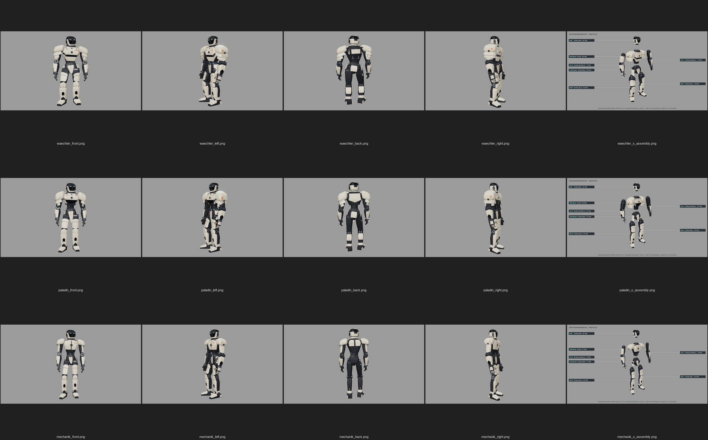
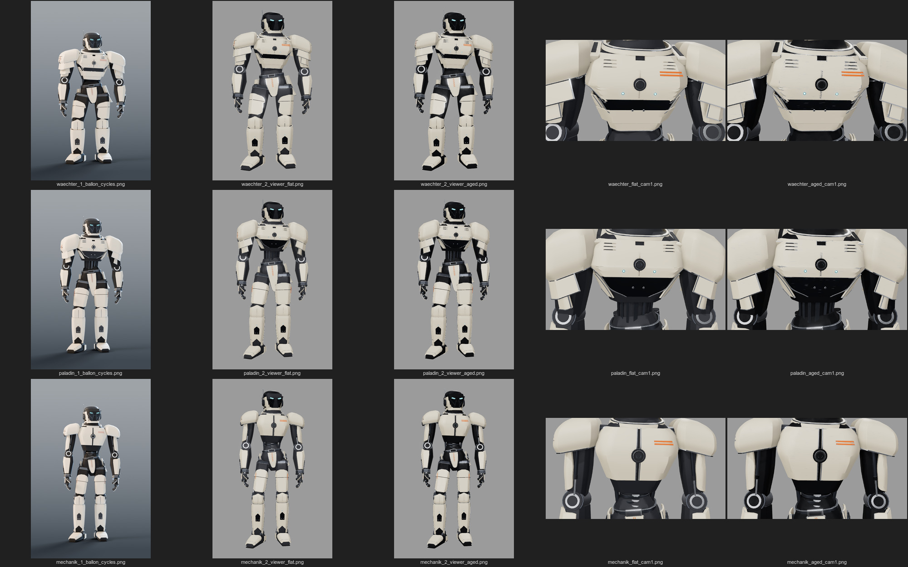
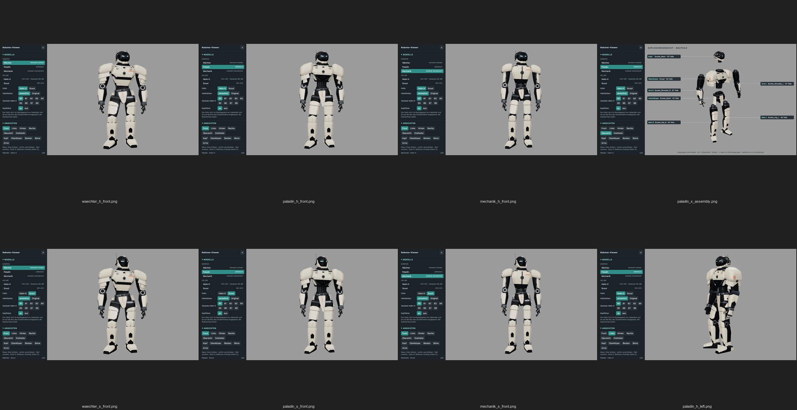
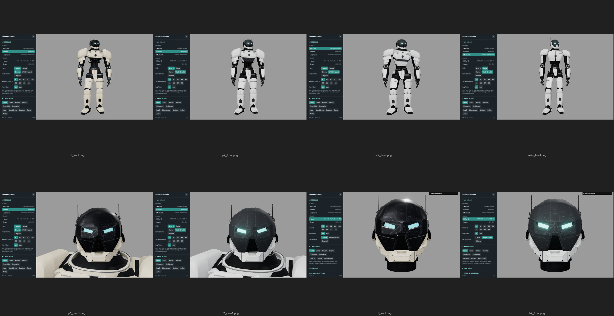
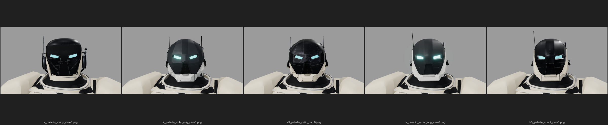
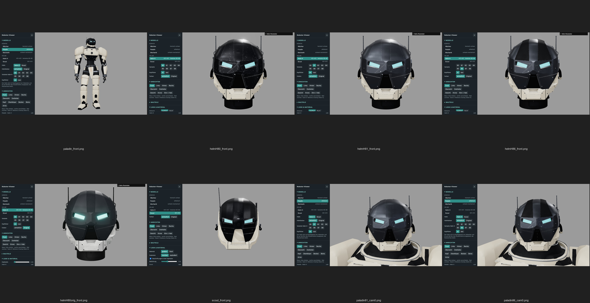

# Körper, Helme und Farbschema (0.10–0.12)

In `cubeescape-ballon` sind in „Roboter Runde 5“ drei Körperstudien für den BASIC-Roboter entstanden. Die Runde gehört zu Ballon 0.23 „Gauntlet“,
liegt auf dem Branch `claude/ballon-0-23-gauntlet-runde5-b524af`, Commit `14bd78d`, und ist dort nicht nach `main` gemergt.
Ein Nutzer hat noch keine der Studien gewählt. Critic übernimmt alle drei als eigene Modelle in den Viewer. Seit 0.12 sind sie die einzigen
Körper des Werkzeugs („wir bauen dann auf ballon auf“); die früheren three.js-Körperstudien 0.5–0.9 sind entfernt und nur noch Archiv.



| Modell | Ballon-Studie | Charakter | Höhe × Breite × Tiefe | Teile | Dreiecke |
|---|---|---|---|---|---|
| `waechter` | `a_waechter` | heroisch-schwer: gedrungen, Fassbrust, Schulterpanzer in zwei Lagen, Rückenmodul | 1668 × 866 × 525 mm | 408 | 395 342 |
| `paladin` | `b_paladin` | athletisch: V-Rumpf, Hüfte auf halber Höhe, große Schulterpanzer | 1710 × 802 × 499 mm | 383 | 368 088 |
| `mechanik` | `c_mechanik` | schlank-mechanisch: offenes Skelett, Kolben an den großen Gelenken | 1715 × 731 × 457 mm | 380 | 367 600 |

Alle drei tragen den parametrischen Militärhelm der Studien (`studies/helmet.py`), stehen in der Haltung `idle` ohne Waffe und haben die
fünf Baugruppen aus Ballon: Kopf, Arme, Oberkörper, Unterkörper und Beine. Die sechs Anker (`Socket_Neck`, `Socket_Shoulder_R/L`,
`Socket_Waist`, `Socket_Hip_R/L`) sind in allen drei Studien geschlossen, mit einem Abstand von 0 mm.

## Quelle und Export

Der Generator bleibt in Ballon. Critic übernimmt ihn nicht als Kopie, sondern pinnt den Stand in `blender/robot/SOURCE.json`:
Repo, Branch und vollen Commit. Kopiert würde sonst ein großer Baum mit Waffenbaukasten, Ego-Armen und Formen. Gebaut und exportiert
wird nur der Körper, mit `blender/robot/export_robot.py`:

```bash
# Repo-Wurzel; Ballon-Quelle am gepinnten Commit nach runs/ (nicht im Repo) entpacken
mkdir -p runs/robot/src
git -C ~/Claude/cubeescape-ballon archive 14bd78d84c3b8d497482ad458981e6e9732477f2 basic tools data | tar -x -C runs/robot/src
# je Studie ein Blender-Lauf (je ≈ 1 min), schreibt assets/robot-bodies/<name>/
for s in a_waechter b_paladin c_mechanik; do
  ./ce lock blender -- /Applications/Blender.app/Contents/MacOS/Blender -b --factory-startup \
    -P "$PWD/blender/robot/export_robot.py" -- --src runs/robot/src --study $s --out assets/robot-bodies
done
```

Das Skript ruft `basic.robot.use(<studie>)` und `tools/robot_build.build('idle', mode='color')` aus Ballon auf. Es exportiert
mit angewandten Fasen-Modifikatoren und schreibt je Studie `assembled/<name>.glb`, `parts.json` und `manifest.json`
([Lieferindex](../assets/robot-bodies/README.md)). Die Materialien sind die flachen Gestaltungsfarben der Ballon-Rollen
(`shell`, `graphite`, `metal`, `accent`, `energy` …). Die gealterte Cycles-Fassung „aaa“ aus den Ballon-Bildern hat glTF nicht.
**Nachweis:** Zwei Exportläufe ergeben bytegleiche GLBs und Manifeste.

## Gealterte Materialien (0.11 „Patina“)



Seit 0.11 zeigt der Viewer die Körper standardmäßig gealtert (`&wear=on`; `&wear=off` oder Navigation „Lackierung › Material“ = flach).
`web/src/robotWear.js` bildet das Cycles-Material `aaa_nodes()` aus Ballon (`basic/kit.py`, Skin `standard`) im Shader nach.
Alle Zahlen stehen in `web/src/robotWearParams.json`:

- **Je Materialrolle** (aus dem GLB-Materialnamen `MT_<rolle>_color`): Rauheit schwankt um ±15 % (Rauschen Maßstab 60/m),
  dazu Feinrelief wie Ballons Bump-Knoten (Schale 400/0,04, Graphit 900/0,12, Gummi 2600/0,5, brüniertes Metall 1200/0,05).
  Graphit und Gummi haben die dunkleren „aaa“-Farben und weniger Spiegelung.
- **Kantenabrieb** (Schale 1,0, Orange 0,8, Eloxal 0,3, brüniertes Metall 0,25, Graphit 0,15): im Radius 4 mm um Abriebkanten,
  aufgebrochen durch Rauschen (Maßstab 420/m, Schwelle 0,30–0,42); dort Farbe #9EA3A9 und Rauheit 0,28.
- **Feine Kratzer** auf Schale, Orange und Eloxal: in X gestrecktes Rauschen, Schwelle 0,70–0,74, Anteil 0,55, Farbe #A7ACB2.

Cycles erkennt Kanten mit dem raytracenden Bevel-Knoten, den es in Echtzeit nicht gibt. Der Viewer teilt deshalb jedes Mesh
beim Laden einmal in Einzeldreiecke. Jedes Dreieck trägt seine Ecke (Baryzentrik) und je Kante die Höhe über ihr, falls sie eine
Abriebkante ist. Der Shader kennt damit den Abstand zu den Abriebkanten **des eigenen Dreiecks** in Objektmetern. Ein Fächerdreieck,
das eine Abriebkante nur mit einer Ecke berührt, bekommt dort keinen Abrieb; je nach Triangulierung hat das Band kleine Lücken. Wie beim Bevel-Knoten
zählen die **Schattierungsnormalen**, nicht die Facetten. Eine Kante reibt ab, wenn die Normalen über sie um mindestens 30° springen
(harte Kante) oder wenn sie an einen Fasenstreifen grenzt. Ein Fasenstreifen ist ein Dreieck, dessen Normalen sich um mindestens 30°
und schneller als 2,5°/mm drehen; er reibt ganz ab. Glatt schattierte Rundungen bleiben sauber, ebenso flache Knicke mit Minifasen.
Der Schritt kostet beim Laden etwa 1 s je Körper (Headless-Software-GL). Die Einzeldreiecke (≈ 1,1 Mio. Eckpunkte je Körper)
bleiben nach dem ersten Altern im Speicher, auch wenn auf flach umgeschaltet wird.

**Abweichungen von Ballon, bewusst:**
- Am Abrieb mischt Ballon den Metallanteil auf 1,0. Im dunkleren Studio des Viewers liest sich volles Metall als schwarze Flecken,
  deshalb 0,35.
- Den Schmutz in Vertiefungen (Cycles-AO, 6 mm) übernimmt die GTAO des Viewers.
- Ballons Rauschen ist Perlin, im Viewer wird ein eigenes Werterauschen verwendet. Muster und Lage sind deshalb nicht pixelgleich,
  Maßstab und Verteilung entsprechen sich. Feinere Oktaven als ein Pixel blenden auf ihren Mittelwert aus.
- Ballons Schwellen (Map Range) sind linear, ebenso hier; die Reihenfolge ist dieselbe (Abrieb, dann Kratzer darüber).
- Gummi-Tupfen sind in Ballon Voronoi, hier Werterauschen gleichen Maßstabs. `energy` (Leuchtteile) bleibt ohne Rauheitsschwankung.
- Anisotropie der Zierkanten (`trim`) und Glasmuster fehlen.
- Der GLB-Export im Viewer schreibt die flache Fassung; das Altern ist ein Viewer-Shader.

## Helmwahl (0.12 „Fusion“)



Jeder Körper trägt **Helm H** (der three.js-Helm, H01–H21; Standard) oder **Scout** (S01–S13): Navigation „Modelle › Helm“ oder
`&helmet=critic|scout` (`web/src/robotHelmet.js`). Helm H lässt sich in allen gesicherten Varianten 80–88 aufsetzen (Oberfläche,
Akzente, Stirnblenden; `&helmetVariant=`, Daten `web/src/criticHelmetVariants.json`) und mit oder ohne Kopfhörer (`&headset=`).
Der **Studienhelm** aus dem GLB ist ins Archiv gewandert: nicht mehr in der Auswahl, per `&helmet=study` weiter erreichbar.
- Der Helm hängt im Kopfsegment `SEG_head`, dessen Ursprung der Halsanker `Socket_Neck` ist. Er folgt damit Kopfneigung, Kopfdrehung
  und Explosion. Critic und Scout schauen nach +Z, das Gesicht im Segment nach −Z: eine halbe Drehung um Y.
- Eingepasst wird gleichmäßig auf die Box des Studienhelms ohne Antennen: gleiche Höhe, gleiche Unterkante, gleiche Mitte in x/z.
  Bei Helm H entfällt vorher der Präsentationshals (`configureHelmetAssembly(…, { neck: false })`), die Schale reicht dann
  vom Kinn bis zum Kopfhörerband.
- Der Roboterhals (`neck`, `neck_ring`, `neck_trim`) bleibt; die Teile des Studienhelms werden ausgeblendet, nicht gelöscht.
- In der Explosion gehört der Helm zur Gruppe Kopf; im Bauteilbaum steht er als eigener Zweig unter Kopf mit seinen Kennungen.
- **Helmfarben** (Nutzerwunsch „Die Farben des Helms müssen noch an die des roboters angepasst werden“): Standard Farbschema 1 (`colors=body`).
  Jedes Helmmaterial bekommt das flache Rollenmaterial des Roboters, zugeordnet über eine feste Tabelle in `web/src/robotHelmetColors.json`
  nach dem Vorbild des Studienhelms: Schale Creme, Haube und Maske Eloxal, Module brüniertes Metall, Kabel Gummi, Streifen Zierkante,
  Augen Cyan. Damit altert der Helm mit demselben Shader wie der Körper. Abriebradius und Rauschen rechnen je Mesh in echten Metern,
  trotz der Skalierung im Kopfsegment. Der facettenreiche Helm H bekommt einen Abriebfaktor von 0,35, Scout 0,5; mit voller
  Stärke wirkten die vielen harten Kanten deutlich abgenutzter als Körper und Studienhelm. Die dunkle Rüstung von Helm H folgt der
  Oberfläche der Variante (original → Eloxal, Metall → brüniertes Metall, Graphit → Graphit), damit 80–88 unterscheidbar bleiben.
  `&colors=original` oder „Helmfarben › Original“ zeigt die eigenen Materialien der Helme.
- **Einheitliche Farbschemata für alles** (Nutzer: „nimm die aufteilung zwischen ballon und critic raus. Das wird ein Tool“, dann
  „Vielleicht passen wir die farben auch an die original farben vom helm an 🙂 Variante 1 und Variante 2“): `&colors=body|helmet|original`.
  - **Farbschema 1 „Creme“** (`body`, Standard): Palette der Körper; Werte in `web/src/ballonRoles.json` wie in den Körper-GLBs (Test
    gleicht ab).
  - **Farbschema 2 „Weiß-Graphit“** (`helmet`): Jede Rolle der Körper übernimmt Farbe, Rauheit, Metall und Leuchten des passenden
    Originalmaterials von Helm H (`robotHelmetColors.json › scheme2`: Schale → Weiß, Eloxal/Graphit → Graphit-Rüstung, Metall →
    dunkles Metall, Akzent → Oliv, Lichter → Visier-Cyan); die Werte werden live aus `createMaterials('original','original')` gelesen.
  - **Original**: jedes Modell in seinen eigenen Materialien (Körper in Schema 1, Helme mit Texturen).
  Helm H und Scout allein folgen demselben Schema und altern wie die Körper (Maßstab des Helmrahmens 0,25 m je Einheit). Der GLB-Export
  schreibt die flache Fassung: Körper und Helme im Schema mit dessen Rollenmaterialien, bei `original` die eigenen.







## Viewer

`?model=waechter`, `?model=paladin` oder `?model=mechanik` lädt den GLB. Der Viewer skaliert den Körper auf den Rahmen des
früheren three.js-Gesamtkörpers 0.9 (`ROBOT_FRAME`, Höhe 5,44, Füße bei y = −4,85), damit dessen Kameras (`front`, `left`, `back`, `right`)
ohne Anpassung passen. Mit `&exploded=0..1` oder dem Regler „Explosionsabstand“ öffnet sich die Explosionsansicht. Dafür verschiebt der Viewer die Segmentknoten
(GLB-Wurzeln mit Extras `asm`/`side`) um `explode_mm` aus `parts.json`, genau wie `robot_build.explode()` in Ballon; der Oberkörper
bleibt stehen. Die Etiketten zeigen sieben Gruppen (Kopf, Arm R/L, Oberkörper, Unterkörper, Bein R/L) mit Anker und Teilezahl.
In der GUI wechselt „Körperstudie“ zwischen den drei Modellen. Die Geometrie-Regler sind aus, weil Ballon die Quelle bleibt.

**Seiten:** R/L ist die Körperseite des Roboters. Die rechte Seite liegt bei −X und erscheint in der Frontansicht links im Bild.
Die three.js-Teile A/B und Scout R/L zählen anders.

**Skins (0.13):** Neben den Farbschemata gibt es die Skins Rost, Glut und Ornat für Körper und Helme (Navigation „Lackierung“,
`&skin=`); sie brauchen nur die Extras `asm`/`part`/`side` und die Rollenmaterialien `MT_<role>_color` der GLBs.
[Werkzeugkette und Mischer](SKINS.md).

## Grenzen und nächste Schritte

- Die Studien bleiben Entwürfe aus Ballon; Änderungen an der Form gehören dort in `basic/robot/studies/` und kommen per neuem
  Export und neuem Pin hierher.
- Ohne Waffe und ohne Haltung `ready`: Die Pilotwaffe gehört zu Ballon und ist nicht exportiert.
- Die GLBs selbst bleiben flach; gealtert wird erst im Viewer (siehe oben). Andere Programme sehen nur die Gestaltungsfarben.
- Für die Körper gibt es keine Vorlagenbilder und keine IoU-Messung; der Vergleich mit den Ballon-Cycles-Bildern (`~/Library/Caches/CubeEscapeBallon/out/robot/studies/`) ist eine Sichtprüfung.
- Offen ist die Wahl des Nutzers: Welcher Körper wird weiter ausgearbeitet, mit welchem Helm und welcher Variante?
