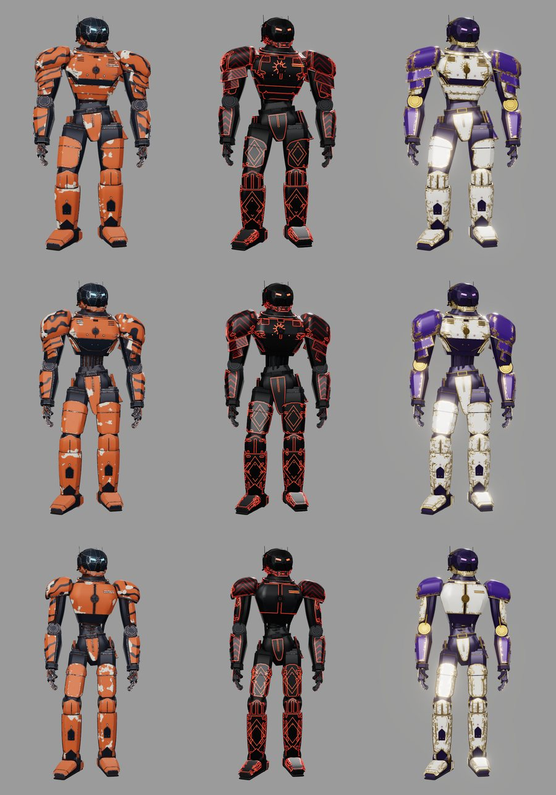
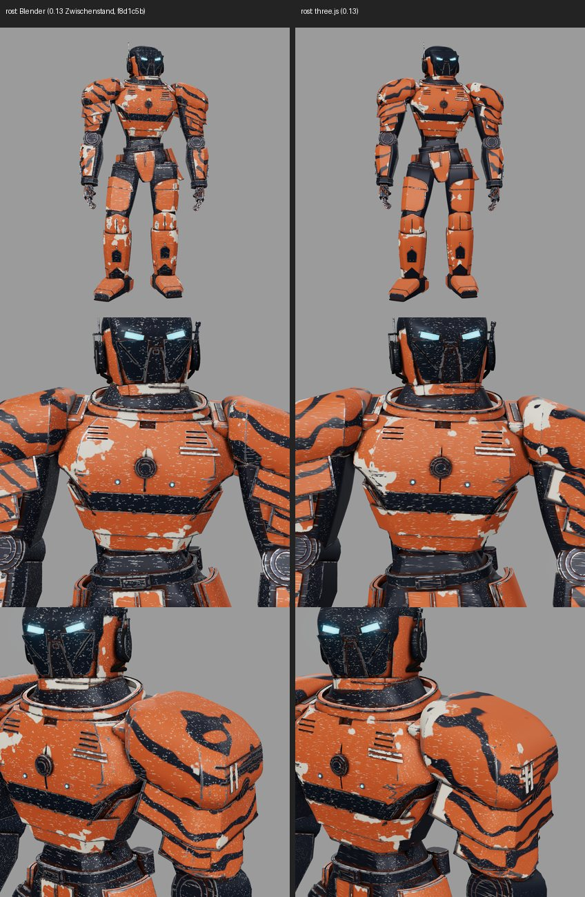
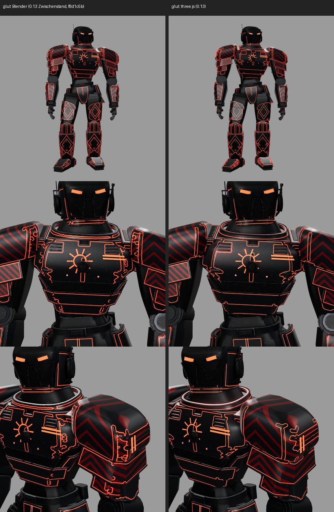
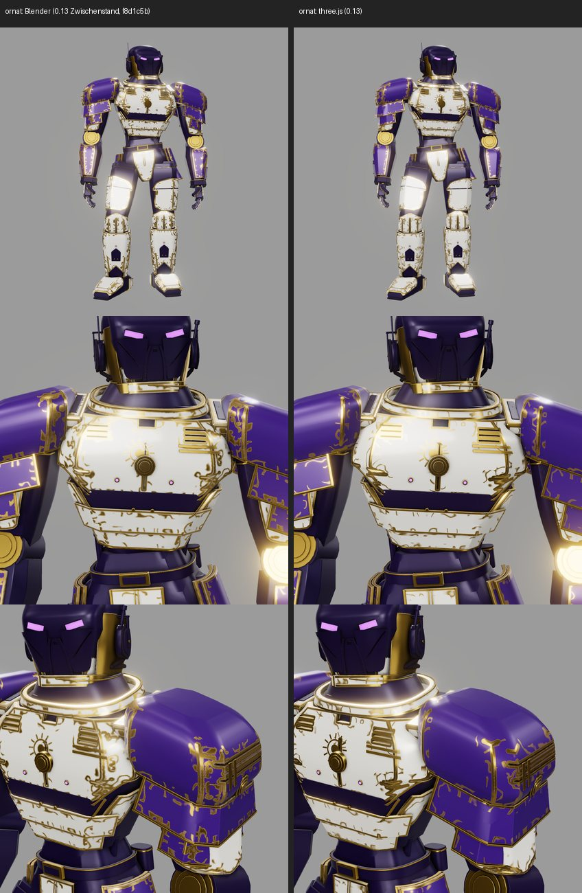
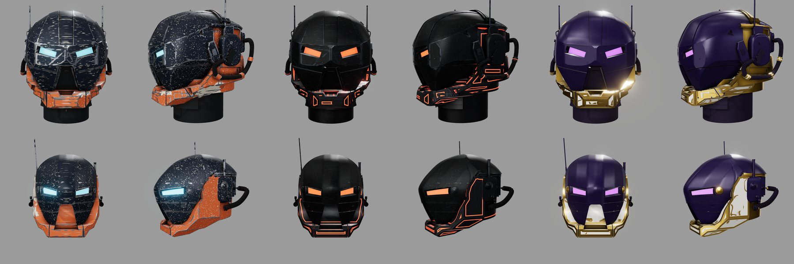

fertig – Skins Rost, Glut, Ornat für alle drei Körper, Helm H und Scout, ganz in three.js (kein Blender); Navigation „Lackierung“; Tests, Build, Verify grün; Richter siehe unten; Commit/PR/Merge nur nach Ja des Nutzers.

# 0.13 „Skins“ – Lackierungen für Körper und Helme, ohne Blender

Auftrag: Skins nach dem Referenzbild des Nutzers vom 29.10.2026 (drei Roboter: Rost Orange/Navy mit Streifen und abgeplatztem Lack,
Glut Schwarz mit roten Leuchtlinien, Chevrons, Rauten und Emblem, Ornat Weiß/Violett/Gold mit Filigran) – eine Textur je Modell statt
neun flacher Materialien. Nach einer ersten Blender-Fassung (Commit `f8d1c5b`, Zwischenstand) entschied der Nutzer: **three.js ist der
Standard, Blender soll ganz raus.** Diese Version baut die Werkzeugkette neu, die Geometrie der Körper in three.js baut die parallele
Sitzung 0.14.
Sitzung **CRITIC 0.13 „Skins“ · Mac**, Branch `claude/critic-0.13-skins`, Basis `23a311a` (0.12 „Fusion“) mit dem Zwischenstand `f8d1c5b`.
Opus 5.5, `high`. Grund: Kernsystem und Entwurf einer neuen Werkzeugkette mit Sichtabgleich.

Zwei Ziele: (1) Oberflächen in three.js, (2) Skins im Viewer für alle Körper und beide Helme mit Navigation „Lackierung“.

[Werkzeugkette, Mischer, Viewer](../SKINS.md)

## Was neu ist

- **Atlas in Node** (`web/tools/skinXatlas.mjs`, xatlasjs 0.2.0 als WASM): ein UV-Atlas je Modell, 2048², Rand 2 px, deterministisch.
  Punkte werden nur bei gleicher Schattierungsnormale verschweißt (CSG-Dreiecke wachsen zusammen, harte Kanten bleiben Kartengrenzen);
  die Packdichte wird nachgeregelt, weil xatlas sie für eine Auflösung nur schätzt.
- **Karten** (`web/tools/skin_bake.mjs`): Rastern im UV-Raum (Position, Normale, Teile- und Rollen-ID, als Kontrollbilder in `runs/skins/`),
  Kantenabstand in mm in 3D zu den Plattenkanten des Meshes, AO mit 32 Strahlen bis 15 mm; beides mit three-mesh-bvh in Worker-Threads.
  Ablage `assets/skins/<modell>/` (`atlas.json`, `atlas.bin`, `maps.png`). Der Atlas bildet die Punkte eines Meshes neu ab, er ersetzt die
  Geometrie nicht – darum gilt er auch für Helm H, das erst zur Laufzeit entsteht, und für jede künftige Körperquelle mit den Extras
  `asm`/`part`/`side` und Rollenmaterialien `MT_<role>_color`.
- **Mischer als Shader** (`web/src/skinShader.js`): die Rezepte der Blender-Fassung (`web/src/skins.json`, unverändert übernommen) werden zu
  GLSL; alle zehn Schichtarten (fill, band, wear, dirt, scratches, stripes, diamond, chevron, emblem, filigree) je Fragment in Modellmetern.
  Nur AO und Kantenabstand kommen aus der Karte, Muster bleiben nah scharf. Rauschen bandbegrenzt nach Pixelgröße.
- **Viewer** (`web/src/robotSkins.js`, `main.js`): Skins auf allen drei Körpern und beiden Helmen, auf dem Roboter und allein, auch
  explodiert (`&skin=rost|glut|ornat`). Navigation **„Lackierung“**: Farbschema *oder* Skin, für Körper und Helm zusammen; „Material
  gealtert/flach“ dort beim Farbschema. **Texturen exportieren** (Basisfarbe, ORM, Emission je Atlas als PNG, im UV-Raum mit dem Mischer
  gerendert, < 1 s je 2048²); der GLB-Export trägt dieselben Texturen.
- Helm H im Browser: Chromes CSG ergab bei einem Teil (Cheek_L) 1 569 statt 1 572 Punkte. Solche Meshes übernehmen die UVs vom
  nächstgelegenen gebackenen Dreieck (`transferGeometry`); dafür speichert der Atlas von Helm H die gebackenen Positionen.
- Entfernt: Blender-Fassung der Skins (`blender/robot/uv_template.py`, `bake_maps.py`, `skins.py`, `skins.json`, `helmet_template.py`,
  `requirements.txt`, `web/tools/helmet_snapshot.mjs`, Texturen `assets/robot-bodies/waechter/skins/`). Körper-GLBs, Manifeste und
  `export_robot.py` wieder bytegleich mit 0.12 (keine Blender-UVs, je 4,5 MB kleiner). Sicherung: `f8d1c5b` und `~/Library/Caches/Critic/0.13/`.

## Zahlen

| Modell | Meshes | mm/px (2048²) | Deckung | Bake |
|---|---|---|---|---|
| Wächter | 408 | 2,28 | 46,1 % | 50 s |
| Paladin | 383 | 2,15 | 45,2 % | 51 s |
| Mechanik | 380 | 1,95 | 46,4 % | 64 s |
| Helm H (Blenden an/aus) | 104 | 0,63 | 56,7 % | 71 s |
| Scout | 44 | 0,38 | 59,1 % | 102 s |

Blender-Fassung zum Vergleich: Wächter 49 % Deckung, 2,20 mm/px bei 2048². Zwei Läufe sind bytegleich (Wächter und Helm H geprüft).
`assets/skins/` 37 MB (je Modell `atlas.bin` 3–5 MB, `maps.png` 2–3 MB); dafür entfallen 13,3 MB Blender-UVs in den GLBs und 29 MB Texturen der Blender-Fassung (nur Wächter).

## Vergleich mit der Blender-Fassung (gleiche Kamera)

`web/tools/skin_shots.mjs` rendert beide Stände headless mit denselben Kameras (Front, Brust, Schulter; Studienhelm wie damals).

Gleiche Rezepte, gleiche Art und Dichte; die Zufallsmuster (Streifenverlauf, Abplatzer) unterscheiden sich, weil das Rauschen anders
gehasht ist. Die Leuchtbänder von Glut folgen den Plattenkanten ruhiger, weil der Kantenabstand in 3D statt im Bild gemessen wird (in der
Blender-Fassung erzeugten UV-Nähte wellige Linien). Zwei Abgleiche waren nötig: Fasen aus mehreren Segmenten nach Drehrate erkennen
(sonst fehlten Band und Filigran an der Schulterplatte), feines Rauschen erst ab ≈ 0,7 Zellen je Pixel ausblenden (sonst fehlten die
hellen Sprenkel von Rost). Helm H wirkt in Rost überwiegend navy, weil seine Haube in der Rollentabelle „anodized“ ist (wie bei den
Farbschemata); eine eigene Helmrolle wäre eine Nutzerwahl.

## Prüfungen

- `npm --prefix web test`: 78 Node-Tests grün (neu `tools/skins.test.mjs`, 11 Tests: Atlas deckt jedes Mesh jeder Quelle und baut seine
  Dreiecke nach, keine Kartenüberlappung, Helm H mit/ohne Blenden auf dem Roboter und allein, Übertrag, Rezeptauswahl, GLSL je Rezept,
  Kantencode, PNG, xatlas deterministisch, flacher GLB-Ersatz), Python-Tests grün (mit NumPy über `uv`, im System-Python fehlt NumPy).
- `npm --prefix web run build` grün. `npm --prefix web run verify` grün: IoU 0,909 wie zuvor; neu ein Skin-Durchgang in Chromium
  (Wächter mit Helm H in Rost: 408/408 und 98/98 Meshes im Atlas, Texturbake gefüllt; GLB-Export mit Skin nur mit gebackenen
  Materialien, auch bei zwei gleichzeitigen Exporten mit Skinwechsel; Skin-Wahl in der Navigation bei 1,5 s verzögertem Atlas-Laden mit Neuaufbau dazwischen ohne Fehler). `./check` grün.
- Sichtprüfung im App-Browser: Wechsel Skin ↔ Creme ↔ Weiß-Graphit, Helmwechsel Scout/Helm H und Variante 87 mit Skin, Nahansicht Kopf,
  Helm H allein explodiert (104/104), Texturbake und GLB-Export mit Skin (2 Materialien, 6 Texturen), Konsole ohne Fehler.

Belege außerhalb des Repos: `~/Library/Caches/Critic/0.13/compare/` (`blender/`, `threejs/`, `roster/`, `textures/` mit den exportierten
Texturen je Skin), Kontrollkarten `runs/skins/<modell>/` (position, normal, part, role, edge, ao).

## Grenzen und offene Punkte

- Ändert die Sitzung 0.14 die Körpergeometrie (three.js statt Blender-GLB), muss `node tools/skin_bake.mjs --model <körper>` neu laufen;
  Meshes ohne passenden Eintrag werden bis dahin ohne Karten gemalt (Warnung in der Konsole), der Test `skins.test.mjs` schlägt an.
- Helm-H-Regler (lil-gui) ändern die Geometrie: kleine Änderungen übernimmt der Übertrag, große malen ohne Kantenabrieb und Schmutz.
- Die Muster sind Shader, kein Malprogramm: eigene Bemalung von Hand wäre ein exportiertes PNG als Grundlage (Knopf „Texturen exportieren“).
- AO der Helme ist ohne Körper gebacken (Helm allein und auf dem Roboter gleich).

## Richter

Codex `gpt-6.1-sol` (high; 2 464 Diff-Zeilen, Kontingent 44 % übrig).
- Runde 1: **Nachbessern Nr. 4** – (a) Skin wurde vor dem Atlas-Laden aktiv, ein Neuaufbau währenddessen brach ab → Skin erst nach dem
  Laden setzen, Prüfung in `verify` mit verzögertem Laden; (b) Meshes ohne Atlas gingen mit Shader-Material in den GLB → flacher Ersatz aus
  den Füllschichten des Rezepts (`flatSkinMaterial`, Test); (c) fehlende Atlanten übersprangen Tests → sie schlagen jetzt fehl.
  `test_map.json` gibt es in diesem Repo nicht (Unity-Punkt der Checkliste).
- Runde 2: **Nachbessern Nr. 4** – `assets/skins/` war für Git noch unbekannt und fehlte im Diff → angemeldet (wird mitcommittet).
- Runde 3: **Nachbessern Nr. 4** – ein Skinwechsel während eines GLB-Exports wurde danach von der Wiederherstellung überschrieben,
  überlappende Exporte störten sich → Exporte laufen nacheinander, zurückgesetzt wird nur, was noch das Exportmaterial trägt; `verify`
  startet zwei Exporte und wechselt währenddessen den Skin (zwei Downloads, neuer Skin bleibt).
- Runde 4: **Nachbessern Nr. 4** – derselbe Befund, enger: Der Test wechselte den Skin, bevor der Export startete (Warteschlange) → Test
  wartet jetzt, bis der Export seine Materialien getauscht hat; Gegenprobe ohne Schutz scheitert („materials skin_rost“). Dazu: PNG-Export
  backt alle Bilder und Namen vor dem ersten `await` (Prüfung in `verify` mit Skinwechsel währenddessen).
- Runde 5 (zweite Runde mit demselben Befund → eine Stufe höher; über `sol` gibt es keine Codex-Stufe): Opus-Richter `ce-judge` –
  **Freigabe**; Exportwettlauf und Atlas-Laden als behoben bestätigt. Vier niedrige Punkte, drei gleich behoben: Atlastest vergleicht
  Kanten- und AO-Parameter mit `skins.json` (veralteter Bake fällt auf), fehlgeschlagenes Atlas-Laden wird verworfen und die Auswahl
  zurückgesetzt, die internen `skin*`-Attribute gehen nicht in den GLB (Prüfung in `verify`). Offen (niedrig): einige Grenzwerte
  (Boxtoleranz 2 %, Seitengrenze ±2 mm, Lückenfüllung 8 px, Schweißwinkel 20°) stehen im Code statt in `skins.json`.
- CI (Linux): Die CSG von Helm H ergab auf dem Runner bei `Cheek_L` andere Dreiecke als auf dem Mac – wie in Chrome. Der Atlastest lässt
  für Helm H jetzt den Übertrag zu (höchstens 3 Meshes, UVs im Atlas); die Toleranzregel steht einmal in `skinAtlas.js › closeSignature`.

## Ist-Zeit

Warten 10 min (Richter) · Rechnen 30 min (Bakes, Renders, Verify) · Lesen 15 min · Umsetzen 65 min.

🤖 Generated with [Claude Code](https://claude.com/claude-code)
