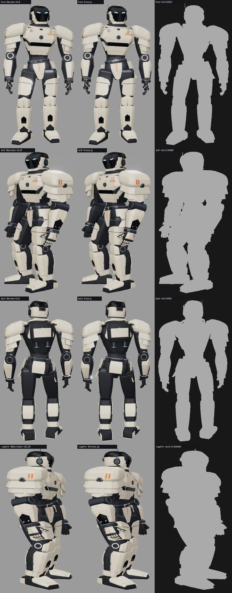
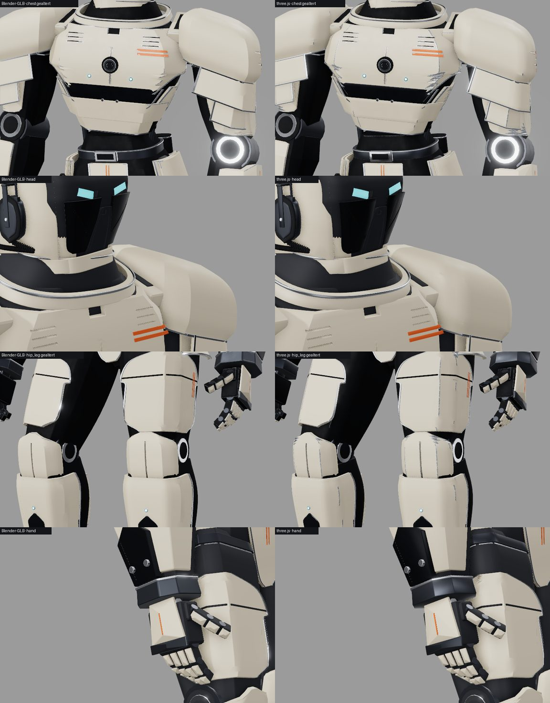
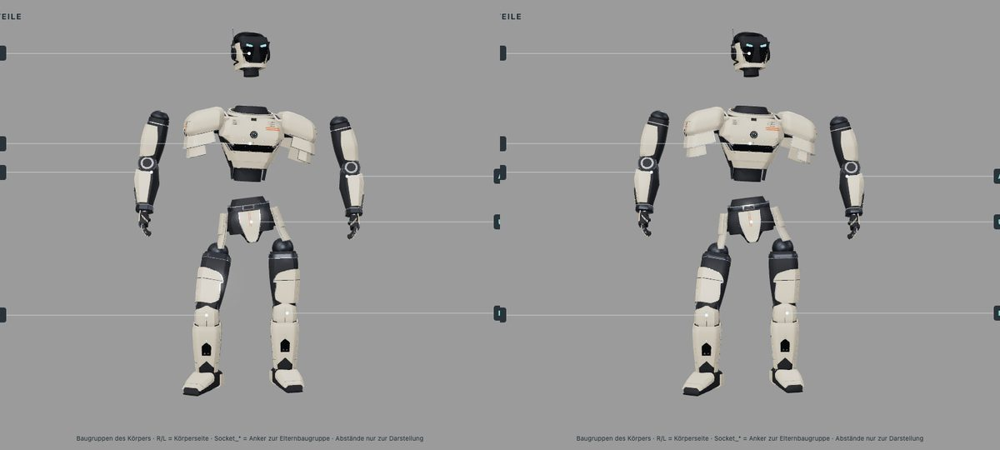

fertig (Etappe 1) – Wächter als three.js-Generator ohne Blender, gegen den Blender-GLB gemessen, im Viewer per `&gen=three`; Tests, Build, Verify grün, Codex-Richter Freigabe. Entscheidung nötig: Abnahme Wächter → Etappe 2 (Paladin, Mechanik, Scout). Commit/PR/Merge nur nach Ja des Nutzers.

# 0.14 „Foundry“ – Roboterkörper als three.js-Generator (Etappe 1: Wächter)

Auftrag (über die Sitzung „CRITIC 0.13 Skins“): Nutzerentscheid vom 29.10.2026 „three.js ist der Standard, alles in three.js, Blender soll
ganz raus“, auch für die Geometrie. Ziel 1: den Wächter als three.js-Generator nachbauen (gleiche Baugruppen und Teile-IDs, Extras
`asm`/`part`/`side`, Rollenmaterialien, Segmentwurzeln, Fasen als Geometrie, Messung gegen den GLB, im Viewer wählbar). Ziel 2 nach
Abnahme: Paladin, Mechanik, danach Scout, in Etappen.
Sitzung **CRITIC 0.14 „Foundry“ · Mac**, Branch `claude/critic-0.14-foundry`, Basis `23a311a` (`main` mit 0.12). Opus 5.5, `high`.
Grund: Kernsystem und Formentwurf.

[Aufbau, Messung, Abweichungen](../ROBOTER_BALLON.md#threejs-generator-014-foundry) · [Übergabe Etappe 2](../uebergabe-0.14-etappe2.md)

## Was neu ist

- **`web/src/robotgen/`** – Übertragung der gepinnten Ballon-Quelle (Commit `14bd78d`) Datei für Datei: `forms.js` (Querschnitte,
  Hermite-Verdichtung, loft/wrap/tube), `shapes.js` und `body.js` (Formbaukasten aller drei Studien), `studyHelmet.js`, `arm.js`
  (Arm v3 mit Hand), `studies.js` (Wächter), `robot.js` (Skelett, Segmente, Anker, Haltung), `bevel.js` und `mesh.js` (Fasen als
  Geometrie, Fugen per three-bvh-csg mit Entfernen volumenloser Schnittreste und Schließen der T-Kreuzungen, Spiegeln, Kippen, Normalen),
  `index.js` (Szene wie der GLB).
- **Viewer:** `?model=waechter&gen=three` (`robotBodies.js › loadRobot(name, { gen })`, `GENERATED`); `main.js` reicht nur den
  URL-Schalter weiter. Die GLB-Fassung bleibt Standard. Helm H/Scout, Farbschemata, Altern, Bauteilbaum und Explosion laufen
  unverändert, weil Szene, Extras und Materialnamen denen des GLB gleichen.
- **Messwerkzeuge:** `web/tools/robotgen_dump_spec.py` (Teileliste aus Ballon ohne Blender), `web/tools/robotgen_compare.mjs` und
  `robotgen_iou.py` (beide Fassungen mit gleicher Kamera: vier Ansichten, Masken, IoU, fünf Nahansichten flach und gealtert, Explosion).
- **Tests** `web/tools/robotgen.test.mjs` (7): Teileliste = Python-Referenz, Segmentmatrizen = GLB, Box je Objekt < 1 mm, Materialien
  und Zylindernormalen = GLB, Teileindex = `parts.json`, deterministisch, alle Meshes geschlossen und einheitlich orientiert (jede
  gerichtete Kante so oft wie ihre Gegenrichtung), Schattierungsnormalen auf der Vorderseite jeder Fläche.

## Messung

| Prüfung | Ergebnis |
|---|---|
| Teileliste (294 Definitionen mit allen Parametern), Segmente, Schulteranker | identisch mit Ballon (Toleranz 10⁻⁶) |
| 45 Segmentmatrizen | max. Abweichung 5·10⁻⁷ |
| Box je Objekt, 408 Objekte, gegen `manifest.json` | Median 0,05 mm, p90 0,29 mm, max. 0,65 mm |
| Umriss-IoU vorn / links / hinten / rechts | 0,9992 / 0,9988 / 0,9995 / 0,9989 |
| Dreiecke | 377 735 (GLB 395 342) |
| Abriebkanten (Rumpf, Becken, Beine) | 385 m (GLB 341 m) |
| Aufbau | ≈ 0,8 s in Node, ≈ 1,5–3 s im Headless-Browser (GLB laden ≈ 1,3 s) |

Nahvergleich mit gleicher Kamera (flach und gealtert) und Explosion:

**Während der Abnahme korrigiert** (nach Sichtprüfung der gealterten Nahansichten): (1) Platten mit `a1 < a0` (Akzentstreifen) fasten
nach außen – jetzt mit Vorzeichen; (2) senkrechte Abrieblinien am Schulterpanzer – Ursachen T-Kreuzungen der CSG-Fugen und
Flächengewichtung der Normalen; jetzt `closeTJunctions`, gleichmäßige Gewichtung, Lofts mit Knickwinkel ≥ 44°; (3) Medaillonringe matt
statt hell – Zylinder jetzt mit den Normalen des GLB (Deckel flach, Fasenreihen 22,5°/45°/67,5°) und doppelseitige Materialien wie im Export.

**Bekannte Abweichungen:** Fugenkanten nicht nachträglich gefast; Rauschabrieb an einigen Plattenrändern (Brust, Kniekappen) etwas
anders verteilt; Blenders 30°-Bevel auf Innenkanten nur über die Normalen nachgebildet. Keine UV-Koordinaten (auch der GLB hat keine).

## Prüfungen

| Prüfung | Ergebnis |
|---|---|
| `npm --prefix web test` | 74/74 Node-Tests, `test_iou.py` OK, `test_save_pass.py` OK (Python über `uv` mit `web/requirements.txt`) |
| `npm --prefix web run build` | grün (bekannte Warnung Chunkgröße) |
| `npm --prefix web run verify` (Helm H, IoU) | passed, Mittel 0,909 wie in 0.12 |
| `./check` | alles in Ordnung |
| `node web/tools/robotgen_compare.mjs` | IoU siehe oben, keine Konsolenfehler; Standardansicht mit Helm H, Scout/Weiß-Graphit und Explosion headless geprüft |
| Richter (Codex `gpt-6.1-sol` high, 2309 Diff-Zeilen) | Runde 1: Nachbessern Punkt 4 (Geschlossenheitstest prüfte nur das Volumen) → Kanten- und Normalenprüfung ergänzt; dabei 175 volumenlose Flächenpaare in Maske, Brust, Schienbein entfernt (`dropSheets`). Runde 2: **Freigabe**, alle acht Punkte ok |

Belege außerhalb des Repos: `~/Library/Caches/Critic/0.14/` (Renders `glb/`, `three/`, `views.jpg`, `close.jpg`, `compare.json`,
Silhouetten). Kein MP4: keine Bewegung geändert.

## Nach dem Merge von 0.13 „Skins“

`main` mit #20 zusammengeführt (Konflikte nur in Doku und Versionsnummer, beide Fassungen erhalten; `main.js` automatisch). Danach 85/85 Node-Tests, Build, `verify` (Helm H IoU 0,909; Skin Rost auf dem GLB-Wächter 408/408 Meshes im Atlas) und `./check` grün.

**Skins (0.13) mit `&gen=three`:** Die Atlanten in `assets/skins/` sind aus den Körper-GLBs gebacken und binden Meshes über Pfad und Eckenzahl; die generierten Meshes haben andere Eckenzahlen. Der Skin-Mischer malt den generierten Wächter deshalb ohne Karten (0/408 im Atlas, Konsole „painted without maps“): Lackierung und Muster stimmen, Kantenabrieb und Schmutz in Vertiefungen fehlen. Abhilfe in Etappe 2: `web/tools/skin_bake.mjs` mit dem Generator als Quelle backen, sobald `gen=three` Standard wird.

## Nicht in dieser Etappe

- Paladin, Mechanik, Scout ([Übergabe](../uebergabe-0.14-etappe2.md)); Blender-Dateien bleiben bis zur Zustimmung des Nutzers.
- Skin-Atlas für den generierten Wächter (siehe oben).

## Ist-Zeit

Warten 6 min (Renders, Prüfläufe) · Rechnen 4 min · Lesen 10 min · Umsetzen 30 min.

🤖 Generated with [Claude Code](https://claude.com/claude-code)
