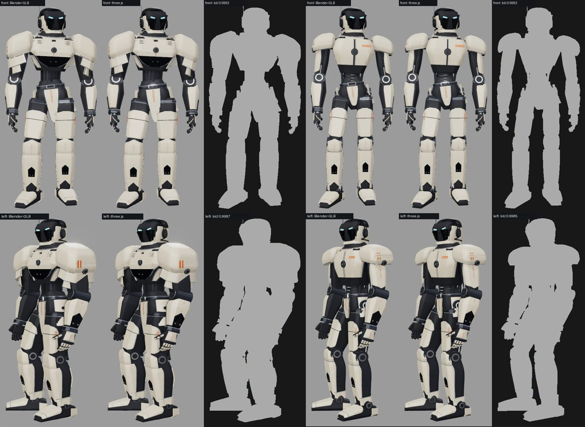
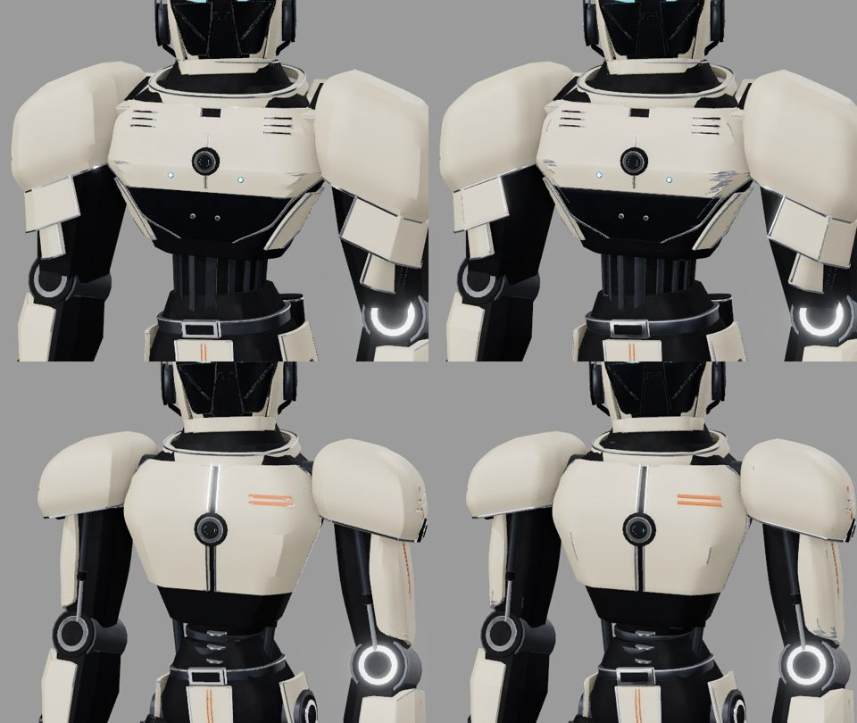
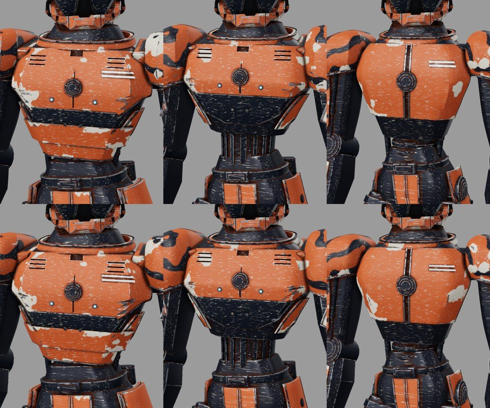

fertig – Paladin und Mechanik als three.js-Generator, gegen die Blender-GLBs gemessen; Skin-Atlanten aus dem Generator für alle drei Körper (`verify` 408/408, 383/383, 380/380 mit `&gen=three`). Tests (103), Build, Verify, `./check` grün; Codex-Richter Freigabe (Runde 2). Merge durch Sightline nach Ja des Nutzers.

# 0.15 „Anvil“ – Paladin und Mechanik in three.js, Skin-Atlas aus dem Generator

Auftrag (Übergabe [0.14 › Etappe 2](../uebergabe-0.14-etappe2.md), Ziele 1 und 3): Paladin und Mechanik im three.js-Generator mit den
Prüfungen des Wächters; `skin_bake.mjs` mit `buildRobotBody(name)` als Quelle, `verify` meldet volle Abdeckung mit `&gen=three`.
Nicht in dieser Version: Scout (0.16), Umstellen des Standards, Löschen von `blender/robot/` oder Körper-GLBs.
Sitzung **CRITIC 0.15 „Anvil“ · Mac**, Branch `claude/critic-0.15-anvil`, Basis `eab038a` (`main` mit 0.14). Opus 5.5, `high`.
Grund: Kernsystem und Formvergleich.

[Aufbau, Messung, Abweichungen](../ROBOTER_BALLON.md#threejs-generator-014-foundry-015-anvil) · [Skins](../SKINS.md#ablauf) ·
[Übergabe, Stand nach 0.15](../uebergabe-0.14-etappe2.md)

## Was neu ist

- **Studien Paladin und Mechanik** (`web/src/robotgen/studies.js`) aus `b_paladin.py` und `c_mechanik.py` der gepinnten Ballon-Quelle
  (`14bd78d`); Referenzen `web/tools/fixtures/robotgen_paladin_spec.json`, `robotgen_mechanik_spec.json` per `robotgen_dump_spec.py`
  (die Wächter-Referenz kam dabei bytegleich wieder heraus). Viewer: `?model=paladin|mechanik&gen=three` (`GENERATED`).
  Der Formbaukasten `body.js` brauchte keine Änderung; die befürchteten Fallen der Übergabe (`hull`/`hulls`/`prism`, `pyRound` bei `hz`,
  `rot`) traten nicht auf, weil alle drei Studien den parametrischen Helm nutzen (`style: 'mil'`: Kamm, Antenne, Ohrform, `hz` gehen
  dort nicht ein).
- **CSG-Splitter** (`mesh.js`): An der Maske (verschachtelte Augenhöhlen-Schneider) lässt three-bvh-csg Splitter unter 0,01 mm, die das
  Mesh öffnen – Paladin und Mechanik bestanden die Geschlossenheitsprüfung nicht. Ein allgemeines Nachverschweißen (Punkte < 0,001 mm
  einrasten, Nulldreiecke entfernen, T-Kreuzungen schließen) öffnete dafür andere Meshes und ist verworfen. Jetzt prüft der Generator
  jedes geschnittene Teil mit dem Schlüssel des Tests (`meshDefects`) und wiederholt den Schnitt mit um je 0,002 mm größeren Schneidern
  (`CUT_JITTER`, höchstens 32 Versuche). Paladin: 8, Mechanik: 15 Versuche an der Maske; Wächter unverändert.
- **Indizierte Meshes wie der GLB** (`indexGeometry`): Ecken mit gleicher Position und Schattierungsnormale teilen sich einen Punkt;
  Schattierung bitgleich, ein Viertel der Punkte (Wächter 271 833 statt 1 133 205).
- **Skin-Atlas aus dem Generator:** `node web/tools/skin_bake.mjs --model all --gen three` backt aus `buildRobotBody(name)` nach
  `assets/skins/<körper>-three/`; der Viewer wählt den Atlas per `skinAtlas.js › atlasName(model, gen)`. Teile mit CSG-Fugen behalten
  ihre gebackenen Positionen (Übertrag bei anderer Triangulierung, z. B. Linux-CI), der Rest wird exakt nachgebaut. Größe je Körper
  ≈ 5 MB + 3,4 MB wie die GLB-Atlanten (zuerst 24 MB mit losen Dreiecken – Anlass für das Indizieren), Deckung ≈ 50 % (GLB 46 %).
- **Navigation:** Die Körper-Links behalten `&gen=three` (seit 0.14 fiel ein Klick auf einen anderen Körper auf die GLB-Fassung
  zurück; vom Nutzer im Viewer bemerkt, nach der Merge-Freigabe behoben und im Viewer geprüft).
- **`verify`** prüft zusätzlich Wächter, Paladin und Mechanik mit `&gen=three&skin=rost`: jedes Mesh im eigenen Atlas.
- `.ce-repo.json` auf 0.15.0 „Anvil“ (0.13 hatte die Nummer nicht gehoben).

## Messung (Blender-GLB ↔ three.js, gleicher Viewer, gleiche Kamera)

| Prüfung | Wächter | Paladin | Mechanik |
|---|---|---|---|
| Teileliste gegen Python-Abzug (alle Parameter), Segmente, Schulteranker | 294 identisch | 272 identisch | 263 identisch |
| Box je Objekt gegen `manifest.json`: Median / p90 / max. | 0,05 / 0,29 / 0,65 mm | 0,05 / 0,28 / 0,87 mm | 0,05 / 0,26 / 0,50 mm |
| Objekte, Teileindex = `parts.json` | 408, identisch | 383, identisch | 380, identisch |
| Umriss-IoU vorn | 0,9992 | 0,9992 | 0,9992 |
| Umriss-IoU links | 0,9988 | 0,9987 | 0,9985 |
| Umriss-IoU hinten | 0,9995 | 0,9994 | 0,9992 |
| Umriss-IoU rechts | 0,9989 | 0,9988 | 0,9988 |
| Dreiecke (GLB) | 377 735 (395 342) | 353 108 (368 088) | 353 001 (367 600) |
| Aufbau Node warm / Headless-Browser | 1,2 s / 2,6 s | 3,0 s / 4,2 s | 4,6 s / 7,3 s |
| Skin Rost mit `&gen=three` (`verify`) | 408/408 im Atlas | 383/383 | 380/380 |

Nahvergleich gealtert (oben Paladin, unten Mechanik; links GLB, rechts three.js) und Skin Rost (oben GLB, unten three.js):

**Sichtprüfung:** vier Ansichten, fünf Nahansichten flach und gealtert, Explosion und Skin Rost je Körper – Form, Fugen, Explosion
deckungsgleich; Kantenabrieb und Schmutz der Skins kommen aus dem neuen Atlas. **Bekannte Abweichung** wie beim Wächter (0.14): Der
Rauschabrieb an den seitlichen Brustplattenkanten fällt in three.js etwas kräftiger aus (Fasenstreifen anders trianguliert).
**Kosten:** Die Masken-Wiederholungen verlängern den Aufbau (Paladin + 2 s, Mechanik + 3,5 s); vor der Umstellung auf `gen=three`
beheben ([Übergabe › Offen 2](../uebergabe-0.14-etappe2.md#offen)).

## Prüfungen

| Prüfung | Ergebnis |
|---|---|
| Node-Tests (`node --test --test-concurrency=1 tools/*.test.mjs`, ohne npm) | 103/103 (0.14: 85; neu: je 6 Generator-Tests für Paladin und Mechanik, `meshDefects` am Würfel, Wiederholung `firstClosed` mit kontrolliertem Fehlerfall, Masken geschlossen, drei Atlastests `-three`); `test_iou.py`, `test_save_pass.py` OK |
| Gegenprobe | `CUT_RETRIES = 0` und `atlasName` → GLB-Atlas: Geschlossenheit Paladin/Mechanik, Maskentest und drei Atlastests rot; Schleifengrenze `<` statt `<=` und `meshDefects` ohne Normalen: beide neuen Einheitentests rot; zurückgesetzt grün |
| `vite build` | grün (bekannte Warnung Chunkgröße) |
| `verify` | passed; Helm H IoU Mittel 0,909 wie in 0.12–0.14; Skins siehe oben |
| `robotgen_compare.mjs` je Körper | IoU siehe oben, keine Konsolenfehler |
| `./check` | alles in Ordnung |
| Richter (Codex `gpt-6.1-sol` high, 642 Diff-Zeilen) | Runde 1: Nachbessern Nr. 4 (niedrig) – der Splitter-Test verlangte, dass auf der Plattform ein erster Schnitt offen ist → Wiederholung als `firstClosed` mit kontrolliertem Fehlerfall geprüft, `meshDefects` am Würfel, Masken nur noch auf geschlossene Endgeometrie. Runde 2: **Freigabe**, alle acht Punkte ok |

Ist-Zeit ≈ 75 min (30.10.2026, 09:59–11:15): Warten ≈ 20 min (Richter zwei Runden), Rechnen ≈ 25 min (Bakes, Vergleiche, `verify`,
Tests; teils parallel zum Umsetzen), Lesen ≈ 10 min, Umsetzen ≈ 25 min.

Belege außerhalb des Repos: `~/Library/Caches/Critic/0.15/` (`compare/<körper>/` mit Renders `glb/`, `three/`, `views.jpg`,
`close.jpg`, Silhouetten; `skinshots/`; Logs von Tests, Bake, `verify`). Kein MP4: keine Bewegung geändert.

## Nicht in dieser Version

- Scout im Generator (0.16), Ladezeit der Masken-Wiederholungen, Umstellung des Standards und Archivieren von `blender/robot/` und den
  Körper-GLBs (nur nach Ja des Nutzers) – [Übergabe](../uebergabe-0.14-etappe2.md).
