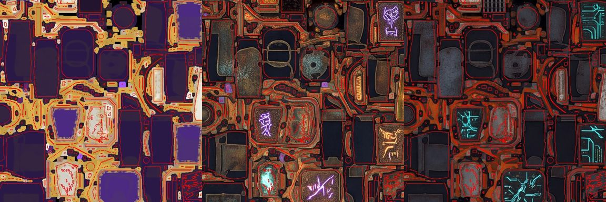
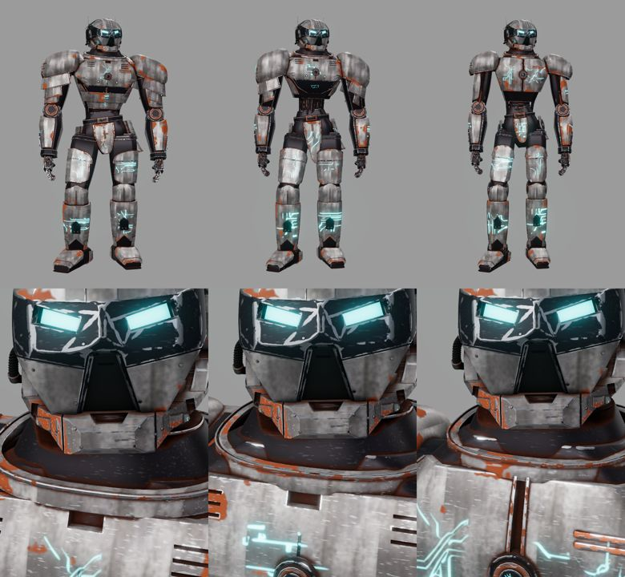
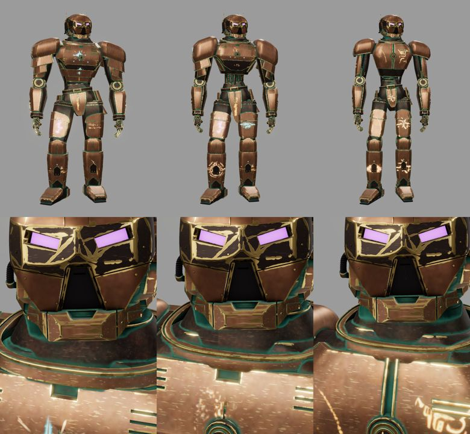
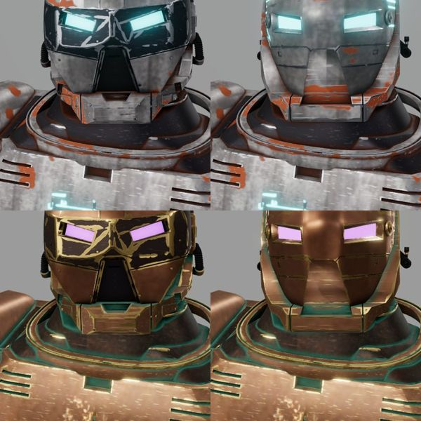

fertig – Skins Bronze und Schrott aus den generierten Bildern des Nutzers, stimmig auf allen drei Körpern und beiden Helmen; Vorlagenkarten und Prompts für Nano Banana Pro; Brustsonne zentriert. Prüfungen und Richter siehe unten. Baut auf PR #21 (0.15) auf; Merge durch Sightline nach Ja des Nutzers.

# 0.16 „Swatch“ – Skins aus Nutzerbildern, Prompts für Bildgeneratoren

Anlass (Sitzung „CRITIC 0.15 Anvil“, 30.10.2026): Im Viewer bemerkte der Nutzer, dass die Sonne von Glut und Ornat nicht in der Mitte
des Brustpanzers sitzt. Danach brachte er zwei mit Nano Banana Pro generierte Atlasbilder (Vorlage: exportierte Basisfarbe Wächter/Ornat)
mit dem Befund „passen überhaupt nicht“ und bat um passende Texturen daraus sowie um einen Prompt, damit der Generator sie künftig
richtig erstellt; dazu: „Die Helme können ja eine eigene Textur haben“. Sitzung **CRITIC 0.16 „Swatch“ · Mac**, Branch
`claude/critic-0.16-swatch`, Basis `89fe013` auf `claude/critic-0.15-anvil` (PR #21, noch nicht gemergt). Opus 5.5, `high`.

## Warum die Bilder nicht passten

Die Inseln liegen richtig (rote Atlasränder auf den gemalten Formen), aber der Generator bemalt jede Insel für sich. Gemessen auf den
Schalen des Wächters schwankt die Helligkeit derselben Rolle zwischen 55 und 188 (p10–p90): Auf dem Modell springt das Material von Teil
zu Teil, Muster brechen an Nähten ab, Runen landen zufällig. Ein Bildgenerator kann das grundsätzlich nicht lösen – er weiß nicht, welche
Inseln im 3D nebeneinanderliegen.

## Was neu ist

- **`web/tools/skin_swatches.py`:** nimmt aus einem solchen Bild nur das Material: je Rolle (Rollenkarte des Bakes) die größte ruhige
  Fläche mit typischer Farbe als nahtlose Kachel (versetzt überblendet) und die leuchtenden Linienmotive (Runen, Leiterbahnen; Flecken
  verworfen) als 4 × 4-Bogen mit Alpha. Ablage `assets/skins/textures/` samt Herkunft der Ausschnitte (`*_swatches.json`).
- **Mischer-Schichten** (`skinShader.js`): `tex` – Kachel triplanar im Modellraum, je Teil versetzt, Modus `overlay`/`multiply`/`replace`;
  `decal` – ein Motiv je Teil (Wahl über die Teilmitte, links und rechts gleich), Projektion von vorn oder seitlich, optional leuchtend.
  Texturen lädt `robotSkins.js › loadSkinTextures` vor dem ersten Skin.
- **Skins Bronze und Schrott** (`skins.json`): Grundfarben je Rolle = Mediane der Inseln im jeweiligen Bild, Kacheln als Detail,
  Kantenabrieb (blankes Gold bzw. Stahl), Grünspan bzw. Rost in Vertiefungen, Kratzer (auf dunklem Metall dezent), Motive auf den großen
  Platten, Leuchtfarbe aus dem Bild.
- **Helme mit eigenem Platz:** jede Mesh-Beschreibung trägt ihr Modell (`kind`), Schichten filtern mit `kinds`/`not_kinds`. Helm H und
  Scout haben `<skin>_helm_shell` und `<skin>_helm_decals` (vorerst Kopien des Körpermaterials, austauschbar); Maske, Gesicht, Augen,
  Kinn bleiben dunkel; Körpermotive gehen nicht auf Helme.
- **Vorlagenkarten** (`web/tools/skin_guide.py`): je Atlas jede Insel in ihrer Rollenfarbe, weiße Inselränder, magentafarbene Ränder um
  die Motivflächen, Legende – für Wächter, Helm H und Scout (`runs/skins/guide/`).
- **Prompts für Nano Banana Pro** in [SKINS.md](../SKINS.md#prompts-für-nano-banana-pro): empfohlen nahtlose Materialkacheln und
  Motivbögen auf Schwarz (direkt verwendbar, höhere Auflösung als ausgeschnittene Stücke); für ganze Atlasbilder ein Prompt zur Vorlagenkarte.
- **Brustsonne** (Glut, Ornat): Der Teilrahmen nahm die Boxmitte des gedrehten Brustpanzers (Paladin: 13 mm seitlich, mit Rezeptversatz
  20 mm über dem Medaillon). Emblem-Schichten mit `anchor` werden um die Mitte des Ankerteils gelegt (`skinAnchor`); Radius so, dass der
  Ring außerhalb des Medaillons sitzt.

## Ergebnis

**Grenzen:** Die Kacheln sind klein (64–160 px), weil die Bilder kaum ruhige Flächen haben – sie wirken als Detail über den Grundfarben,
nicht als scharfe Fläche aus der Nähe. Die Helmplätze tragen bis zu eigenen Helmbildern das Körpermaterial. Motivbögen, die ein
Generator auf Schwarz liefert, brauchen noch eine Umwandlung in Alpha (kleine Ergänzung an `skin_swatches.py`, sobald der erste Bogen da ist).

## Prüfungen

| Prüfung | Ergebnis |
|---|---|
| Node-Tests | 106/106 (neu: Emblem-Anker, Texturschichten mit Dateien und Samplern, `kinds`-Filter); Python-Tests OK |
| Gegenprobe | Anker aus Glut entfernt, `kinds`-Filter aus `skinLayerMask` entfernt, eine Helm-Motivdatei weggenommen: die drei neuen Tests rot; zurückgesetzt grün |
| `vite build`, `verify`, `./check` | grün; `verify` unverändert (Helm H IoU 0,909, Skins 408/408, 383/383, 380/380 mit `&gen=three`) |
| Sichtprüfung | Wächter (GLB), Paladin und Mechanik (`gen=three`) in Schrott und Bronze, Kopf nah; Helm H und Scout; Sonne an Paladin (Glut) und Wächter (Ornat); alle Meshes im Atlas, keine Konsolenfehler |
| Richter | siehe PR |

Belege außerhalb des Repos: `~/Library/Caches/Critic/0.16/` (Nutzerbilder und Vorlage in `quellen/`, Aufnahmen `shots/`,
Überlagerungen, Kachelübersicht, Vorlagenkarten `guide/`). Kein MP4: keine Bewegung geändert.

## Nicht in dieser Version

- Eigene Helmbilder (der Nutzer erzeugt sie mit den Prompts), Alpha-Umwandlung für Motivbögen auf Schwarz, Übertrag der Skins in den
  Texturexport mit neuen Schichten ist automatisch (gleicher Shader), aber nicht eigens geprüft.
