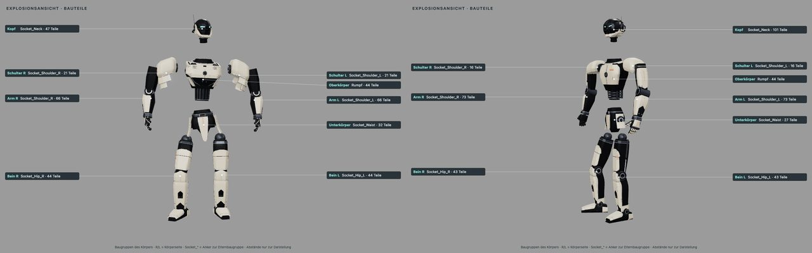

fertig – Scout entsteht ohne Blender im three.js-Generator (44/44 Meshes, Box je Objekt ≤ 0,09 mm, IoU 0,9990–0,9997, eigener Skin-Atlas); die Masken-Schnitte laufen über eine geprüfte Stufentabelle (Node: Paladin 9,6 → 4,5 s, Mechanik 12,0 → 4,0 s); Schultern sind im Viewer eine eigene Baugruppe; Motivbögen auf Schwarz werden zu Decals. Merge durch Sightline nach Ja des Nutzers.

# 0.17 „Outrider“ – Scout im three.js-Generator, Ladezeit der Masken-Schnitte

Auftrag (Sightline, 30.10.2026, [Übergabe](../uebergabe-0.14-etappe2.md) › Offen 1 und 2): Scout aus `blender/scout/` in den three.js-Generator
übertragen und gegen das Lieferpaket messen; die Ladezeit der Masken-Wiederholungen (Paladin, Mechanik) erst messen, dann senken.
Nebenaufgabe: Motivbögen auf Schwarz in `skin_swatches.py`, SciPy in die Anforderungen. Während der Arbeit kam ein Nutzerwunsch dazu:
die Schultern von den Armen trennen (eigene Baugruppe gewählt). Sitzung **CRITIC 0.17 „Outrider“ · Mac**, Branch
`claude/critic-0.17-outrider`, Basis `565f444` (0.16 „Swatch“). Opus 5.5, `high`.

## 1 · Scout im three.js-Generator

`web/src/robotgen/scout.js` baut die Szene von `assets/helmet-scout/assembled/scout.glb`: 44 Meshes mit Namen, Extras, Gruppen,
Explosionsversätzen und den flachen Materialien des Lieferpakets. Übertragen ist nur der Weg zu den exportierten Teilen von
`run.py › bauen_lauf6b` – Teile, die der Blender-Generator baut und wieder entfernt (Maske, Wangenplatten, Leuchtkörper, Lauf-3-Module),
fehlen bewusst. Aufbau, Dateien und Abweichungen: [HELM_SCOUT.md](../HELM_SCOUT.md#threejs-generator-017-outrider).

- **Guss S01–S04** aus `blender/scout/guss_2h.npz`, gelesen von `npz.js` (Zip64, Deflate über `zlib` bzw. `DecompressionStream`),
  dann wie in Blender: Innenschicht der Haube weg, Krempe gekappt, Mundwanne S05 (Ebenenschnitte nach `bmesh.bisect_plane`, Rand am
  unversehrten Guss per Raycast), Schattierung nach Winkel mit harten Augenrändern. Punkte/Flächen der Teile wie im Manifest
  (Haube 72 470/69 649 statt 72 475/69 653).
- **Unterhelm S06–S09** aus Kopfvolumen, Prismen, Halbräumen und Zylindern. three-bvh-csg (float32) versagte an den verketteten
  Kieferschnitten: ohne Zwischenreparatur offen, Kinnblock 4 mm zu breit; mit Reparatur nach jedem Schritt 93 s. `bsp.js` (BSP-Booleans
  nach csg.js, doppelte Genauigkeit) liefert exakte, geschlossene Teile in ≈ 1,7 s.
- **Anbauten S10–S13**: Funkmuscheln (Superellipsoid, Ring, Kappe, Halter, Bügel), Antennen, Rückmodul mit Feld, Hebel und Schrauben,
  Spiralkabel als Kurve mit 10-Punkt-Profil und Hülsen; Blenders `orthogonal`/`rotation_difference` nachgebaut, damit Spirale und
  Zylinder gleich liegen.
- **Viewer:** `?model=scout&gen=three`, als Helm auf jedem Körper mit `&gen=three`; Navigation „Modelle › Quelle: GLB / three.js“,
  die Links behalten die Quelle. **Skin-Atlas** `assets/skins/scout-three/` (Deckung 57 %).

| Prüfung (`scoutgen.test.mjs`, `robotgen_compare.mjs --model=scout`) | Ergebnis |
|---|---|
| Objekte, Extras, Gruppen und Versätze gegen `manifest.json`/`parts.json` | 44/44 identisch |
| Box je Objekt (H = 1,0 ≈ 300 mm) | max. 0,089 mm (Spiralkabel R); alle anderen ≤ 0,03 mm |
| Umriss-IoU vorn / links / hinten / rechts | 0,9993 / 0,9997 / 0,9990 / 0,9994 |
| Dreiecke three.js (GLB) | 182 438 (180 248) |
| CSG-Teile geschlossen, außen orientiert; Aufbau deterministisch | ja |
| Skins mit `&gen=three` (`verify`) | Scout allein und auf Paladin 44/44 im Atlas `scout-three` |

## 2 · Ladezeit der Masken-Schnitte

Gemessen (`web/tools/robotgen_bench.mjs`, Median aus drei Läufen, Mac unter Last: ein Blender-Lauf einer anderen Sitzung belegte
≈ 4 Kerne, Last 6–10): Die Maske ist der Großteil der Zeit – Paladin 4,9 von 6,1 s Teilezeit, je Versuch ≈ 0,3–0,5 s.

Entscheidung zwischen den beiden Wegen der Übergabe, beide gemessen:

- **(b) Schneider je Auge vorher vereinigen** (Experiment über 17 Stufen je Körper): schließt genauso zufällig wie heute (Wächter jetzt
  bei Stufe 0 offen, Paladin und Mechanik bei 0 geschlossen, insgesamt etwa jede dritte Stufe), je Versuch nur ≈ 25 % schneller. Verworfen.
- **(a) Geprüfte Tabelle** – umgesetzt: `src/robotgen/cutStages.json` (Paladin `SEG_head/mask` 8, Mechanik `SEG_head/mask` 14 und
  `SEG_head/cheek_l` 1, geschrieben von `tools/robotgen_cut_stages.mjs`). `firstClosed` schneidet zuerst mit der Tabellenstufe; nur wenn
  die nicht schließt (andere Plattform, geänderter Teil), sucht es wie bisher ab 0 (Stufe übersprungen). Ergebnis geometrisch identisch,
  Skin-Atlanten unverändert gültig. Test: auf der Plattform der Tabelle (darwin-arm64, Node 24.19) muss jedes gelistete Teil sofort bei
  seiner Stufe schließen und jedes andere bei 0; auf Linux-CI nur Hinweis, die Geschlossenheitstests bleiben dort unverändert.

Messung vorher/nachher (gleicher Code, Tabelle leer = Verhalten vor 0.17; Mac unter Last 9–13 durch einen Blender-Lauf einer anderen
Sitzung, daher streuen Einzelwerte um den Faktor 2):

| Aufbau | Paladin vorher | Paladin nachher | Mechanik vorher | Mechanik nachher |
|---|---|---|---|---|
| Masken-Schnitte (deterministisch) | 9 | 1 | 15 (+2 Wange) | 1 (+1 Wange) |
| Node, 5 Paare abwechselnd, Median | 9,6 s | **4,5 s** | 12,0 s | **4,0 s** |
| Headless, `gen=three`, zwei Runden je 3 Ladungen (Median) | 15,5 / 19,9 s | 12,7 / 13,6 s | 11,1 / 15,6 s | 12,2 / 14,6 s |
| Headless, GLB zum Vergleich | 1,6–4,8 s | | 2,9–4,7 s | |
| Vor der Arbeit (13:00, gleiche Last) | Node 7,3 s, Headless 15,9 s | | Node 10,2 s, Headless 14,9 s | |

In Node halbiert bzw. drittelt die Tabelle den Aufbau. Im Headless-Browser ist der Gewinn unter dieser Last nicht sauber messbar: Der
Rest (übrige Fugen, Lofts, Shader-Aufbau mit Software-GL) überwiegt. Scout aus dem Generator: Node 1,4 s, Headless 6,6 s (GLB 3,3 s).
Der Nutzer hat deshalb am 30.10. **Weg 1** gewählt: Der three.js-Generator wird zum Export-Programm, das die GLBs vorab baut; der Viewer
lädt dann nur Dateien (eigene Version 0.18, [Übergabe](../uebergabe-0.14-etappe2.md)).

## 3 · Schultern als eigene Baugruppe (Nutzerwunsch)

Frage des Nutzers: „sind alle Bauteile getrennt?“ – ja, jedes Teil ist ein eigenes Mesh in seinem Segment; nur gehörten die
Schulterpanzer zum Oberkörper und die Schulterkugel zum Arm. Auf Wunsch („Schultern von den Armen getrennt“, Wahl: eigene Baugruppe)
hängt der Viewer sie in `SHOULDER_R/L` (`web/src/robotShoulders.js`): eigene Explosion (150 mm seitlich, 20 mm hoch), Etiketten
„Schulter R/L“, Zweig im Bauteilbaum, Nahansicht. Weltlage und Atlas-Schlüssel bleiben (`userData.sourcePath`); GLB, `parts.json` und
Generator unverändert. Wächter und Paladin 21, Mechanik 16 Teile (mit Schulterkolben).

## 4 · Motivbögen auf Schwarz, SciPy

`python3 tools/skin_swatches.py --decals <bogen> <ziel> <skin>` macht aus einem 4 × 4-Bogen auf Schwarz `<skin>_decals.png` (Alpha aus
der Helligkeit, Farbe durch Alpha geteilt, leere Zellen gemeldet, nicht quadratische Bögen abgelehnt). `scipy==1.18.1` steht in
`web/requirements.txt` (Python ≥ 3.12, Wheels für cp312 Linux und macOS), damit `test_skin_tools.py` in CI läuft.

## Prüfungen

| Prüfung | Ergebnis |
|---|---|
| Node-Tests | 124/124 (neu 17: `scoutgen.test.mjs` 8 – npy, `bisect`, BSP, Objekte/Gruppen, Box je Objekt, Materialien, Topologie, Geschlossenheit/Determinismus/Explosion; `robotShoulders.test.mjs` 4; Stufentabelle je Körper 3 und Reihenfolge Tabelle→Suche 1; Scout-Atlas `scout-three` 1); Python-Tests OK, `test_skin_tools.py` neu mit Motivbogen und jetzt mit SciPy auch in CI |
| Gegenprobe | Ohrmuschel um 4 mm versetzt → Box-Test rot (1,21 mm); Schultern mit `add` statt `attach` und ohne `sourcePath` → Schulter-Test rot; Paladin-Maskenstufe 8 → 7 → Tabellentest rot; Decals ohne Teilen durch Alpha → Decal-Test rot; Stufenreihenfolge-Test war zunächst selbst falsch (Stufe schloss im Test) und ist korrigiert; alles zurückgesetzt grün |
| `vite build`, `./check` | grün; `guss_2h.npz` als Asset gebündelt, Generator als eigener Chunk |
| `verify` | VERIFY_RESULT |
| Vergleich GLB ↔ three.js (`robotgen_compare.mjs --model=scout`) | IoU 0,9993/0,9997/0,9990/0,9994, Kontaktbögen oben, keine Konsolenfehler |
| Sichtprüfung | Scout vier Ansichten, fünf Nahaufnahmen flach und gealtert, Explosion; Paladin/Mechanik explodiert mit Schultern, Paladin mit Scout (`gen=three`) montiert |
| Richter | JUDGE_RESULT |

Ist-Zeit ≈ IST_ZEIT

Belege außerhalb des Repos: `~/Library/Caches/Critic/0.17/` (`scoutgen/` mit Renders, Masken, Bögen, `compare.json`; Aufnahmen der
Schulter-Explosion). Kein MP4: keine Bewegung geändert (die Explosion ist ein Zustand, kein Ablauf).

## Nicht in dieser Version

- Umstellung auf `gen=three` und Archivieren von Blender (nur nach Ja des Nutzers); eigene Helmbilder liefert der Nutzer.
- Schnellerer BSP-Schnitt Kern ∩ Kopfvolumen (≈ 1,7 s des Scout-Aufbaus) – Ansatz in der [Übergabe](../uebergabe-0.14-etappe2.md).
- Rückmodul-Feld ohne Fase (Blender fast auch das Feld).
