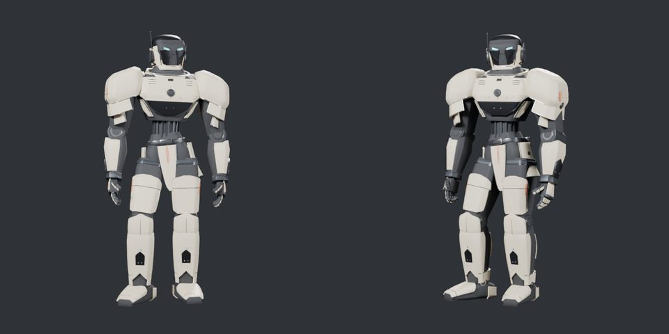

fertig – Der three.js-Generator ist ein Export-Programm: `robotgen_export.mjs` schreibt Lieferpakete für Wächter, Paladin, Mechanik und Scout, der Viewer lädt sie (headless 1,2–2,5 s statt 4,3–6,4 s aus dem Generator live, so schnell wie die Blender-GLBs); Konsistenztest Export ↔ Generator grün, ein Skin-Atlas je Modell, Blender-Generatoren im Archiv, Cycles nur noch optional aus den GLBs. Merge durch Sightline nach Ja des Nutzers.

# 0.18 „Prefab“ – Generator als Export-Programm, Blender nur noch Cycles-Render

Auftrag (Sightline, 30.10.2026, Ja des Nutzers vom selben Tag, [Übergabe](../uebergabe-0.14-etappe2.md) › Weg 1): (1) Der three.js-Generator
baut Körper und Scout vorab, der Viewer lädt nur Dateien, ein Test hält Export und Quelle zusammen; (2) Blender raus aus der Werkzeugkette –
Generatoren ins Archiv, Blender nur noch als optionaler Cycles-Render aus den exportierten GLBs. Sitzung **CRITIC 0.18 „Prefab“ · Mac**,
Branch `claude/critic-0.18-prefab`, Basis `719516b` (0.17, inzwischen als `1bfe965` in `main`). Opus 5.5, `high`.

## 1 · Export-Programm

`web/tools/robotgen_export.mjs` baut in Node mit `buildRobotBody` bzw. `buildScout` und schreibt Pakete im Format der Blender-Pakete
([Aufbau](../ROBOTER_BALLON.md#export-018-prefab)):

| Paket | Dateien | Meshes | Dreiecke | GLB |
|---|---|---|---|---|
| `assets/robot-bodies-three/waechter/` | `assembled/waechter.glb`, `parts.json`, `manifest.json` | 408 | 377 735 | 8,8 MB |
| `assets/robot-bodies-three/paladin/` | dto. | 383 | 353 108 | 8,2 MB |
| `assets/robot-bodies-three/mechanik/` | dto. | 380 | 353 001 | 8,2 MB |
| `assets/helmet-scout-three/` | `assembled/scout.glb`, `exploded/scout_exploded.glb`, `parts.json`, `manifest.json` | 44 | 182 438 | 2 × 4,2 MB |

- `GLTFExporter` in Node mit kleinem `FileReader`-Ersatz; die Wurzeln kommen in eine `THREE.Scene`, damit die GLB-Wurzeln wie bisher die
  Segmentknoten (Scout: die Meshes) sind – sonst entstünde eine zusätzliche Ebene und alle Atlas-Schlüssel änderten sich.
- `parts.json` ist inhaltlich gleich der Blender-Fassung (Körper: bisheriger Test `robotgen.test.mjs`; Scout: gleiche Gruppen und Versätze).
- `manifest.json` wie bisher (Objekte mit Baugruppe, Teil, Seite, Punkten, Dreiecken, Bounding-Box in Blender-Koordinaten, Maße je
  Baugruppe) plus `digest` je Mesh und `generator`: sha256 über alle 22 Dateien in `web/src/robotgen/` und das Export-Programm, Versionen
  von three 0.186.1, three-bvh-csg 0.0.18, three-mesh-bvh 0.9.16, Plattform `darwin-arm64 node 24`.
- Zwei Läufe bytegleich (`--check` nach dem Export: keine Abweichung). Export aller vier ≈ 15 s (Mac unter Last).
- **Viewer:** `&gen=export` (Standard) lädt die Pakete, `&gen=three` baut live, `&gen=blender` lädt die eingefrorenen Blender-GLBs
  (`robotBodies.js › SOURCES`); Navigation „Quelle: Export / Live / Blender“. `robotgen_compare.mjs` vergleicht jetzt Blender-Referenz
  und Export, `robotgen_bench.mjs --browser` misst alle drei Quellen abwechselnd.

**Konsistenztest** `web/tools/robotgen_export.test.mjs` (12 Tests, je Modell drei): Eingaben-Hash im Manifest = aktueller Generator;
Manifest beschreibt den gelieferten GLB Mesh für Mesh (Namen, Punkte, Digest); ein frischer Export ergibt dieselben Bytes auf der
Plattform des Pakets – sonst nennt die Meldung die abweichenden Meshes und den Befehl. Auf einer anderen Plattform (Linux-CI, dort kann
three-bvh-csg einzelne Fugen anders triangulieren) vergleicht er Meshes, Extras, Materialien und Boxen auf 0,1 mm.

## Ladezeit

Gemessen mit `node web/tools/robotgen_bench.mjs --browser --runs=3`: Zeit bis `window.__ready` im Headless-Viewer (Software-GL),
Median aus drei Ladungen nach einer Aufwärmrunde, die drei Quellen je Runde abwechselnd geladen, damit wechselnde Last alle gleich trifft.
Der Mac war belastet (Sitzungen anderer Repos, in Runde 1 zusätzlich die eigene Cycles-Probe); zwei Runden:

| Modell | Export (neu, Standard) | Live `&gen=three` (vorher) | Blender-GLB | Node-Aufbau |
|---|---|---|---|---|
| Wächter | 2,2 / **1,2 s** | 8,9 / 4,7 s | 3,3 / 1,2 s | 3,9 / 1,5 s |
| Paladin | 4,7 / **1,2 s** | 16,3 / 4,7 s | 3,7 / 1,2 s | 4,0 / 1,5 s |
| Mechanik | 2,4 / **1,3 s** | 8,0 / 6,4 s | 2,1 / 2,0 s | 3,4 / 2,2 s |
| Scout | 3,0 / **2,5 s** | 11,3 / 4,3 s | 3,5 / 2,4 s | 1,8 / 0,7 s |

Runde 1 bei Last 15–36, Runde 2 bei Last 6–11. Der Export lädt so schnell wie der Blender-GLB (gleiche Größe, flache Materialien) und
3,5- bis 5-mal schneller als der Live-Aufbau; Scout bleibt etwas langsamer, weil Montage und Explosion als zwei GLBs geladen werden.
Rohdaten: `~/Library/Caches/Critic/0.18/bench.json`.

## Skin-Atlanten

Die exportierten GLBs haben nach dem GLTFLoader-Rückimport dieselben Meshes wie der Live-Aufbau: Schlüssel und Signaturen aller
408/383/380/44 Meshes passten ohne Neubacken auf die bisherigen `-three`-Atlanten. Diese sind jetzt die einzigen Atlanten
(`assets/skins/<modell>/`); die Atlanten der Blender-GLBs sind entfernt, `atlasName` und `skin_bake.mjs --gen` entfallen. Neu gebacken
aus den GLBs (`node web/tools/skin_bake.mjs --model <name>`):

| Modell | `maps.png` | Einträge geändert | Grund | Deckung |
|---|---|---|---|---|
| Wächter | bytegleich | 5 (Maske, Schienbeinschalen, Schulterpanzer) | GLTFExporter normiert deren CSG-Normalen; xatlas verschweißt nach Normalen | 49,9 % |
| Paladin | bytegleich | 3 (Maske, Schienbeinschalen) | dto. | 49,6 % |
| Mechanik | bytegleich | 3 (Gesichtsmitte, Schienbeinschalen) | dto. | 50,2 % |
| Scout | neu gepackt | Haube S01 (168 747 → 100 534 Atlas-Punkte), dadurch alle UVs | dto.; besser verschweißt | 57,4 → 58,5 % |

Die Signatur der Atlas-Einträge (Punkte, Ecken, Box) ist für Export und Live-Aufbau gleich, deshalb passt derselbe Atlas auf beide
(`skins.test.mjs` prüft je Modell beide; CSG-Teile tragen weiter gebackene Positionen für andere Plattformen). `&gen=blender` zeigt
Skins ohne Karten (Warnung in der Konsole).

## 2 · Blender raus aus der Werkzeugkette

- `blender/robot/` und `blender/scout/` → `archive/blender/` (Git-Umbenennung, Geschichte bleibt; [Archiv-Index](../../archive/blender/README.md)).
- Eingaben des Generators nach `web/src/robotgen/data/`: `guss_2h.npz`, `helm_params.json` (Scout), `SOURCE.json` (Ballon-Pin, gelesen
  von `robotBodies.test.mjs` und `robotgen_dump_spec.py`). Pfade in `scout.js`, `scoutGuss.js`, `src/scout.js`, `scoutGussNode.mjs`.
- Die Blender-GLBs `assets/robot-bodies/`, `assets/helmet-scout/` bleiben unverändert als Referenz; `robotgen.test.mjs`,
  `scoutgen.test.mjs` und `robotgen_compare.mjs` messen weiter gegen sie.
- **Cycles-Render** `blender/cycles_render.py`: liest einen exportierten GLB in eine leere Szene, Kamera und drei Flächenlichter an einem
  Drehpunkt (Licht dreht mit, wie im Viewer), Cycles auf der GPU (Metal/OptiX/CUDA/HIP, sonst CPU), Ansichten `front,left,back,right,three_quarter` oder `--turntable N`.
  Kein Pflichtschritt; unter `./ce lock gpu -- …`. Probe: Paladin, 640², 24 Samples, zwei Ansichten in 19 s.

## Prüfungen

| Prüfung | Ergebnis |
|---|---|
| Node-Tests | 132/132 (neu: `robotgen_export.test.mjs` 12; `skins.test.mjs` zusammengeführt: je Modell GLB und Live-Aufbau in einem Test, 4 statt 8) |
| Python-Tests | `test_iou.py`, `test_save_pass.py`, `test_skin_tools.py` OK |
| `vite build`, `./check` | grün |
| `verify` | grün: Rost auf Wächter 408/408, Paladin 383/383, Mechanik 380/380, Scout allein und auf Paladin 44/44 (alle aus dem Export), Paladin mit Scout live 383/383 und 44/44; Helm H IoU 0,909 wie zuvor |
| Gegenprobe | Kommentaränderung in `src/robotgen/` nach dem Export → Eingaben-Test und Byte-Test rot (`manifest.json differ … (meshes: none)`); Rückmodul 1,2 mm tiefer (`helm_params.json › backBox.d`) → rot mit Liste der Meshes (Rückmodul, Hebel, Kabel, Hülsen); dieselbe Änderung mit Manifest-Plattform `linux-x64` → Box-Test rot (0,004 H); unverändert mit `linux-x64` → grün über den Box-Vergleich; alles zurückgesetzt, `--check` ohne Abweichung |
| Sichtprüfung | `robotgen_compare.mjs` Blender ↔ Export, alle vier: IoU Wächter 0,9992/0,9988/0,9995/0,9989, Paladin 0,9992/0,9987/0,9994/0,9988, Mechanik 0,9992/0,9985/0,9992/0,9988, Scout 0,9993/0,9997/0,9990/0,9994 – gleich den Werten aus 0.14/0.15/0.17; Nahbögen ohne Unterschied; Cycles-Probe angesehen |
| Richter | JUDGE |

Belege außerhalb des Repos: `~/Library/Caches/Critic/0.18/` (Cycles-Probe, Vergleichsbögen, Ladezeit-Rohdaten). Kein MP4: keine
Bewegung geändert.

Ist-Zeit IST_ZEIT

## Nicht in dieser Version

- Ego-Arme aus BALLON (eigener Auftrag, Nexogen 1.20.34); schnellerer BSP-Schnitt am Scout-Kern.
- Normalen der CSG-Teile im Generator normieren (dann wären Live-Aufbau und Export bis in die Normalen gleich) – [Übergabe](../uebergabe-0.14-etappe2.md) › Offen 3.
- Eingegangen während der Arbeit (Postfach, REF 0.33 „Gaitline“): Messwerte zur Außenansicht des Ganzkörpers (Atemhub, Leerlauf,
  Wende) für die spätere Pose – nicht Teil dieser Version.
