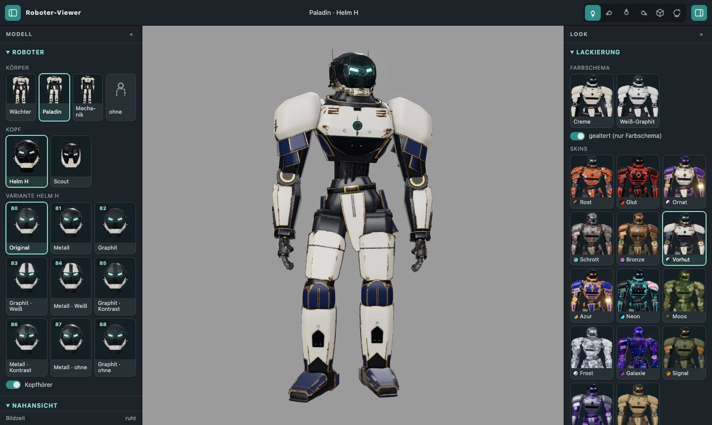
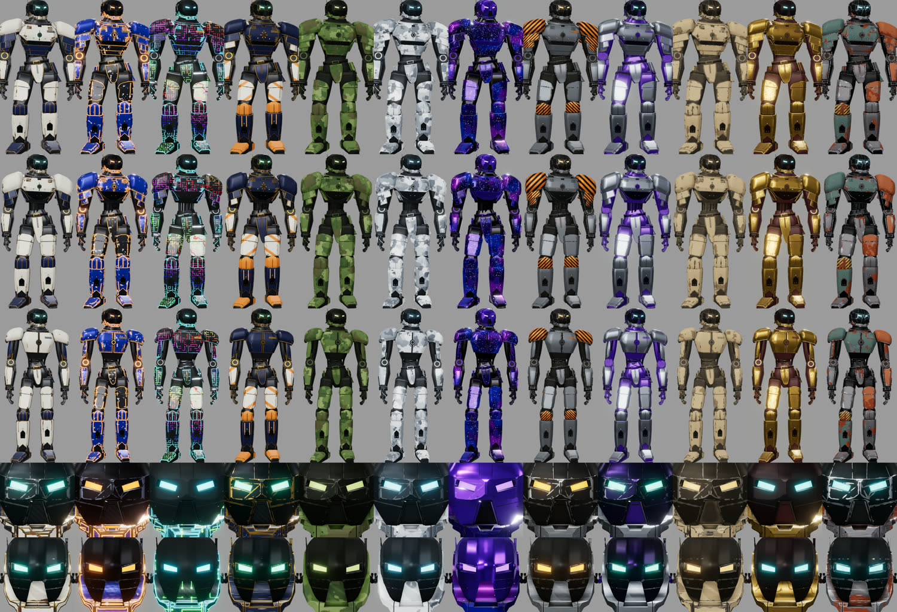

fertig – zehn neue Skins nach den Nutzerbildern (Vorhut, Azur, Neon, Orbit, Moos, Frost, Galaxie, Signal, Chrom, Sand), Bronze und Schrott neu, Navigation neu aufgebaut (Leiste oben, zwei einklappbare Seitenleisten, Bildkacheln), ohne Seitenneuladen, mit Ladebalken. Merge durch Sightline nach Ja des Nutzers.

# 0.20 „Livery“ – neue Skins, Seitenwechsel ohne Neuladen, Ladebalken

Auftrag (Nutzer, 30.10.2026, sechs Bilder): „Neue Skins – versuche dich mal daran. Kannst du auf die Website einen Ladebalken für z. B.
Seitenwechsel einbauen und es wäre cool, wenn die Navigation nicht immer mit nachladen würde.“ Sitzung **CRITIC 0.20 „Livery“ · Mac**,
Branch `claude/critic-0.20-livery`, Basis `44f6874` (0.19). Opus 5.5, Denkaufwand niedrig.

## 1 · Skins

Zehn neue Rezepte in `web/src/skins.json` (Orbit kam auf Nachfrage zu Bild 6 dazu), rein prozedural (keine neuen Bilddateien), für Wächter, Paladin, Mechanik, Helm H und Scout.
Tabelle der Vorlagen und Schichten: [SKINS.md › Skins nach Nutzerbildern](../SKINS.md#skins-nach-nutzerbildern-020-livery-30102026).

Neue Schichten im Mischer (`web/src/skinShader.js`):

| Schicht | Wofür | Prinzip |
|---|---|---|
| `carbon` | Unterbau von Vorhut und Azur, alles bei Neon | Köperbindung 2/2 je Faserbündel auf der Achsenebene der Normale; unter einem Pixel Mittelwert |
| `circuit` | Neon | Rasterkanten sind mit Wahrscheinlichkeit `density` Bahnen, beide Nachbarzellen sehen denselben Wert → durchgehende Bahnen, Sackgassen mit Lötauge; Regenbogen über `hue_per_m` |
| `sparkle` | Galaxie | ein versetzter Punkt je 3D-Zelle, Anteil `density` leuchtet |
| `stripes.jitter` | Signal (Warnstreifen) | `0` = gleich breite Streifen; ohne Angabe bleibt der GLSL-Code der alten Rezepte gleich (Test) |

Tarnflecken (Moos, Frost) und Nebel (Galaxie) sind `wear`-Schichten mit `edge_weight: 0`. Jedes Rezept hat `swatch` (zwei Farben), die
Skin-Knöpfe zeigen sie als Punkt. Abgestimmt im App-Browser auf Wächter, Paladin und Mechanik mit Helm H, Helm H allein; nachgeschärft:
Neon-Bahnen lichter (Zelle 9 → 16 mm, Linie 0,8 → 1,1 mm, Dichte 0,42 → 0,30, aus der Ferne länger sichtbar), Azur dunkler und weniger Abplatzer, Chrom rauer und dunkler (Rauheit 0,10 → 0,45, Grundfarbe dunkler: kein
Bloom-Überstrahlen an den Softboxen), Vorhut ohne Goldscheiben an den Gelenken.

## 2 · Seitenwechsel ohne Neuladen

Bisher setzten Modell-Links und mehrere Einstellungen (`Quelle`, Variante und Kopfhörer von Helm H, Farbschema eines Helms allein)
`location.search` – die Seite lud neu, Navigation, Shader und GLBs inklusive. Jetzt (`web/src/main.js`):

- `readPage(query)` prüft alle URL-Parameter und lädt Modell, Helm und Skin-Atlanten, **ohne** den gezeigten Zustand zu ändern. Ein
  Fehler oder ein späterer Klick (`pageRun`) lässt die aktuelle Seite stehen.
- `enterPage(page)` gibt das alte Modell frei (vorbereitete Skins, gealterte Kopien, Geometrie von Helm H; GLB-Geometrie bleibt im
  Loader-Cache), setzt den Zustand, baut Modell, lil-gui, Navigationsinhalt; Kamera nur bei anderem Modelltyp neu (Körper → Körper
  bleibt stehen). `robotLook`, `robotHelmet`, `presentationOptions` bleiben dieselben Objekte (verify greift über `window.*` darauf zu).
- `go(search)` verbindet beides mit Ladebalken und `history.pushState`; `popstate` lädt die Seite aus der URL. Klicks mit Strg/⌘ oder
  Mitteltaste öffnen wie bisher einen neuen Tab (`navigation.js › onLink`).
- Navigation: Rahmen einmal, `clear()` leert den Inhalt; offene Abschnitte und Scrollstand bleiben.

## 3 · Ladebalken

`web/src/loadingBar.js`: 3 px Balken oben über dem Bild mit Text, kriecht gegen 90 %, springt am Ende auf 100 % und blendet aus; Fehler rot
mit Meldung (6 s). Schon in `index.html` sichtbar („Lade Viewer …“), bis das dritte Bild steht. Seiten-, Helm- und Skinwechsel laufen
darunter. Neue Shader kompilieren per `renderer.compileAsync`; solange zeichnet die Schleife nicht (`compiling`), das letzte Bild bleibt
stehen, statt dass der Tab beim Kompilieren einfriert. Nebenbei: die Explosionsbeschriftung ist bis zum ersten Bild verborgen (sie
blitzte während des Ladens auf, weil sie jetzt vor dem Modell entsteht).

## 4 · Kontrast, Bronze und Schrott neu, Neon überarbeitet (Nachauftrag)

Nutzer: „…Skins wie Neon, Bronze, Schrott, Moos, Frost, Galaxie – dass da ein gewisser Kontrast wie bei den anderen Skins herrscht
(weiße Panzerplatten, schwarze Mechanik zum Beispiel)“, „Überarbeite die Skins Schrott und Bronze generell“, „Neon sieht auch irgendwie
merkwürdig aus“.

- **Regel:** Muster und Farbe nur auf den Platten (`shell`, `accent`), Mechanik (`graphite`, `dark_metal`, `rubber`, `anodized`) dunkel.
  Moos (schwarz-oliv), Frost (anthrazit), Galaxie (glänzend schwarz): Tarnflecken, Moos, Nebel und Sterne nur noch auf den Platten.
- **Bronze** und **Schrott** prozedural neu ([SKINS.md](../SKINS.md#skins-aus-generierten-bildern-bronze-und-schrott-30102026)); die
  Kacheln und Motivbögen aus 0.16 bleiben als Material, ihre Schichten testet ein eigenes Testrezept.
- **Neon** neu: schwarz glänzende Platten, Leuchtbahnen im Verlauf Cyan → Magenta (Zelle 26 mm, Linie 2,2 mm, aus der Ferne lesbar),
  cyanfarbene Kanten, Mechanik helles mattes Carbon, Chromteile; ohne Graffiti.

**Nach den Renderbildern** (Nutzer: „…mehr an den Rendern orientieren. Ornat, Glut, Vorhut, Azur sieht krass aus“, dann „Die sollen
jetzt nicht alle gleich ausschauen. Ich habe mich auf die Render bezogen“ und „Auch hier die Devise: weiße Panzerplatten, schwarze
Mechanik“): Ein erster Versuch gab allen dieselbe Formel (abgesetzte Felder, Metallkante, Leuchtlinie, Emblem) – verworfen. Jetzt folgt
jeder Skin seinem Roboter im Render und behält den Kontrast Platten/Mechanik: Sand, Moos, Chrom, Frost, Signal (jetzt Gunmetal statt
Oliv, damit es sich von Moos abhebt), Galaxie, Neon (Carbon-Platten, mattschwarze Mechanik, weiße Sticker, orange Bauchlinie) und Bronze
(goldener Roboter aus Bild 5: graviertes Gold, weinroter Unterbau, türkise Augen statt Violett). Azur auf Nachfrage („Was ist denn
z. B. mit dem Render als Skin?“ – Bild 2 ist seine Vorlage) näher ans Bild: blaues Carbon statt flacher Farbe, breitere, hellere orange
Kantenlinie, Goldornament nur an Schultern und Brust, glühender Emblemkern, dunkle Gelenkscheiben mit orangem Ring, Kreidekratzer,
schwarze Carbon-Oberschenkel. **Orbit** (Bild 6, Nachfrage „Was ist denn z. B. mit dem Skin?“) neu: Navy mit Gold, weiße
Panzerteile mit Orange, orange Leiterbahnen an Brust und Schienbeinen, türkise Augen.

## 5 · Navigation neu aufgebaut (Nachauftrag)

Nutzer: „Die Navigation muss mal aufgeräumt und passend strukturiert werden. Ggf. kannst du ja auch mit Bildern, SVGs oder so arbeiten“,
„Navigation ein- und ausblendbar. Vielleicht kann man ja auch eine Navbar einbauen oder auch die rechte Seitenleiste verwenden“, „Wenn
ich den Helm auswähle, dann sollen die Varianten angezeigt werden. Helm H hat z. B. Varianten, Scout nicht“, „Was ist Farbschema
‚Original‘? Brauchen wir das?“, „Die Roboterauswahl und Kopfauswahl oben in der Navbar in die linke Seitenleiste“

| Vorher (eine Leiste links) | Nachher |
|---|---|
| Modell-Links als Textliste | links „Modell“ › Roboter: Körper (Wächter, Paladin, Mechanik, „ohne“) und Kopf (Helm H, Scout) als Bildkacheln – Körper und Kopf frei kombinierbar |
| Abschnitt „Modelle“ mit Quelle, Helm, Variante 80–88 als Zahlenknöpfe, Kopfhörer, Erklärtext | Varianten als Bildkacheln mit Nummer und Name, nur solange Helm H der Kopf ist; Kopfhörer als Schalter |
| – | Leiste oben: gezeigtes Modell, Ansichten als SVG-Icons, Schalter der Seitenleisten (die Modellwahl stand dort kurz als Bild-Tabs, auf Wunsch nach links verlegt) |
| „Lackierung“: 3 + 14 Textknöpfe | rechts „Look“ › Lackierung: Farbschemata und Skins als Bildkacheln (Ausschnitt Brust/Helm des Wächters) |
| „Ansichten“: 6 Textknöpfe + Nahansichten | Ansichten oben als Icons, Nahansichten links |
| „Look & Material“: Regler, Overlay, GLB-Export; Texturexport in der Lackierung | rechts „Darstellung“ (eingeklappt) und „Referenz & Export“ (Originalmaterialien, GLB, Skin-Texturen, Quelle) |
| lil-gui schwebte oben rechts über dem Bild | rechts „Helm-Geometrie“ (nur Helm H) |
| Leiste nur ganz einklappbar, Ersatzleiste unten | beide Leisten einzeln, Knöpfe oben, Tasten `[` `]`, gemerkt; Ersatzleiste unten entfällt |

**Vorschaubilder:** `web/tools/nav_thumbs.mjs` rendert headless (Metal auf dem Mac, 3 min) 30 JPEGs nach `web/src/navThumbs/`
(≈ 210 KB): 5 Modelle, 9 Varianten, 2 Farbschemata, 14 Skins, auf der Kachelfarbe der Leiste. Icons sind Inline-SVG in `navigation.js`.

**Farbschema „Original“:** jedes Modell in seinen eigenen Materialien; die Regel aus 0.12 ist ein Farbschema für alle Modelle (Creme,
Weiß-Graphit), „Original“ ist die Referenz von `verify` (`colors=original`, AGENTS.md: Materialien bleiben dort erhalten). Deshalb nicht
mehr in der Lackierung, sondern als Schalter „Originalmaterialien (Referenz)“ unter „Referenz & Export“; die URL bleibt.

## Prüfung

| Prüfung | Ergebnis |
|---|---|
| `npm test` (Node 24, Mac) | 138/138 grün, davon neu `skins.test.mjs` › Vorschaubild je Skin, Variante, Farbschema, Modell und › 0.20-Schichten (carbon/circuit/sparkle im GLSL, Streifen ohne `jitter` unverändert, Farbpunkt je Skin, Radius je `wear`); Python-Tests grün |
| `npm run build` | grün |
| `npm run verify` | grün: alle 15 Skins kompilieren und rendern auf Wächter + Helm H (`rost:2 … orbit:2`); **Seitenwechsel**: Paladin → Mechanik → Scout per Kachel-Link der linken Leiste im selben Dokument, Skin Glut bleibt, Zurück zeigt wieder Mechanik; Rost-Atlanten wie bisher 408/383/380/98/44; Helm H IoU 0,909 wie zuvor |
| `./ce check` | grün |
| Sichtprüfung | App-Browser 1440 und 1100 px: Leisten ein/aus (Knöpfe, `[` `]`), Körper × Kopf in allen Kombinationen (Varianten nur bei Helm H), „ohne“ Körper, Farbschema ↔ Skin ↔ Originalmaterialien, lil-gui in der Leiste; Wechsel Wächter ↔ Paladin ↔ Mechanik ↔ Scout ↔ Helm H, Zurück/Vor, Quelle Live, Helm Scout, Skins; keine Konsolenfehler außer den bekannten BVH-Hinweisen des Live-Generators |

**Belege** (außerhalb des Repos, `~/Library/Caches/Critic/0.20/`):
- `skins/kontaktbogen_skins.jpg` – zwölf neue bzw. überarbeitete Skins (Spalten) auf Wächter, Paladin, Mechanik, Helm H, Scout (Zeilen), GPU-Chromium;
  verkleinert im Repo als [`docs/bilder/livery_skins.jpg`](../bilder/livery_skins.jpg).
- `clip/navigation_ladebalken.mp4` – 22 s, 720p: Wächter → Paladin → Azur → Neon → Mechanik → Galaxie → Scout → Zurück, mit Ladebalken;
  Ablauf geändert, daher ein Clip.

## Ist-Zeit

≈ 4 h 30 min (mit fünf Nachaufträgen): Warten 55 min (sieben verify-Läufe, drei davon durch Änderungen während des Laufs ungültig –
Schutzprüfung „Source files changed“ bzw. Neuladen durch Vites Dateiwächter) · Rechnen 30 min (Vorschaubilder, Kontaktbögen, Clip) ·
Lesen 30 min (Viewer, Mischer, Rezepte, Teilelisten, Renderbilder) · Umsetzen 2 h 35 min.

**Lehre aus dem Ablauf:** Während `verify` keine Dateien unter `web/src`, `web/tools` oder `web/index.html` ändern – Doku ja.

**Umgebung:** Der Haupt-Checkout hatte kein `xatlasjs` in `node_modules` (der APFS-Klon war veraltet); aus einem aktuellen Worktree
nachgeklont. `verify` braucht NumPy für den IoU-Schritt: mit `uv run --no-project --with-requirements requirements.txt node verify_renders.mjs`.

🤖 Generated with [Claude Code](https://claude.com/claude-code)
