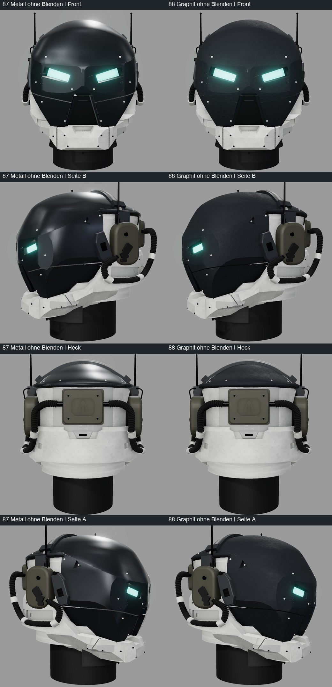

Fertig – Muster auf Nutzerwunsch vollständig entfernt; neun Varianten 80–88 bleiben erhalten. 45 Tests, Build und unabhängige Nachprüfung bestanden.

# 0.4 „Continuity“ – durchgängige Maske und Haubenvarianten

Die Augenmaske wirkte an ihren seitlichen Flächenknicken unterbrochen. Eine breitere, tangentiale Rundung verbindet
jetzt Augenfläche und Seitenfase bei erhaltener Form der akzeptierten Sehschlitze. Zwei separate Stirnblenden folgen
der gewölbten Haube über den Scheitel bis zur hinteren Haubenkante; der Mittelstreifen bleibt frei.

Der Nutzer wünscht außerdem Material- und Gestaltungsproben. Neun Stände bleiben einzeln abrufbar:

| Stände | Inhalt | Quelle |
|---|---|---|
| 80 | Neue Form mit Originalmaterial, dunkle Befestigungen | `9e1b495` |
| 81/82 | Metall beziehungsweise Graphit, helle obere Schrauben, dunkle Streifen | `9e1b495` |
| 83/84 | Graphit beziehungsweise Metall mit weißen Streifen | `9e1b495` |
| 85/86 | Graphit beziehungsweise Metall mit anthrazitfarbenen Kontraststreifen | `b773c1d` |
| 87/88 | Metall beziehungsweise Graphit ohne Stirn-/Scheitelblenden | `f90d7c4` |

Die hellen Befestigungen betreffen ausschließlich die dunkle Rüstung; Rahmen- und Funkschrauben bleiben dunkel.
Weiße Streifen übernehmen das vorhandene Rahmenmaterial. Anthrazitstreifen sind auf Graphit glatter, auf Metall matter
als ihre Umgebung. Die anschließend erprobten Muster 89–91 wurden vom Nutzer ausdrücklich komplett verworfen.
Musterfunktion, Optionen und aktive Musterexporte sind entfernt; die neun bisherigen Proben bleiben erhalten.
Die verworfenen Versuche sind nur im [Verlauf](../HELM_VERLAUF.md) und in der Git-Historie dokumentiert.
Das Video bleibt die maßgebliche Referenz; die erweiterten Streifen, symmetrischen Kopfhörer und Stilproben folgen
zusätzlichen ausdrücklichen Nutzerwünschen. Keine Variante wird aus positiver Rückmeldung zur verbindlichen Auswahl erklärt.

[Alle GLBs, Texturen und Reproduktion](../../assets/helmet-continuity/README.md) · [Stilbeschreibung](../HELM_STIL.md)
· [Agentendokumentation: Aufbau, Entscheidungen und visueller Eindruck](../HELM_AGENTEN.md)

[Metallvergleich](../bilder/helm_continuity_metall_auswahl.jpg) · [Graphitvergleich](../bilder/helm_continuity_graphit_auswahl.jpg)
· [Ohne Blenden](../bilder/helm_continuity_ohne_blenden.jpg)

## Umsetzung und Prüfung

- `templeRound`: Radius .055 und zehn Segmente; analytische Außennormalen an der neuen Rundung vor den Augenausschnitten.
- H20/H21: radiale Schalenoffsets entlang der Haube, transformierte Normalen, flacher Anschluss an die Maske.
- Unabhängige Optionen: `finish=original|metal|graphite`, `accents=original|light-fasteners|white-strips|contrast-strips`,
  `strips=on|off`. Entfernte `--crown-pattern`-Argumente werden als unbekannt abgewiesen.
- 102 Grundmeshes bleiben über alle neun Varianten geometrisch und in ihren Transformationen identisch.
  80–86 ergänzen H20/H21 (104 Meshes), 87/88 lassen sie weg (102). Kein Bemalungsträger mehr vorhanden.
- Geometrieprüfungen umfassen Augen, 640 Strahlen an den Rundungen, Streifenauflage/Wandstärke vorne/oben/hinten,
  freien Mittelstreifen und Bügelabdeckung. Materialtests prüfen alle zwölf Finish-/Akzentkombinationen ohne Geometrieänderung.
- **45 Tests bestanden:** 32 Node-, fünf IoU- und acht Belegsicherungsprüfungen. Build erfolgreich; bekannte Bundlegrößenwarnung bleibt.
  [Testausgabe](../../assets/helmet-continuity/tests-current.txt).
- Fünf zuvor bestandene Tests entfielen ausschließlich mit der verworfenen Musterfunktion. Keine fehlschlagenden Tests gelöscht.
  Die Streifen-Geometrieprüfung und der Test für die Ablehnung entfernter Optionen bleiben erhalten.
- Die ursprüngliche [Browserprüfung](../../assets/helmet-continuity/viewer-reset.txt) des Zwischenstands bestätigt
  den Reset-Erhalt der Blendenwahl; ihr zusätzlicher Mustersichtbarkeitsteil ist historisch und gehört zum entfernten Feature.
- **36 Ansichten der neun verbleibenden Proben visuell geprüft**, mit gleichen Kameras und Grundparametern.
  Die Silhouetten sind innerhalb 80–86 und innerhalb 87/88 jeweils identisch. Bei der Rücknahme wurden die bereits
  geprüften musterlosen Belege weiterverwendet: keine Geometrie, Materialwerte oder Renderparameter dieser Proben geändert.
- [Exportvergleich](../../assets/helmet-continuity/export-comparison.json) prüft GLB-Geometrien, Transformationen,
  Kameras, Silhouetten und Quell-/Ausgabehashes. Ausgabehash-Anzahlen für 80–88: 24/25/27/27/25/29/27/25/27 (236 Ausgaben).
  Jeder Quellhash wird gegen den zugehörigen Git-Stand aus der Tabelle geprüft; frühere Manifeste bleiben unverändert.
- Gegenüber 79 sind 97 Meshes bytegleich. Geändert: Maske, Wangen, obere Befestigungen, beide Streifen; zusätzlich
  numerische Abweichungen an `Visor_L` (Position maximal 2.12e−8, Translation 7.30e−9 Modelleinheiten).
  Augenmaße, Normalen, UVs und Ausrichtung bleiben erhalten. Keine Bytegleichheit der gesamten Augenbaugruppe behauptet.
- Vier unabhängige Prüfungen mit `./ce codex judge`, jeweils **Freigabe**:
  [Grundform/Materialien: GPT-6.1 Sol high](../../assets/helmet-continuity/code-review.txt),
  [Kontrastprofile: GPT-6 Luna medium](../../assets/helmet-continuity/code-review-contrast.txt),
  [Blenden und historischer Musterversuch: GPT-6.1 Sol high](../../assets/helmet-continuity/code-review-patterns.txt),
  [vollständige Musterrücknahme: GPT-6.1 Sol high](../../assets/helmet-continuity/code-review-patterns-removed.txt).
  Die ergänzend verlangte Browserabsicherung und Dokumentation des Zwischenstands sind ebenfalls dokumentiert.

| Ansicht | Mit Streifen 80–86 | Ohne Streifen 87/88 |
|---|---:|---:|
| Front | 90,22 % | 89,97 % |
| Seite B | 93,30 % | 93,15 % |
| Heck | 89,98 % | 89,98 % |
| Seite A | 90,06 % | 89,83 % |
| Mittel | **90,89 %** | **90,73 %** |

Die Silhouetten-IoU misst weder Materialqualität noch gesamte Referenzähnlichkeit. Die Vergleichsbilder zeigen Form
und Lichtantwort unmittelbar. Ohne Blenden wirkt die Haube nach Einschätzung des Agenten ruhiger. Diese Einschätzung
ist keine Nutzerfreigabe. Die Rücknahme der Muster ist dagegen eine ausdrückliche Nutzerentscheidung.

## Grenzen und Auswahl

Die Gestaltungsauswahl bleibt offen. Originalmaterial und eingeschaltete Streifen bleiben Standard;
der frühere Lieferexport 79 bleibt erhalten. Glanzunterschiede zwischen Ansichten sind weiterhin zu erwarten.
Die neue Rundung mildert den abrupten Knick, die übrige kantige Gesichtsform bleibt bestehen.
Bügel und Streifen überlappen innen etwa .002 Modelleinheiten; fertige Montagepassungen sind nicht zugesichert.
Die Baugruppen bleiben separat und prozedural erzeugbar.

Eine erste Metallprobe mit stärkerer Hauben-Farbstruktur wirkte fleckig. Die gespeicherte Metallprobe verwendet deshalb
gleichmäßige Graphitfarbe, die Rauheitskarte der bisherigen Maske und stark reduziertes Normalenrelief.

## Herkunft und Aufwand

Branch `codex/critic-0.4-continuity`, Basis `0a6bda5` aus dem offenen 0.3-Entwurf. Kein Merge auf `main`.
Vollständige lokale Belege und Zwischenproben: `/Users/ffunk/Library/Caches/Critic/helm-continuity-20261028/`.
Die neun aktiven Exportvarianten und verkleinerten Kontaktbögen sind im Repository gesichert; die drei verworfenen
Musterexporte bleiben über Commit `caf7a79` nachvollziehbar.

Ein gezielt eingesetzter Unteragent (GPT-6.1 Sol high) bearbeitete unabhängige Material-/Runner-/Mustercodeanteile und
Tests; Integration und Sichtprüfung erfolgten durch den Hauptagenten. Vier unabhängige Codex-Prüfungen, Modelle oben.
Kontingent zu Beginn: 27 % verbleibend; keine Ausweichprüfung nötig. Schwere Bildläufe verwendeten die GPU-Sperre.
Zwölf abgeschlossene Vier-Ansichten-Läufe (neun erhalten, drei Muster verworfen), zusätzlich Ausgangsreproduktion und Form-/Materialvorproben; keine Animation geändert.

Zeitanteile, grobe rückblickende Schätzung vom 28.10.2026 anhand lokaler Laufzeitstempel und Arbeitsverlauf:
**Warten <1 % / Rechnen etwa 15 % / Lesen etwa 10 % / Umsetzen und Dokumentieren etwa 75 %**.
Ein belegter Sperrenwarteabschnitt dauerte sechs Sekunden. Die Anteile sind keine exakte Zeiterfassung;
eine belastbare ursprüngliche Gesamtdauerschätzung wurde für den während der Arbeit erweiterten Umfang nicht festgehalten.
