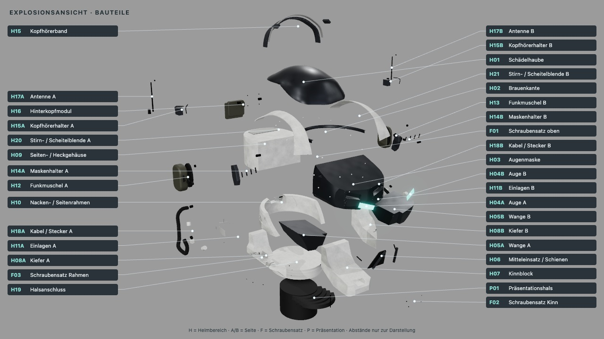

Fertig – Explosionsansicht, Headsetschalter und höhere Schulterstudie mit 54 bestandenen Tests, Build, unabhängiger Nachprüfung und geprüften Lieferexporten.

# 0.5 „Assembly“ – Explosionsansicht und kräftiger Oberkörper

Zwei Ziele: den vorhandenen Helm mit beschrifteten Einzelteilen und ausblendbaren Headsets untersuchbar machen;
darunter eine getrennte Hals-/Schulterstudie im bestehenden Stil ergänzen.

Die Explosionsübersicht trennt alle 104 Helm-Meshes und ordnet sie 34 beschrifteten Teilefamilien zu.
Die Teileliste nennt jedes enthaltene Mesh und die noch zu konstruierenden Verbindungen.
Kopfhörer, Band, Halter, Kabel und Antennen lassen sich gemeinsam ausblenden; Heckkasten und Helm bleiben stehen.

Der neue Oberkörper besteht aus 22 separaten geschlossenen Meshes. Nach Nutzerfeedback wurde der Hals von
0,49 auf 0,31 verkürzt, die Schulterbreite von 1,97 auf 2,3198 erweitert und die Kappen nach oben gewölbt.
Die höchste Schulterkontur steigt zuletzt um etwa 0,15, ohne Hals oder Brust erneut zu verschieben.
Alle Maße sind Modelleinheiten. Stilgrundlage bleiben helle Schutzschalen über dunklen Zwischenlagen.

[Aufbau, Parameter, Teile-IDs und offene Anschlüsse](../HELM_AUFBAU.md) ·
[Exporte und Reproduktion](../../assets/helmet-assembly/README.md) · [Stilbeschreibung](../HELM_STIL.md).

[Kopfhörer an / aus](../bilder/helm_assembly_headset.jpg) ·
[Erster Entwurf und beide Nutzerkorrekturen](../bilder/helm_assembly_schulterverlauf.jpg).

## Prüfung

- 54 Tests bestanden: 41 Node-, fünf IoU- und acht Belegsicherungsprüfungen.
- Build und `./ce check` grün; bekannte Bundlegrößenwarnung bleibt.
- Körperprüfung: geschlossene Kanten, konsistente Flächenrichtung, positive Volumina, deterministische Erzeugung,
  sichtbare Platten, getrennte IDs sowie korrigierte Hals-/Schulterproportionen.
- Alle vier weißen Kappen haben in der Ruhepose mindestens 0,3018 Abstand zum Helm ohne Headset.
- Explosionsprüfung: unveränderte Geometrie/Materialien, korrekte montierte und auseinandergezogene Welttransformationen,
  vollständige semantische Zuordnung; Drahtbügel über Metadaten statt Objektposition erkannt.
- [Exportvergleich](../../assets/helmet-assembly/export-comparison.json): alle 102 Meshes der Kontrolle sind gegenüber
  `graphite-plain` aus 0.4 geometrisch, in ihren Transformationen und Materialzuweisungen identisch; vier identische
  Silhouettenmasken. Ohne Headset bleiben 62 unveränderte Helm-Meshes, mit neuer Studie 56 plus 22 Körpermeshes.
- Rückimport des explodierten GLB: alle 104 Meshes, Positionen und Teilemetadaten erhalten;
  maximale Transformationsabweichung 5,56 × 10⁻¹⁶.
- [Browserprüfung](../../assets/helmet-assembly/viewer.txt): Headset-/Körperwechsel, Explosion, Reset, erhaltene Blendenwahl,
  vollständige Teileliste, 44 kollisionsfreie Beschriftungen bei kombinierter Körperansicht, Ausschluss aus Maskenbildern,
  Wiederverwendung der SVG-Leitlinien. Keine Browserfehler.
- Die [Testsuite](../../assets/helmet-assembly/tests.txt) deckt 53 Fälle ab; nach dem Befund zur Labeltransformation
  wurden die [drei betroffenen Assembly-Tests](../../assets/helmet-assembly/tests-label-transform.txt) einschließlich eines
  neuen Falls erneut bestanden. Damit 54 unterschiedliche bestandene Tests, keine Tests gelöscht.
- Unabhängige [Erstprüfung](../../assets/helmet-assembly/review-initial.txt) und
  [Nachprüfung](../../assets/helmet-assembly/review-followup.txt): GPT-6.1 Sol high für den größeren Geometrie-/Exportdiff.
  Befunde zu SVG-Erzeugung, Bügelzuordnung, Export-Rückimport und Labelkoordinaten behoben.
  Die abschließende [gezielte Prüfung](../../assets/helmet-assembly/review-final.txt) mit GPT-6 Luna medium
  gibt den Koordinatenfix frei. Ein `test_map.json` existiert hier nicht; `tools/*.test.mjs` wird automatisch ausgeführt.
  Präsentationsoffsets sind ausdrücklich Darstellungswerte, keine Konstruktionsmaße.

17 Ansichten der vier Lieferstände wurden gesichtet: vier Kontrolle, vier ohne Headset, vier Oberkörper und fünf Explosion.
Die Übersichtsansicht nutzt eine eigene Kamera; die übrigen Explosionskameras wurden für vollständigen Randabstand
erweitert und erneut gerendert: alle fünf Silhouetten liegen vollständig innerhalb des Bildes mit mindestens
acht Pixeln Rand. Statische Änderung, daher Standbilder statt MP4. Keine neue Aussage zur gesamten Referenzähnlichkeit aus der IoU.

Quellen: Kontrolle, Headset aus und Körper bei `6090262`; Explosion bei `3ff9958` (nur Kameradistanz angepasst).
Alle Quellen- und Ausgabehashes wurden geprüft; Manifeste werden nicht nachträglich auf neue Quellen umgeschrieben.

## Herkunft und Grenzen

Der Nutzer verwies auf die Titan-Auswertung in `cubeescape-reference`; sie wurde im separaten Worktree
`titan-style` gefunden. Ihre noch uncommitteten Dateien sind mit SHA-256 und gelesenen Abschnitten in
[HELM_AUFBAU](../HELM_AUFBAU.md#ergänzende-titan-referenz-und-herkunft) dokumentiert.
Gerundete geschichtete Gehäuse und dunkle Bewegungszonen unterstützen die gewählte Stilrichtung.
Die Quelle liefert keine allgemeingültigen Körpermaße; unsere Zahlen beruhen auf dem eigenen Modell und Nutzerfeedback.

Die neue Körperansicht ist eine statische Studie ohne Arme, Hände, Unterkörper oder Rig. Die Explosionsansicht
belegt Aufbau und Zuordnung, keine Fertigungsfähigkeit. Schrauben, Wandstärken, Toleranzen, Lager und Leitungen
sind noch zu konstruieren. Körper- und Explosionsbilder werden nicht gegen die Helm-Videosilhouette bewertet.
Das Video bleibt die Helmreferenz; keine finale Materialwahl und kein Merge auf `main`.

Belege liegen zusätzlich außerhalb des Repos unter `~/Library/Caches/Critic/helm-assembly-20261028/`.
Kontingentprüfung am Versionsbeginn: 17 % Rest; unabhängiger Richter innerhalb der geltenden Auswahl verwendet.
Alle neuen Bilder stammen aus den beschriebenen Prüfläufen. Der Bericht dient als PR-Beschreibung.

Ist-Zeit, grobe Schätzung anhand der Laufprotokolle: **Warten / Rechnen / Lesen / Umsetzen ≈ 8 / 10 / 6 / 25 Minuten**.
Warten auf die GPU-Sperre überlappte teilweise Dokumentation und Codeprüfung; keine lückenlose Zeiterfassung und
keine addierbare Abrechnung. Rechnen umfasst Tests, Builds, unabhängige Prüfungen und Renderläufe.
