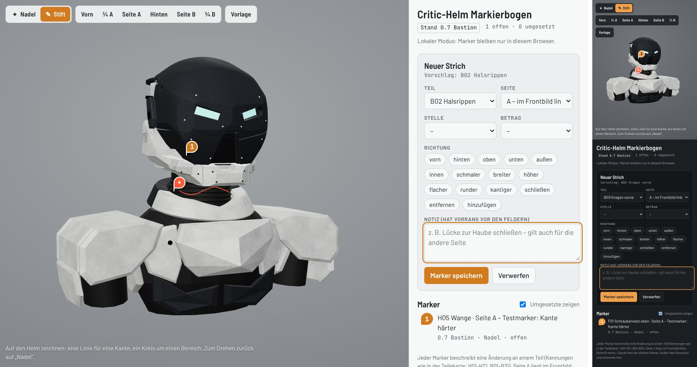

fertig – Markierbogen auf Bastion 0.7, 59 Tests, Build, `./ce check`, `./ce docs` und Seitenprüfung Desktop/Handy; kein Merge.

# 0.7.1 – Markierbogen in 3D

Änderungswünsche setzt der Nutzer jetzt direkt am Modell statt in Bildern: **Nadel** per Klick oder **Stift** zum Zeichnen auf
der Oberfläche. Teil (H01–H21, B01–B31) und Seite A/B erkennt die Seite aus dem getroffenen Mesh, mit derselben
Zuordnung wie die Explosionsansicht. Vorbild ist der Scout-Markierbogen des Blender-Helms. Hier entfällt das Zurückrechnen
vom Bild auf den Punkt, und verdeckte Stellen lassen sich durch Drehen erreichen.

Ziele: (1) Rückmeldung am Modell mit Teil, Seite, Punkt und Blick speichern; (2) Ablauf zum Umsetzen mit Vorher-/Nachher-Bildern.
Sitzung **CRITIC 0.7.1 · Claude Code (Cloud)**, Branch `claude/helm-marker`, Basis `ca2ec9f` auf `codex/critic-0.7-bastion`.

[Anleitung und Ablauf](../MARKER.md) · Seite: https://claude.ai/artifact/5Pp2NuMCLqemQzdfPw6WSB (privat)

## Änderungen

- `web/marker/`: Seite (`page.html`) und Skript (`src/marker.js`, `src/parts.js`), mit Vite zu einer Datei gebündelt.
- `web/src/assembly.js`: Teilezuordnung und Körperbezeichnungen exportiert (`assemblyPartId`, `BODY_LABELS`), keine
  Verhaltensänderung.
- `web/vite.config.js`: Abhängigkeitsscan des Dev-Servers nur über `index.html`.
- `web/tools/marker_build.mjs` (Bündel, Modell als glTF-JSON, Vorlagenbilder, `stand.json`), `marker_check.mjs`
  (Desktop/Handy, Nadel und Strich), `marker_shot.mjs` (je Marker Gesamt- und Nahansicht aus seiner Kamera).
- Modell der Seite: gelieferte `assets/helmet-bastion/assembled/scifi_helmet.glb` (Quellenpin `c445de5`), unverändert.

## Prüfungen und Grenzen

- `npm --prefix web test`: 46 Node-Tests, 5 IoU-Fixtures, 8 Belegsicherungsprüfungen bestanden; `npm --prefix web run build`,
  `./ce check` und `./ce docs` grün.
- `marker_check.mjs`: Seite lädt am Desktop (hell) und am Handy (dunkel), Nadel und Strich lassen sich setzen und speichern,
  Teilevorschlag greift, kein waagerechtes Überlaufen, keine Konsolenfehler. Die Datenbank des Artefakts ist eingerichtet und leer.
- Kein Geometrie- oder Materialwechsel; die Helm- und Körperform von Bastion bleibt unverändert, deshalb keine neue IoU.
- Grenzen: Im Stift-Modus dreht sich die Ansicht nicht. Die Seite zeigt den montierten Stand ohne Explosionsansicht.
  Punkte gelten für den Stand, an dem sie gesetzt wurden.
- Versionsreservierung über Nexogen aus dieser Cloud-Sitzung nicht möglich; Nummer 0.7.1 als Patch auf Bastion gewählt.
