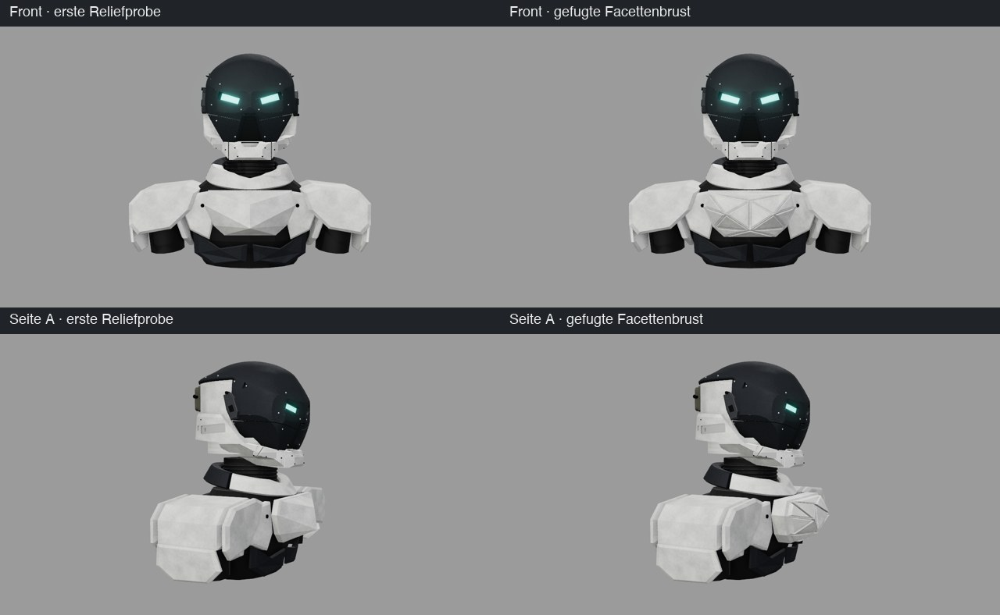

fertig – Bastion aus `3e930f9` (gefugte Facettenbrust), 60 Tests, Build, Projekt-/Dokuprüfung und unabhängige Prüfung; kein Merge.

# 0.7 „Bastion“ – kantige Schultergehäuse und zentrale Brust

Nach den vier neuen Nutzerreferenzen ersetzen tiefe kantige Gehäuse die gebogenen Schulterkappen.
Eine körperlich vorgewölbte Brustplatte mit großen definierten Facetten schließt die Mitte; seitliche Brust- und Flankenplatten gliedern den Rumpf.
Nach Nutzerfeedback sind die Schulterkanten weicher und die Brust erhält mehr tatsächliches Volumen.
In der Nacharbeit steht die Brustmitte als dickere Platte vor, und vierzehn erhabene Facettenfelder mit Fugen gliedern sie.
Kurzer Hals, Helm, Kragen und Rumpfkern bleiben erhalten. Die unteren Lamellen bilden die zweite Panzerlage.

Ziele: (1) Schulter-/Brustform an die neuen Referenzen annähern; (2) Einzelteile, Dokumentation und reproduzierbare Lieferung sichern.
Sitzung **CRITIC 0.7 „Bastion“ · Codex-Mac**, Branch `codex/critic-0.7-bastion`,
Basis `8bd048c0df0ca5cfda84a859e56cf7c5e929b0d0` auf `codex/critic-0.6-cuirass`. Kein Merge, Tag oder Release.

[Aufbau und Stil](../HELM_BASTION.md) · [Lieferindex](../../assets/helmet-bastion/README.md)

## Prüfungen und Grenzen

- 60 Tests: 47 Node, fünf IoU-Fixturetests, acht Belegsicherungsprüfungen. Build und `./ce check` grün.
- Die aktuellen 31 Körpermeshes bestehen die bisherigen Oberflächen- und Determinismusprüfungen.
  Alte Formtests bleiben mit unveränderten Cuirass-Parametern erhalten; drei Bastion-Tests ergänzen Sichtproben.
- Vier Ansichten, explodierter GLB-Rückimport und Browserprüfung einschließlich Teile-/Labelvollständigkeit.
- Erster Versuch: unruhig triangulierte Brustfläche und zu geringer Flankenabstand; zunächst planare Vorderfläche und
  äußerer Flankenversatz korrigiert. Nach „zu platt“ zunächst definierte innere Scheitel. Im Profil blieb das ein spitzer Keil;
  daher jetzt dickere Platte, zwei seitliche Brustscheitel und gefugte Felder je Facette. Keine Silhouetten-IoU für den Körper behauptet.
- Fugennacharbeit: nur B27 geändert, die übrigen 86 Meshes, Kameras und Texturen bytegleich zur ersten Reliefprobe.
  Tests prüfen alle 17 Fugen frontal offen, alle 14 Felder, exakten Umriss und Z > 0,66. Am Brustbein liegt die Front
  in einer Fuge 0,016 hinter der ersten Reliefprobe; das Volumen sitzt bei den seitlichen Brustscheiteln.

Aus Sicht des Agenten wirken die Schultergehäuse kräftiger und die Brust körperlicher. Es bleiben eine ungeriggte
Formstudie und offene Montageanschlüsse. Kopfhörer/Band sind in der Probe ausgeblendet, Materialien weiter wählbar.
Bekannte Buildwarnung: Hauptbundle größer als 500 kB.

## Unabhängige Prüfung und Belege

Codex-Kontingent einmal zu Versionsbeginn geprüft: 4 % Wochenrest. Deshalb Opus mit der vorgeschriebenen
achtteiligen `./ce codex judge --opus`-Checkliste über den budgetierten API-Weg. Erster Befund: die neue historische Fixture war im gelieferten Diff noch nicht sichtbar. Sie ist nun im
Quellcommit enthalten, bytegleich zum Cuirass-Parameterstand aus `8bd048c`, und im Test zusätzlich per Hash geschützt.
Die unabhängige Folgeprüfung erteilt Freigabe ohne blockierende Befunde. Der verbleibende niedrige Hinweis zum
Vorzeichen der neuen `centerSlopeOrigin`-Konstante ist mechanisch belegt: `y - (-0.84)` entspricht `y + 0.84`;
alle neun Renderbilder vor/nach dieser Parametrisierung sind bytegleich. Quellenpin/Index sind ebenfalls abgeschlossen.
Zwei Aufrufe `claude-opus-5-5`, zusammen 0,122080 USD, jeweils zuvor innerhalb des bestehenden Budgets geprüft.
Umsetzung: GPT-6.1 Sol high; keine neue Unteragentensitzung. Der API-Adapter bietet keinen eigenen Effort-Schalter.

**Fugennacharbeit (Claude Code, Opus 5.5 high):** Prüfung des Brustdiffs durch einen unabhängigen Opus-Richter als
Unteragent (`ce-shared:ce-judge`, Checkliste aus `./ce judge --opus`; Codex-Kontingent nicht erneut abgefragt).
Erste Runde **Nachbessern** (Nr. 4): abgeschwächte Reliefschwelle, fehlende absolute Untergrenze, Messpunkt in einer
Fuge, Tiefe nur durch Felder erfüllt, fest eingetragene Prüfpunkte. Nachgebessert in `1d6894b`; dabei selbst gefunden,
dass vier von 17 Fugen frontal verdeckt waren – Felder jetzt entlang Z extrudiert. Folgeprüfung: Code in Ordnung,
**Nachbessern** (Nr. 6) nur, weil die Lieferung damals noch vor dem Fix committet war; die zwei niedrigen Hinweise
(fehlende Pflichtschlüssel, steile Facetten) sind in `3e930f9` als Fehlerprüfungen umgesetzt. Die Lieferung ist danach
vollständig neu aus `3e930f9` gerendert und gepinnt. Keine API-Kosten (Unteragent).

Belege: `/Users/ffunk/Library/Caches/Critic/helm-bastion-20261028/`. Quellenpin `c445de50b758710962b32097a61202cea534ad97`.
Beide Exporte enthalten 87 Meshes, davon 31 Körperteile; 53 beschriftete Gruppen. Vergleich zu Cuirass:
56 Helmmeshes und zwölf Körpermeshes einschließlich Hals, Kragen, Kern, Rücken und Gelenken unverändert.
Alle elf Originaltexturkarten und montierten Kameras sind identisch. Der explodierte GLB-Rückimport erhält
alle Positionen, IDs und Transformationen innerhalb 1e−6. Prüfmanifeste und alle Ausgabehashes verifiziert.

Sieben koordinierte Renderläufe einschließlich Zwischenproben und finaler Exportkontrolle. Eine kurze Wartephase
an einer fremden GPU-Sperre; kein fremder Prozess angefasst. Zwei gezielte Browserläufe. Keine lückenlose Zeiterfassung;
grob geschätzte Ist-Anteile **Warten 5 % / Rechnen 10 % / Lesen 15 % / Umsetzen 70 %**. Nutzerkorrekturen sind
innerhalb dieser Etappe eingearbeitet. Keine vorab belastbar bezifferte Gesamtdauerschätzung.
